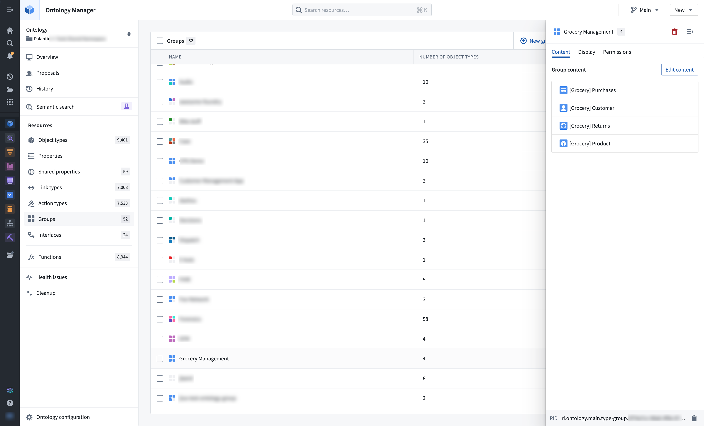
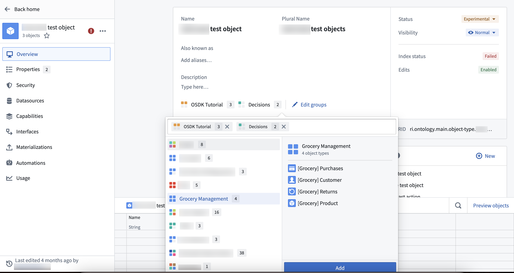
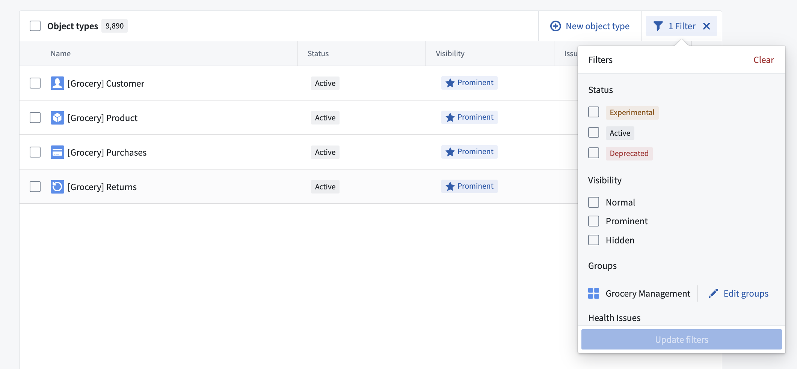

:::callout{theme="warning"}
注意：以下翻译的准确性尚未经过验证。这是使用 [AIP ↗](https://www.palantir.com/platforms/aip/) 从原始英文文本进行的机器翻译。
:::

# Object 类型组

Object 类型组是一种分类原语，可以帮助用户更好地搜索和探索其 Ontology。组通过 Ontology Manager 创建和管理，通常由 Ontology [所有者和编辑者](Object%20%E7%B1%BB%E5%9E%8B%E7%BB%84.md#group-permissions)管理。

## 组配置

组通过 Ontology Manager 侧边栏中的组菜单创建和管理。

还可以通过在 Object 类型概览页面中选择 **编辑组**，直接将组添加到 Object 类型中。

## 组搜索与发现

组可在 [Ontology Manager 的 **搜索**栏和**搜索**栏对话框](../../%E5%BA%94%E7%94%A8/%E6%9C%AC%E4%BD%93%E7%AE%A1%E7%90%86%E5%99%A8/%E5%AF%BC%E8%88%AA.md#header-search-bar)中进行搜索。Ontology Manager 中的 Object 类型表支持按组显示和筛选。组还显示在 [Object Explorer 主页](../../%E5%BA%94%E7%94%A8/%E5%AF%B9%E8%B1%A1%E6%B5%8F%E8%A7%88%E5%99%A8/%E5%85%A5%E9%97%A8.md#group-exploration-b-c-d)上。

## 组权限

任何可以查看 Ontology 的用户都可以查看组。请注意，某些支持资源权限标记的传统 Ontology 可能包含所有用户无法查看的组。

与其他 Ontology 实体一样，可以通过组[角色](../%E6%9C%AC%E4%BD%93/%E6%9D%83%E9%99%90.md#ontology-roles)以及默认的 Ontology 范围内角色授予用户与组管理相关的其他操作：

* **Ontology 所有者**可以在 Ontology 内创建、修改和删除*所有*组。
* **Ontology 编辑者**可以在 Ontology 内创建新组，并成为每个新创建组的默认所有者。

## 传统组迁移

截至 2024 年 5 月 22 日，本页面描述的*组*原语已取代传统组的基于标签的系统。

在大多数情况下，传统组在此时自动迁移到 Object 类型组。如果需要手动操作，Ontology 所有者会通过升级助手干预收到通知。

### 组名称可见性

以前，如果组内的所有 Object 类型对某个用户不可发现（例如，由于对支持数据集的访问控制），该组对该用户也是不可发现的。如上文所述的 [组权限](Object%20%E7%B1%BB%E5%9E%8B%E7%BB%84.md#group-permissions)部分所述，所有组现在对任何可以查看 Ontology 的用户都是可发现的。此更改使组可见性与其他 [Ontology 原语](../%E6%9C%AC%E4%BD%93/%E6%9D%83%E9%99%90.md#ontology-roles)保持一致，以增加治理的清晰度和透明度。

### 局部可见组的迁移

对一个或多个用户不可发现的传统组不符合自动迁移的条件。在这些情况下，Ontology 所有者会通过升级助手干预收到通知，指出需要手动操作。

在 2024 年 5 月 22 日，无法安全迁移的传统组在所有应用程序（如 Workshop 和 Object Explorer）中对操作用户隐藏。为了提供向后兼容性，传统组的名称仍作为 [类型类元数据](Metadata/%E7%B1%BB%E5%9E%8B%E7%B1%BB.md)存储在 Object 类型上。

Ontology 所有者可以继续使用 Ontology Manager 手动迁移这些隐藏的传统组。为此，请导航到左下角的 **Ontology 配置**菜单，然后选择 **批准所有组进行迁移**。
