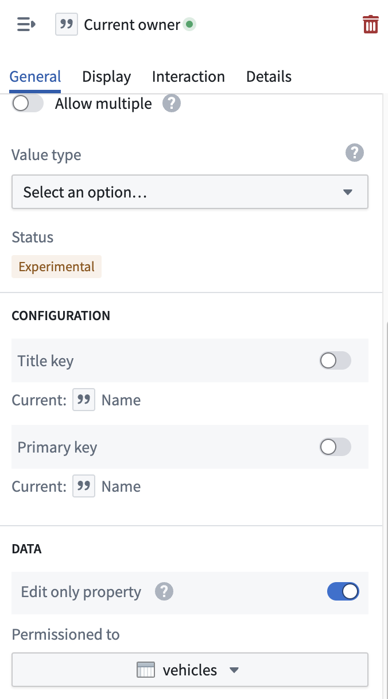

:::callout{theme="warning"}
注意：以下翻译的准确性尚未经过验证。这是使用 [AIP ↗](https://www.palantir.com/platforms/aip/) 从原始英文文本进行的机器翻译。
:::

# 仅编辑属性

仅编辑属性允许您定义Ontology属性，这些属性不会直接映射到Object类型的支持数据集中的列。这在您希望在不修改底层数据集的情况下存储额外信息时特别有用。

## 仅编辑属性概述

使用仅编辑属性时，请注意以下几点：

* **不映射到支持数据集中的列：** 仅编辑属性不需要映射到支持数据集中的特定列。这使您可以在支持列存在之前轻松创建新属性，或者创建仅通过Ontology编辑的属性。
* **需要权限授予给支持Object类型的数据集之一：** 为确保数据一致性和安全性，仅编辑属性必须被授权给支持Object类型的数据集之一。
* **仅在Object存储V2中可用：** 仅编辑属性是一个专用于利用Object存储V2的Object类型的功能。

### 创建仅编辑属性

1. 导航到 **Ontology Manager**。
2. 选择要添加仅编辑属性的Object类型。
3. 选择 **创建属性** 并填写所需的详细信息，包括属性名称、类型和描述。
4. 在 **数据** 部分，切换开启 **仅编辑属性** 开关，并选择一个要授权的数据集（如果您有多个数据集支持Object类型）。
5. **保存** 更改以创建仅编辑属性。

### 将仅编辑属性映射到数据集列

如果您稍后决定向支持数据集中添加一个与当前仅编辑属性对应的列，您可以轻松地将该属性映射到新列。

1. 导航到 **Ontology Manager**。
2. 选择具有您想映射的仅编辑属性的Object类型。
3. 选择仅编辑属性以打开其详细信息。
4. 在 **数据** 部分，取消切换仅编辑属性，并从支持数据集之一中选择一个列。
5. **保存** 更改。
