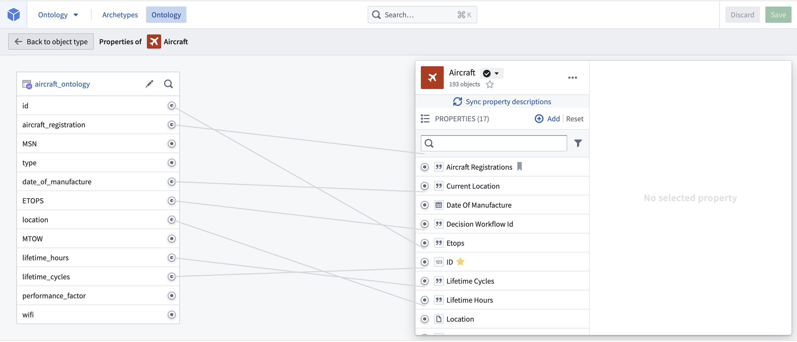
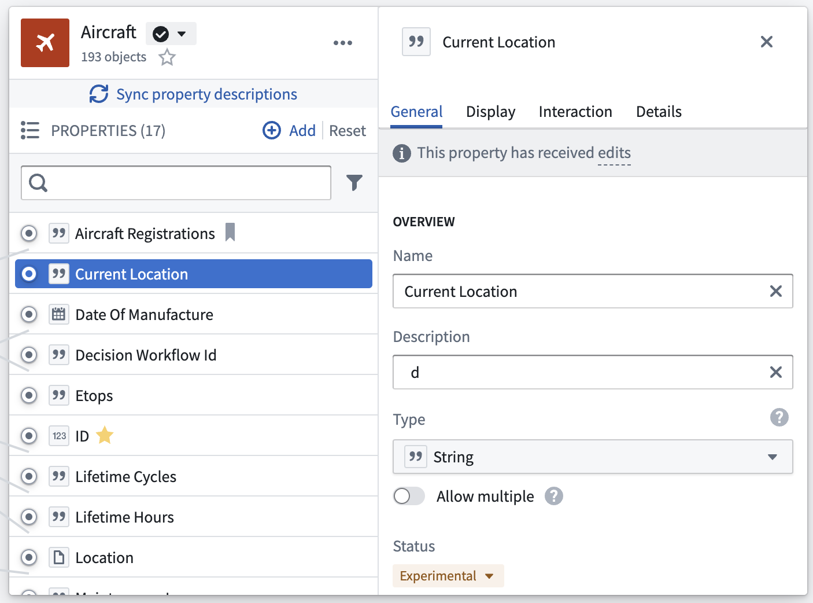
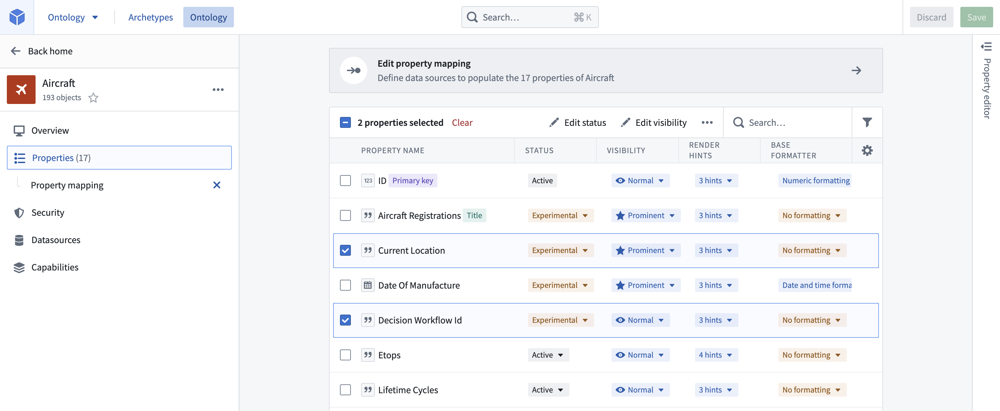

:::callout{theme="warning"}
注意：以下翻译的准确性尚未经过验证。这是使用 [AIP ↗](https://www.palantir.com/platforms/aip/) 从原始英文文本进行的机器翻译。
:::

# 编辑Object类型属性

### 删除属性

在属性编辑器中，在属性窗格中将鼠标悬停在您想要删除的属性上，然后选择**删除属性**。

* 请注意，属性的删除只有在保存更改后才生效，并且会中断任何引用该属性的视图或应用程序。
* 具有`active`状态的属性**不能**被删除。
  * 阅读更多关于[状态](../Metadata/%E7%8A%B6%E6%80%81.md)的信息。

### 更改属性对应的列

在属性编辑器中，在属性窗格中将鼠标悬停在您想要取消映射的属性上，然后选择**取消链接属性**。要将属性链接到新列，将鼠标悬停在属性上并选择**映射到列**。

### 编辑属性类型的元数据

您可以通过选择属性类型来编辑其元数据，如下图所示。

可用于编辑属性元数据的选项被聚集在四个不同的选项卡中，提供以下配置：

1. **显示名称和描述：** 选择现有的显示名称或描述来编辑文本。
2. **状态：** 选择现有状态以打开可用状态的下拉菜单。从`deprecated`、`experimental`和`active`状态中选择。
   * 阅读更多关于[状态](../Metadata/%E7%8A%B6%E6%80%81.md)的信息。
3. **API名称：** 选择现有的API名称以更改其值。
   * 请注意，对于具有`active`状态的属性，您**不能**更改API名称。
     * 阅读更多关于[状态](../Metadata/%E7%8A%B6%E6%80%81.md)的信息。
     * 阅读更多关于[有效API名称](../Object%20types/%E5%88%9B%E5%BB%BA%20Object%20%E7%B1%BB%E5%9E%8B.md#api-name)的信息。
4. **键：** 指示属性是否为Object类型的标题键或主键。
   * 请注意，对于具有`active`状态的Object类型，您**不能**更改主键。
     * 阅读更多关于[键](../Object%20types/%E5%88%9B%E5%BB%BA%20Object%20%E7%B1%BB%E5%9E%8B.md#configure-the-primary-key-and-title-key)和[状态](../Metadata/%E7%8A%B6%E6%80%81.md)的信息。
5. **值格式化：** 对属性的值应用特殊格式化器，以使其在应用程序中更易读。
   * 阅读更多关于[值格式化器](%E6%94%AF%E6%8C%81%E7%9A%84%E5%80%BC%E6%A0%BC%E5%BC%8F%E5%8C%96.md)的信息。
6. **条件格式化：** 对属性应用规则，规定其在应用程序中的呈现方式。
   * 阅读更多关于[条件格式化](%E6%B7%BB%E5%8A%A0%E6%9D%A1%E4%BB%B6%E6%A0%BC%E5%BC%8F%E5%8C%96.md)的信息。
7. **属性基本类型：** 从下拉菜单中选择属性的基本类型。属性的类型限制了可以对属性值进行的操作集合。
   * 例如，具有基本类型`timestamp`的属性可以在Object Explorer中显示在时间线微件中。
   * 如果属性的类型与其对应列的类型不兼容，您将收到出错信息。

:::callout{theme="warning"}
如果您更改了Object属性类型，您还必须更新与该Object上的属性交互的操作所期望的类型。为此，请在Ontology Manager中打开操作并编辑预期类型。
:::

8. **类型类：** 应用类型类作为可由应用程序解释的附加元数据。
   * 查看[类型类文档](../Metadata/%E7%B1%BB%E5%9E%8B%E7%B1%BB.md)以获取可用类型类的列表。
9. **渲染提示：** 从提供的检查清单中选择渲染提示，您希望将这些提示应用于属性，以改善属性值的呈现和在Object Storage v1 (Phonograph)中的索引。
   * 查看[渲染提示文档](../Metadata/%E6%B8%B2%E6%9F%93%E6%8F%90%E7%A4%BA.md)以了解可用渲染提示的描述。
10. **可见性：** 选择现有可见性以打开可用可见性的下拉菜单。一个`重要`的属性会引导应用程序首先向用户显示此属性。一个`隐藏`的属性将不会出现在用户应用程序中。

在更改属性元数据后，启动受影响Object的重新索引以更新Ontology。

### 批量编辑多个属性

您可以通过按住**Cmd/Ctrl**键选择属性，在属性编辑器中选择多个属性。一旦选择了多个属性，以下批量编辑操作将可用：

* 更改基本类型。
* 添加/删除类型类。
* 更改渲染提示。
* 更改可见性。
* 添加/删除值格式化。

您还可以在属性编辑器之外批量编辑上述某些字段，通过从Object类型视图的侧边栏中选择**属性**页面。只需选中您想要编辑的属性旁边的复选框，表格顶部将出现新行，提供批量编辑选项。
