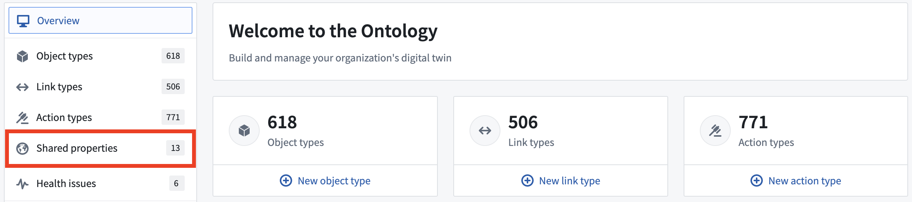
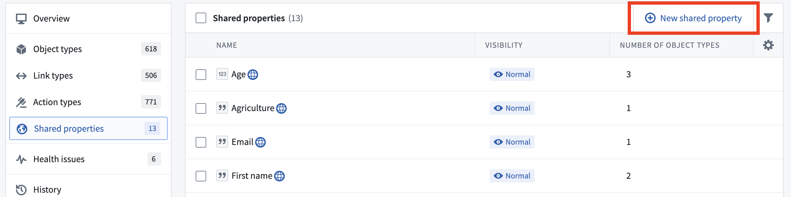
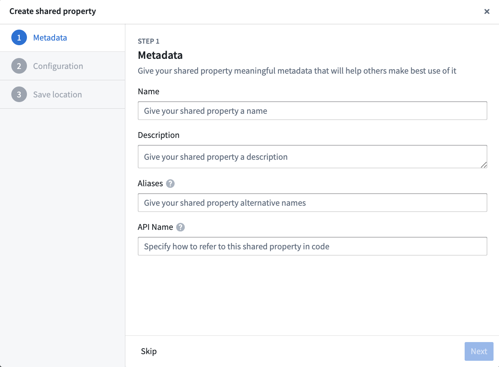

:::callout{theme="warning"}
注意：以下翻译的准确性尚未经过验证。这是使用 [AIP ↗](https://www.palantir.com/platforms/aip/) 从原始英文文本进行的机器翻译。
:::

# 创建共享属性

在Ontology Manager应用程序中，从共享属性页面创建和配置一个新的共享属性。

要访问该页面，请按照以下步骤操作：

1. 在Ontology Manager中选择 **共享属性** 菜单选项。

2. 一旦进入共享属性页面，选择右上角的 **新建共享属性**。

3. 这将打开共享属性创建模式，您可以在其中配置名称、描述、类型和其他元数据以创建共享属性。

共享属性可以配置为常规属性元数据的子集：

* **名称：** 共享属性的名称。
* **描述：** 关于共享属性的解释性文本。例如，`start date`共享属性的描述可以是`员工或承包商开始工作的日期`。
* **基础类型：** 指示此属性的值类型并确定用户应用程序中可用的操作集。例如，`start date`属性将具有基础类型`date`。用户应用程序将允许您使用此属性配置时间线微件。基础类型与底层列类型相关，并且必须与列类型匹配才能应用于一个object类型。
* **值格式化：** 根据属性的基础类型，提供数字格式化、日期和时间格式化、用户ID和资源ID格式化，以将属性的原始值转换为用户应用程序中更易读的版本。了解更多关于[值格式化](../Properties/%E6%94%AF%E6%8C%81%E7%9A%84%E5%80%BC%E6%A0%BC%E5%BC%8F%E5%8C%96.md)的信息。
* **类型类：** 用户应用程序解释的附加元数据。了解更多关于[类型类](../Metadata/%E7%B1%BB%E5%9E%8B%E7%B1%BB.md)的信息。
* **渲染提示：** 向用户应用程序指示如何渲染属性，可能与相同基础类型的大多数属性不同。许多渲染提示可以用于影响object类型的重新索引性能，例如，如果您不期望用户在用户应用程序中搜索或排序`start date`属性，您可以取消选择`可搜索`和`可排序`渲染提示，并提高`Employee` object类型的重新索引性能。了解更多关于[渲染提示](../Metadata/%E6%B8%B2%E6%9F%93%E6%8F%90%E7%A4%BA.md)的信息。
* **可见性：** 向用户应用程序指示如何重要地显示属性。一个`重要`的属性将导致应用程序首先向用户显示此属性。一个`隐藏`的属性将不会出现在用户应用程序中。默认情况下，`start date`属性将具有`正常`可见性。

4. 要将共享属性持久化到Ontology中，请在Ontology Manager的右上方选择 **保存**。
