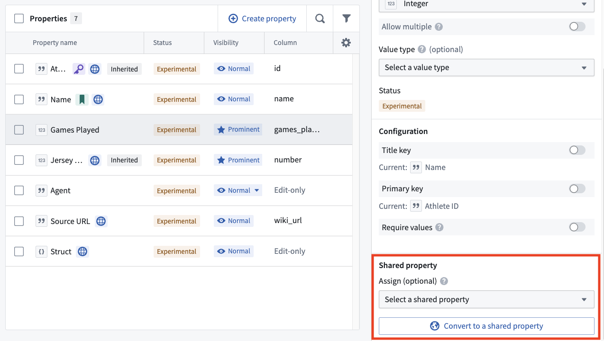
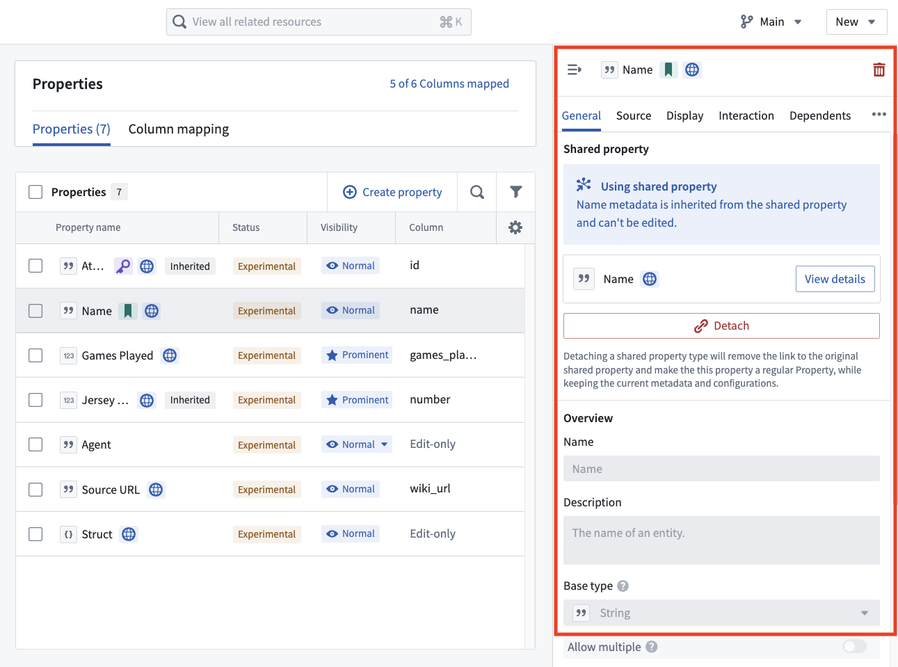

:::callout{theme="warning"}
注意：以下翻译的准确性尚未经过验证。这是使用 [AIP ↗](https://www.palantir.com/platforms/aip/) 从原始英文文本进行的机器翻译。
:::

# 在对象类型上使用共享属性

要将对象类型上的属性更新为共享属性，请完成以下步骤：

1. 在Ontology Manager中导航到对象类型。
2. 在面板中选择您想更新的属性，然后向下滚动到配置的**共享属性**部分。

3. 使用下拉菜单选择一个现有的共享属性，或通过[共享属性创建](%E5%88%9B%E5%BB%BA%E5%85%B1%E4%BA%AB%E5%B1%9E%E6%80%A7.md)模态窗口将属性转换为新的共享属性。

然后该属性将显示为共享属性。要将共享属性的使用持久化到Ontology，请在右上角选择**保存**。

* 在对象上使用共享属性时，对象特定属性的属性ID和API名称将保持不变，以避免破坏利用它们的现有下游工作流。
* 虽然与共享属性关联，但直接编辑从共享属性继承的属性元数据将被禁用。您仍然可以添加、删除或编辑类型类。当属性加载时，结果类型类集将是属性和其关联共享属性中的类型类的并集。
* 如果您使用的共享属性具有与所选属性不同的[渲染提示](../Metadata/%E6%B8%B2%E6%9F%93%E6%8F%90%E7%A4%BA.md)配置值，使用共享属性将覆盖所选属性的配置值。确保您的共享属性已为您的应用案例配置了适当的渲染提示。

### 从对象中分离共享属性

要从共享属性中分离属性，请在Ontology Manager中的对象类型上使用相同的属性面板并选择**分离**。

这样做将移除属性与共享属性之间的关联。
