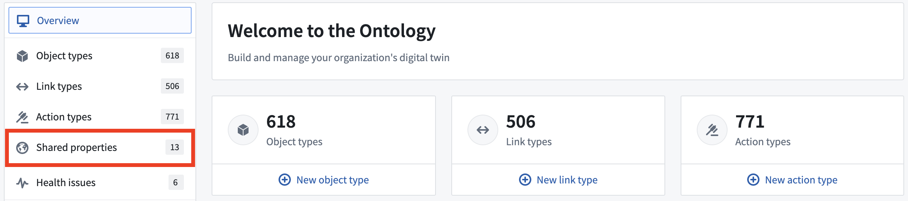

:::callout{theme="warning"}
注意：以下翻译的准确性尚未经过验证。这是使用 [AIP ↗](https://www.palantir.com/platforms/aip/) 从原始英文文本进行的机器翻译。
:::

# 概述

:::callout{theme="warning" title="测试版功能"}
共享属性并非在所有Foundry注册中都可用。请联系您的Foundry代表以获取更多信息。
:::

**共享属性**是可以在您的Ontology中用于多个[Object类型](../Object%20types/%E6%A6%82%E8%A7%88.md)的[属性](../Properties/%E6%A6%82%E8%A7%88.md)。共享属性允许在Object类型之间进行一致性的数据建模，并集中管理属性元数据。尽管属性元数据在Objects之间共享，但底层的Object数据并不共享。

例如，在Ontology管理器中，您可能有`Employee`和`Contractor` Object类型，它们都有属性`start date`。通过创建一个`start date`共享属性并将其用于这两种Object类型，您可以使用一致的属性来建模数据，并在一个地方更新`start date`元数据，而不是在每个Object类型上进行更新。

共享属性可以[直接创建](%E5%88%9B%E5%BB%BA%E5%85%B1%E4%BA%AB%E5%B1%9E%E6%80%A7.md)，或者现有的Object类型属性可以转换为共享属性。添加到您的Ontology后，共享属性可以在Object类型上[使用](%E5%9C%A8%E5%AF%B9%E8%B1%A1%E7%B1%BB%E5%9E%8B%E4%B8%8A%E4%BD%BF%E7%94%A8%E5%85%B1%E4%BA%AB%E5%B1%9E%E6%80%A7.md)，作为Ontology化数据的一部分，并以类似于常规属性的方式[编辑](%E7%BC%96%E8%BE%91%E5%85%B1%E4%BA%AB%E5%B1%9E%E6%80%A7.md)。

Objects上的共享属性在其名称旁边标有一个地球图标。

