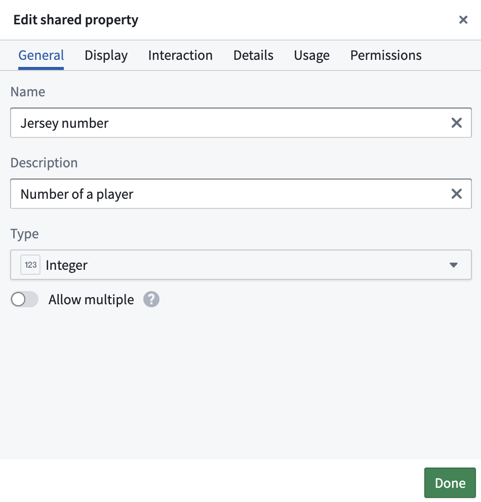
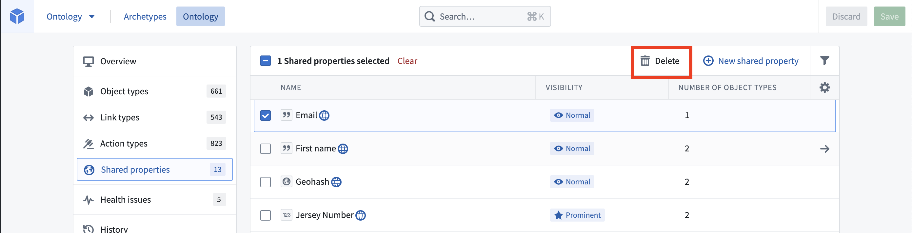
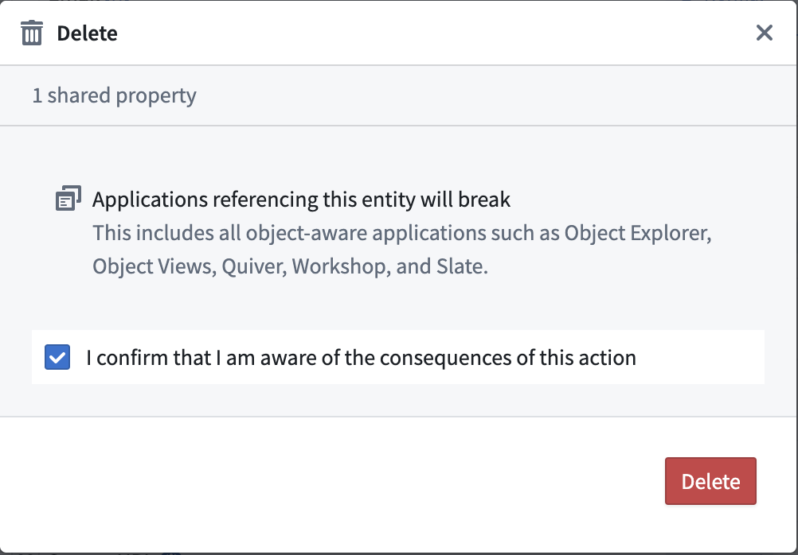

:::callout{theme="warning"}
注意：以下翻译的准确性尚未经过验证。这是使用 [AIP ↗](https://www.palantir.com/platforms/aip/) 从原始英文文本进行的机器翻译。
:::

# 编辑共享属性

### 编辑共享属性元数据

您可以通过首先从Ontology Manager的**共享属性**页面中选择要编辑的共享属性来编辑其元数据。

:::callout{theme="warning"}
由于共享属性可以被用于在Ontology中的多个Object类型上，拥有共享属性`Ontology Editor`权限的用户可能没有在使用该共享属性的所有Object类型上的`Ontology Viewer`权限。因此，如果更改共享属性（如更改基础类型）会破坏任何Object类型，无论可见或不可见，都会抛出出错。这是为了防止对具有不兼容模式的Object类型产生无意的影响。只有当使用该共享属性的所有Object类型的模式与共享属性编辑兼容时，才允许进行此类更改。
:::

编辑共享属性元数据的可用选项分为四个不同的选项卡：**常规**、**显示**、**交互**和**详细信息**。这些选项卡包含以下配置：

* **名称：** 共享属性的名称。
* **描述：** 关于共享属性的解释性文本。例如，`起始日期`共享属性的描述可以是`员工或承包商开始工作的日期`。
* **基础类型：** 指示此属性的值类型，并确定用户应用程序中可用的操作集。例如，`起始日期`属性将具有基础类型`date`。用户应用程序将允许您使用此属性配置时间线微件。
* **值格式化：** 根据属性的基础类型，可应用数值格式化、日期和时间格式化、用户ID和资源ID格式化，将其原始值转换为用户应用程序中更可读的版本。了解更多关于[值格式化](../Properties/%E6%94%AF%E6%8C%81%E7%9A%84%E5%80%BC%E6%A0%BC%E5%BC%8F%E5%8C%96.md)的信息。
* **类型类：** 用户应用程序解释的附加元数据。了解更多关于[类型类](../Metadata/%E7%B1%BB%E5%9E%8B%E7%B1%BB.md)的信息。
* **渲染提示：** 向用户应用程序指示如何渲染属性，这可能与大多数具有相同基础类型的属性不同。许多渲染提示可以影响定义属性的Object类型的重新索引性能。例如，如果您不希望用户在用户应用程序中搜索或排序`起始日期`属性，可以取消选择`可搜索`和`可排序`渲染提示，从而提高`Employee` Object类型的重新索引性能。了解更多关于[渲染提示](../Metadata/%E6%B8%B2%E6%9F%93%E6%8F%90%E7%A4%BA.md)的信息。
* **可见性：** 向用户应用程序指示如何重要地显示属性。一个`重要`属性将使应用程序优先向用户显示此属性。一个`隐藏`属性将不会出现在用户应用程序中。默认情况下，`起始日期`属性的可见性为`正常`。

此外，您可以在**使用情况**选项卡中查看使用此共享属性的Object类型，并在**权限**选项卡中更新共享属性的权限。

### 删除共享属性

要删除共享属性，请完成以下步骤：

1. 导航到Ontology Manager的**共享属性**页面。
2. 选择一个或多个要删除的共享属性，然后选择**删除属性**。

3. 在模式中确认删除操作。

4. 选择右上角的**保存**。

:::callout{theme="warning"}
当共享属性被删除时，所有使用此共享属性的Object类型将恢复为常规属性。
:::
