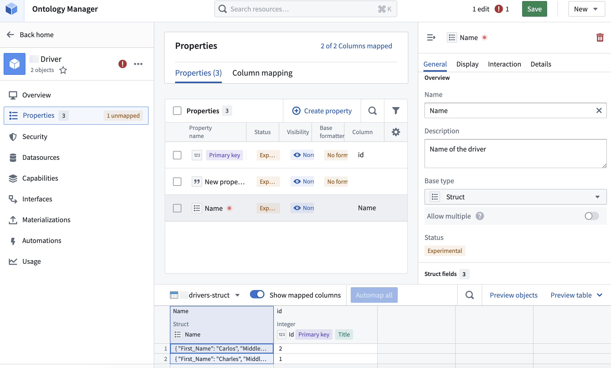
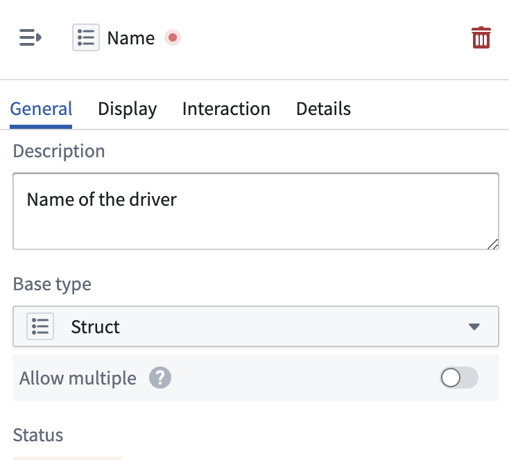
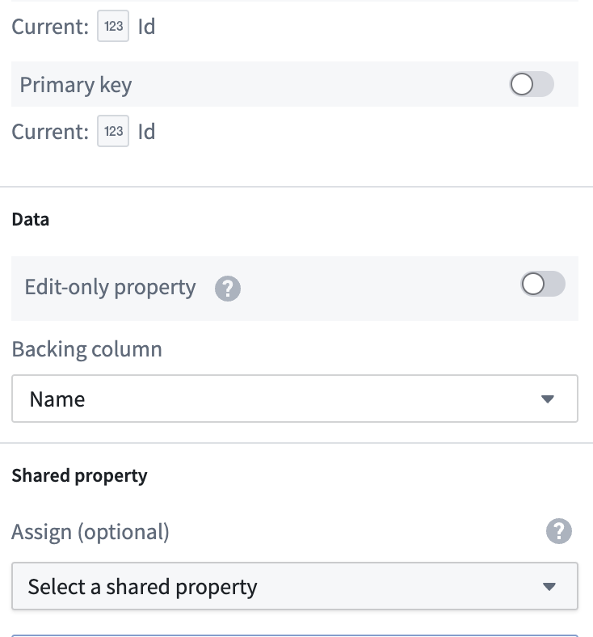
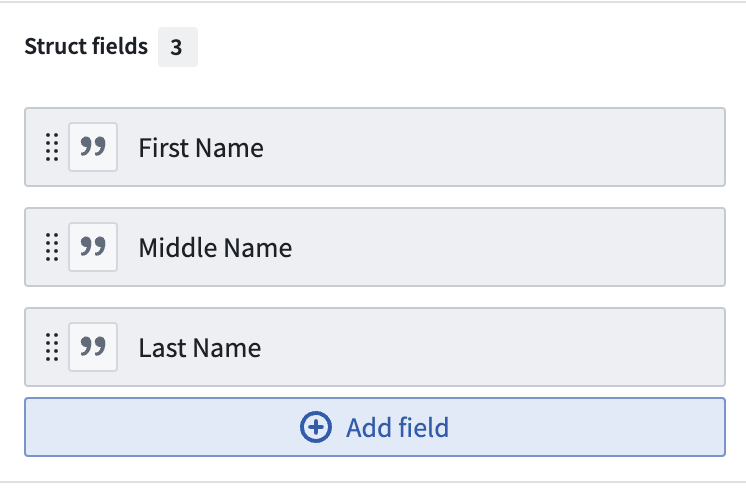

:::callout{theme="warning"}
注意：以下翻译的准确性尚未经过验证。这是使用 [AIP ↗](https://www.palantir.com/platforms/aip/) 从原始英文文本进行的机器翻译。
:::

# 创建结构属性类型

:::callout{theme="neutral" title="结构可用性"}
结构属性类型目前正在开发中，将于2024年9月正式发布。
:::

从Ontology Manager中的**Object类型**页面创建和配置一个新的结构属性。有关结构属性的更多信息，请参见[概述](%E6%A6%82%E8%BF%B0.md)。

1. 在Ontology Manager中，打开左侧边栏的**Object类型**选项卡，并选择一个现有的Object类型。
2. 在Object类型详细信息页面，打开左侧边栏的**属性**选项卡，并在**属性**表的右上角选择**创建属性**按钮。

3. 在**属性编辑器**面板中，添加名称和描述，并从**基础类型**下拉菜单中选择**结构**。

4. 向下滚动到**数据**部分，并从下拉菜单中选择一个**支持列**。

5. 在**结构字段**部分，选择**添加字段**，然后选择**新字段**。

6. 为新结构字段命名，并非必填添加描述。
7. 最后，将数据源中的一列映射到新的结构字段。
