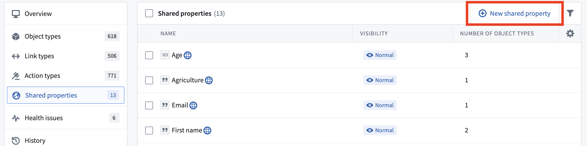
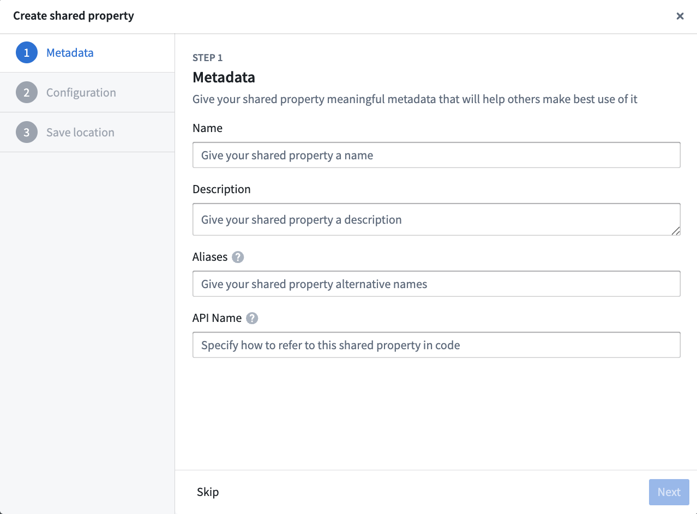
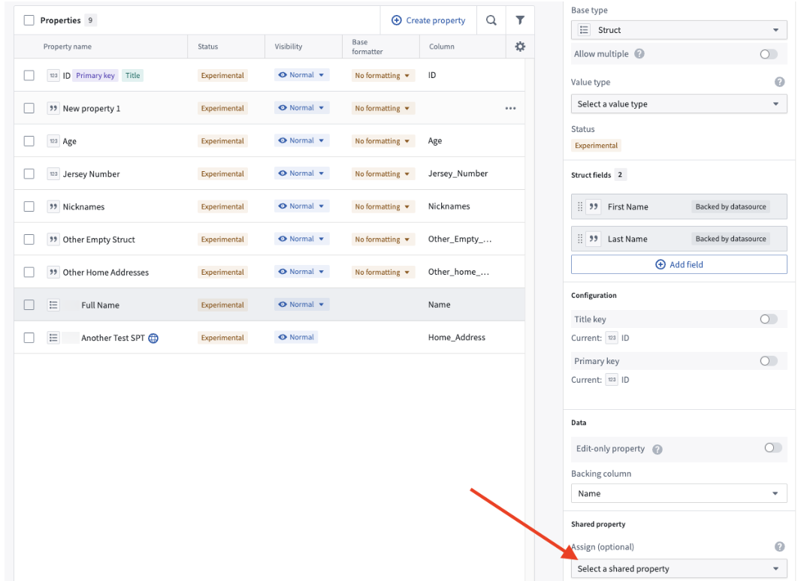
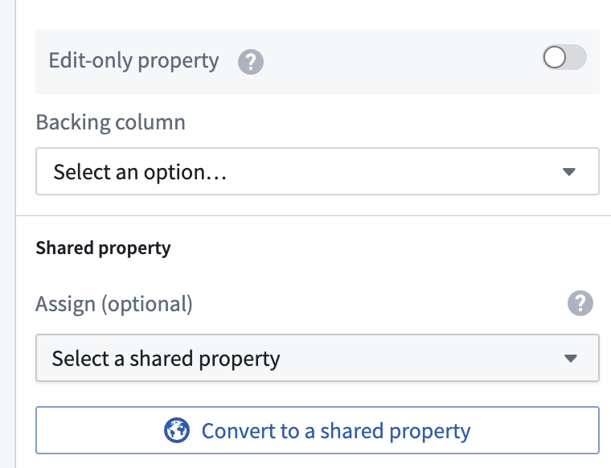

:::callout{theme="warning"}
注意：以下翻译的准确性尚未经过验证。这是使用 [AIP ↗](https://www.palantir.com/platforms/aip/) 从原始英文文本进行的机器翻译。
:::

# 结构属性和共享属性类型

:::callout{theme="neutral" title="结构体的可用性"}
结构属性类型目前正在开发中，将于2024年9月全面上线。
:::

结构属性可用于本地和共享属性类型。在将本地属性类型转换或提升为共享属性类型时，需要重新映射结构字段。由共享属性类型支持的本地结构属性类型将继承共享属性类型字段，但结构字段资源标识符（RIDs）除外。结构字段的元数据（显示名称、描述、别名）将从共享属性类型继承，但结构字段将保留其原始的RIDs。

## 创建一个结构类型的共享属性

1. 在Ontology Manager中，选择 **共享属性** 标签。

2. 在主面板中，选择 **新建共享属性** 按钮。这将打开一个对话框，您可以在其中配置新的共享属性。

## 附加一个结构类型的共享属性

1. 在Ontology Manager中，打开 **属性** 标签并从 **属性** 表中选择所需的属性。
2. 在右侧的 **属性编辑器** 中，向下滚动到 **共享属性** 并在 **指派** 下选择一个共享属性。这将在两个属性之间共享属性元数据。

**注意：** 在将共享属性类型指派给本地结构属性类型后添加新的结构字段，必须将新的结构字段添加到共享属性类型中，并将其映射到所有由共享属性支持的本地结构属性类型的数据源列。

## 将结构属性类型转换为共享属性

以下说明详细介绍了如何将结构属性转换为由共享属性类型支持的结构属性。

1. 在Ontology Manager中，打开 **属性** 标签并从 **属性** 表中选择所需的属性。
2. 在右侧的 **属性编辑器** 中，向下滚动并选择 **转换为共享属性**，这将使结构属性由共享属性类型支持。

