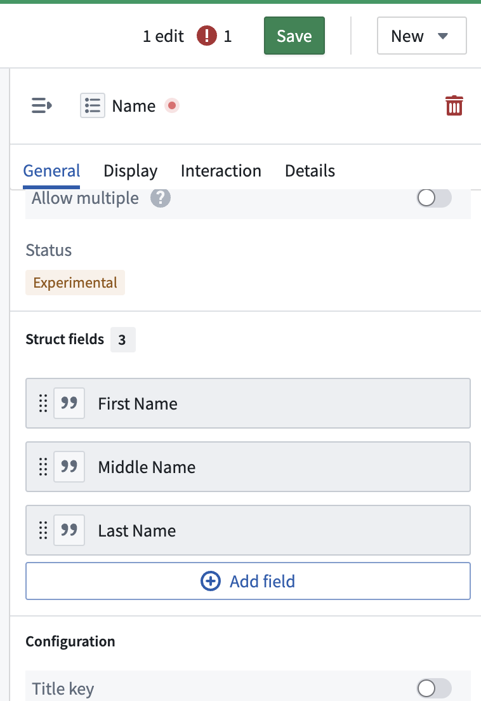
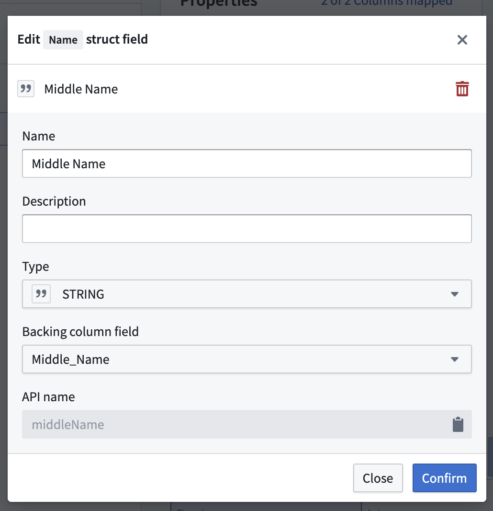

:::callout{theme="warning"}
注意：以下翻译的准确性尚未经过验证。这是使用 [AIP ↗](https://www.palantir.com/platforms/aip/) 从原始英文文本进行的机器翻译。
:::

# 编辑结构属性类型

:::callout{theme="neutral" title="结构可用性"}
结构属性类型目前正在开发中，将于2024年9月全面推出。
:::

1. 在Ontology Manager中，打开左侧边栏的**Object类型**选项卡，并选择一个现有的Object类型。
2. 在Object类型详情页面中，打开左侧边栏的**属性**选项卡，并从**属性**表中选择相关的结构属性类型。
3. 在**属性编辑器**面板中，滚动到**结构字段**部分并选择您想要编辑的结构字段。编辑次数将显示在Ontology Manager界面的右上角。

4. 在**编辑结构字段**对话框中进行必要的编辑，然后选择**确认**。

