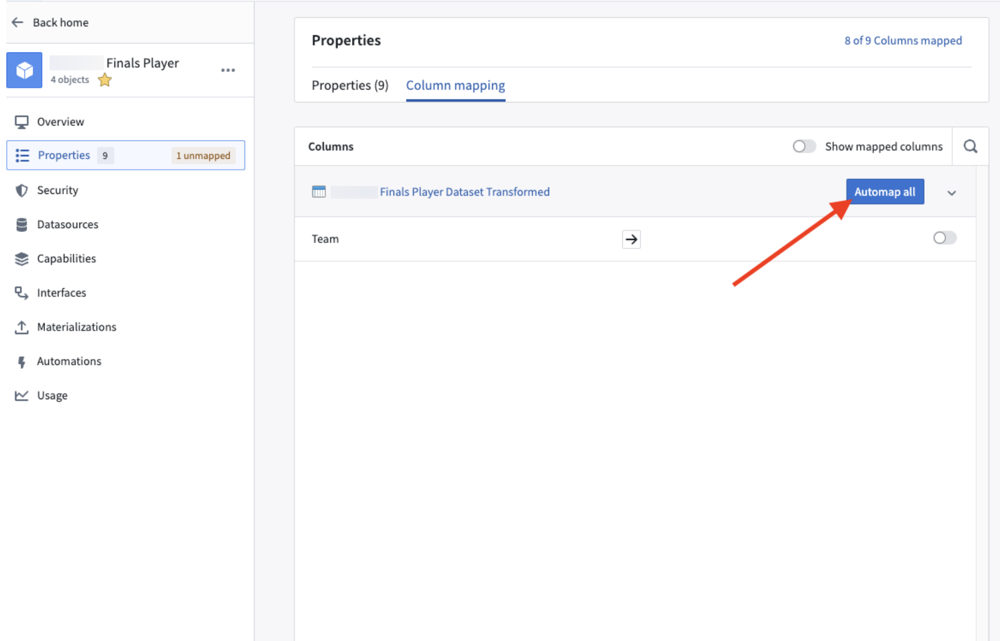
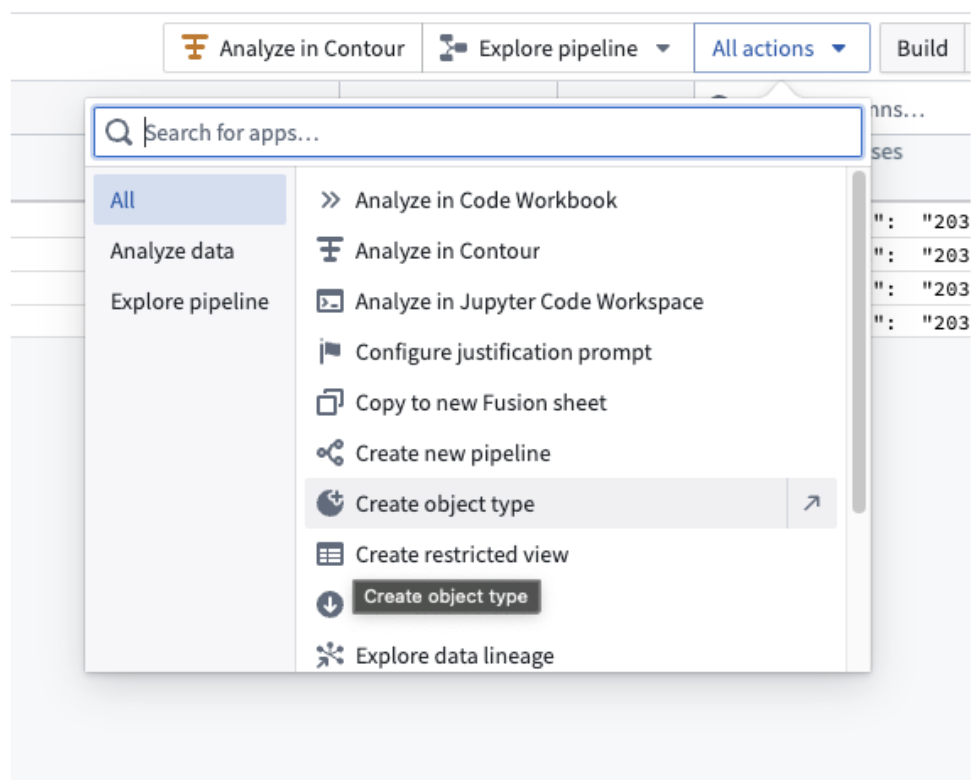
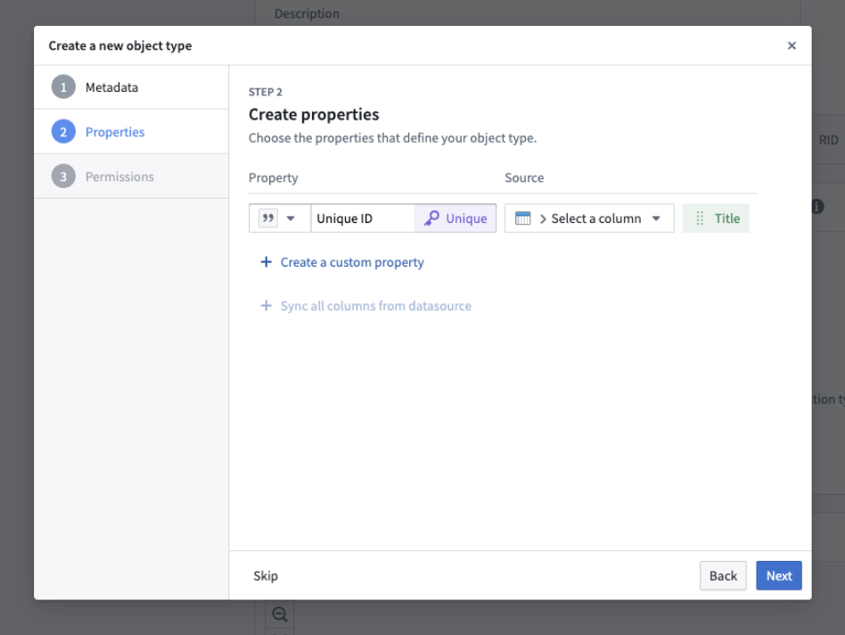

:::callout{theme="warning"}
注意：以下翻译的准确性尚未经过验证。这是使用 [AIP ↗](https://www.palantir.com/platforms/aip/) 从原始英文文本进行的机器翻译。
:::

# 自动映射结构属性

:::callout{theme="neutral" title="Struct 可用性"}
结构属性类型目前正在开发中，将于2024年9月普遍可用。
:::

自动映射允许用户自动映射所有列，而不是手动映射。

## 在Ontology Manager中自动映射结构类型

如果Object已经创建，用户可以使用**自动映射全部**功能自动映射所有列。

1. 在Ontology Manager中，进入**属性**标签并选择所需的属性。
2. 在**列映射**标签下，选择所需的列。

3. 选择**自动映射全部**。

## 在Pipeline Builder中自动映射结构类型

如果Object尚未创建，可以在Object类型创建向导中进行初始Object创建时进行自动映射。

1. 在您的Pipeline Builder管道中，打开相关数据集并选择右上角的**所有操作**下拉菜单。

2. 选择**创建Object类型**以创建新的Object。

3. 在**属性**下，添加需要映射的属性。
4. 选择**下一步**并完成剩余步骤以创建自动映射的Object类型。
