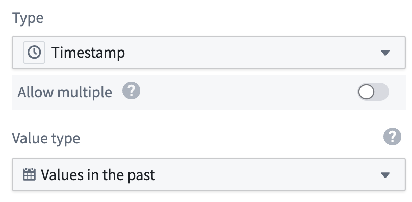

:::callout{theme="warning"}
注意：以下翻译的准确性尚未经过验证。这是使用 [AIP ↗](https://www.palantir.com/platforms/aip/) 从原始英文文本进行的机器翻译。
:::

# 使用值类型

一旦[创建了一个值类型](%E5%88%9B%E5%BB%BA%E5%80%BC%E7%B1%BB%E5%9E%8B.md)，您可以在Foundry中将其用作数据类型。值类型可以支持以下应用案例。

* 将值类型指派给Object类型属性。
* 将值类型指派给共享属性。
* 将值类型指派给Pipeline Builder管道属性，作为逻辑类型，使用`logical type cast`表达式，并在写入对象目标时在属性上选择值类型。

要将值类型指派给属性，在属性配置期间从下拉菜单中选择值类型。

:::callout{theme="warning"}
如果您将值类型应用于包含出错验证的属性值的Object属性，该Object类型将无法索引。您可以在Ontology Manager中的Object类型健康状态中查看此类索引失败，您可以在其中更正数据或更新值类型以解决问题。
:::
