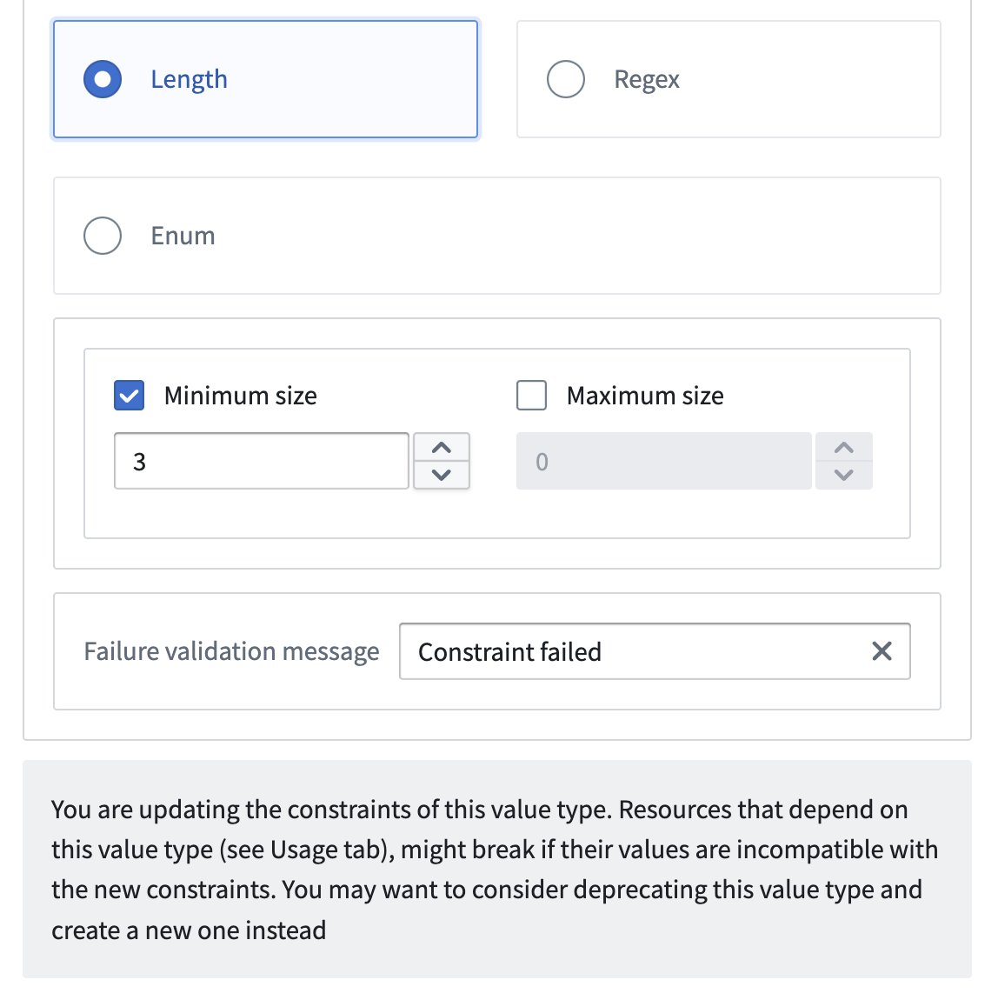

:::callout{theme="warning"}
注意：以下翻译的准确性尚未经过验证。这是使用 [AIP ↗](https://www.palantir.com/platforms/aip/) 从原始英文文本进行的机器翻译。
:::

# 值类型版本

值类型具有版本以处理破坏性和非破坏性的编辑。值类型版本包括两个部分：元数据和约束。名称、描述和apiName的元数据值可以根据需要更改。定义类型验证规则的基础类型元数据和约束是不可变的。

如果您选择更新值类型的约束，将创建该值类型的新版本。如果您的值类型没有使用者，您可以自由更改这些约束。但是，如果您对约束进行了破坏性更改，并且您的值类型有使用者，我们建议弃用当前值类型并创建一个新值类型。这样可以避免潜在的运行时出错和数据不一致。

当您对值类型进行非破坏性更改时，也会创建一个新版本。这个新版本会自动传播到Ontology，确保值类型在Ontology中的所有使用都更新到最新版本。
