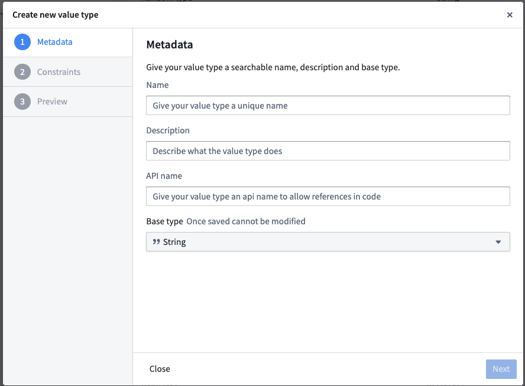
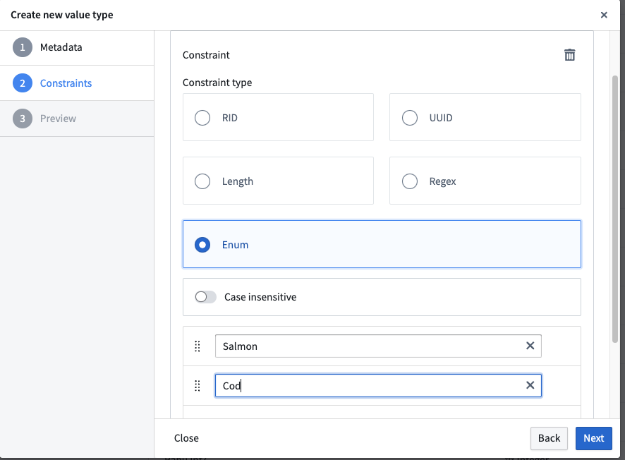
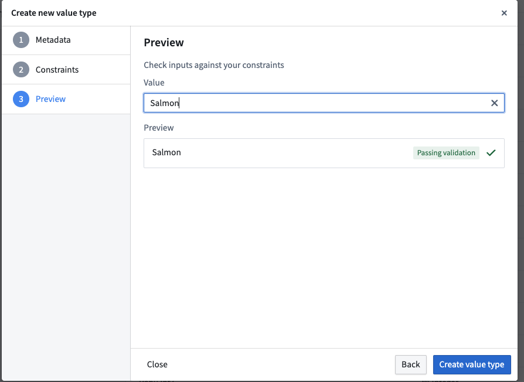

:::callout{theme="warning"}
注意：以下翻译的准确性尚未经过验证。这是使用 [AIP ↗](https://www.palantir.com/platforms/aip/) 从原始英文文本进行的机器翻译。
:::

# 创建值类型

按照以下步骤创建一个值类型，以便在您的平台[空间](https://www.palantir.com/docs/foundry/security/orgs-and-spaces/#spaces)中使用。

1. 从平台侧边栏导航到**值类型管理器**应用程序。
2. 从左上角的下拉菜单中选择您希望创建值类型的空间。
3. 从右上角选择**创建新值类型**。
4. 为您的值类型提供一个清晰的名称、描述和唯一的API名称。

5. 为您的值类型选择一个[基类型](../%E7%B1%BB%E5%9E%8B%E5%8F%82%E8%80%83.md#base-types)。
6. （非必填）为您的值类型定义一个约束。验证器可以是`字符串`类型的正则表达式、枚举、范围或其他验证方法，具体取决于基类型。
   有关基类型支持的约束的完整列表，请查看我们的[值类型约束](%E5%80%BC%E7%B1%BB%E5%9E%8B%E7%BA%A6%E6%9D%9F.md)文档。

7. （非必填但推荐）为您的值类型提供一个示例预览值。

8. 保存您的值类型。
