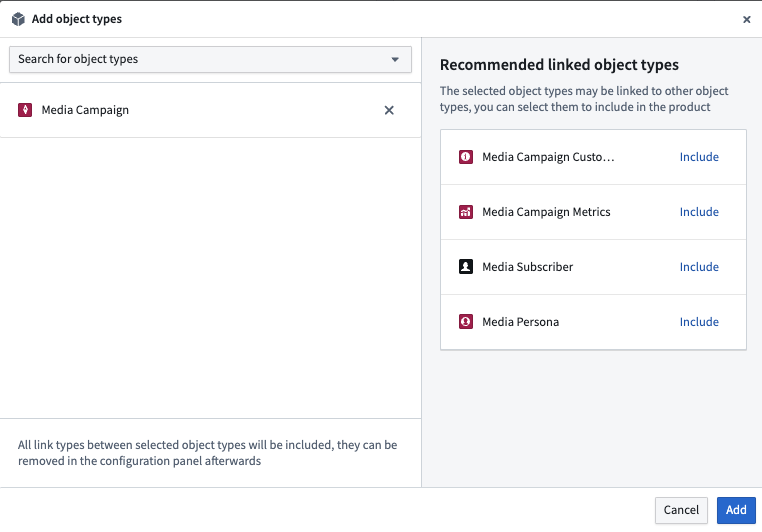
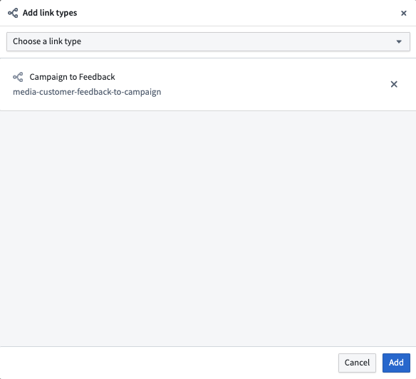
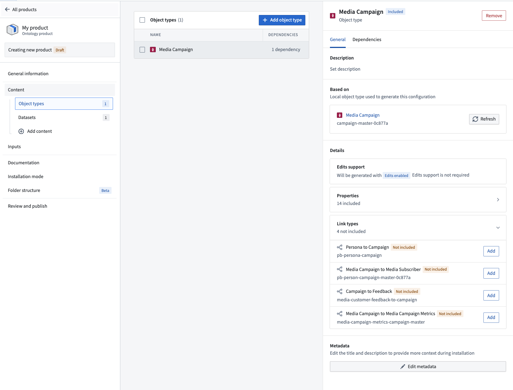
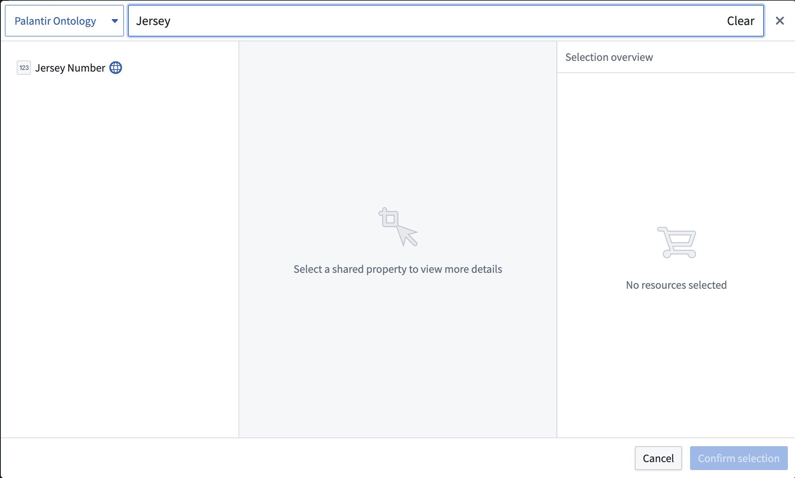
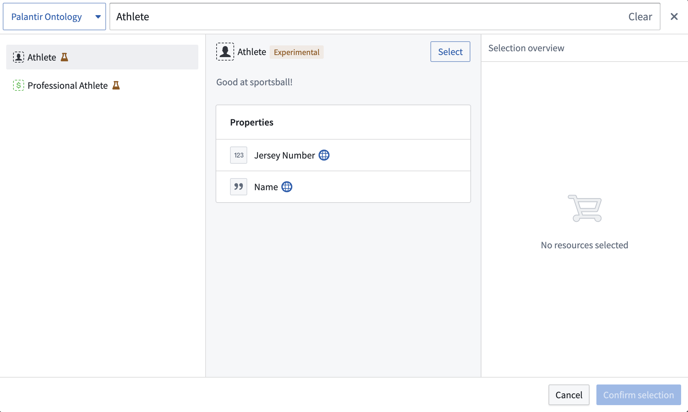

:::callout{theme="warning"}
注意：以下翻译的准确性尚未经过验证。这是使用 [AIP ↗](https://www.palantir.com/platforms/aip/) 从原始英文文本进行的机器翻译。
:::

# 将Object和链接类型添加到Marketplace产品 \[Beta]

使用[Foundry DevOps](https://www.palantir.com/docs/foundry/devops/overview/)将您的Object和链接类型包含在[Marketplace产品](https://www.palantir.com/docs/foundry/devops/core-concepts/#product)中，以供其他用户安装和重用。[了解如何创建您的第一个产品。](https://www.palantir.com/docs/foundry/foundry-devops/create-products/)

## 支持的功能

大多数[Object属性类型](Properties/%E6%A6%82%E8%A7%88.md)在Marketplace产品中是支持的，但以下内容尚不可用：

* [Cipher](https://www.palantir.com/docs/foundry/cipher/overview/)
* 地理时间
* 向量

Marketplace产品尚不支持以下内容：

* 具有流数据源的Object类型
* 没有数据源的Object类型
* 架构迁移

如果您需要上述任何功能的支持，请联系您的Palantir代表。

## 将Object类型添加到产品中

要将Object类型添加到产品中，首先[创建一个产品](https://www.palantir.com/docs/foundry/foundry-devops/create-products/)，然后选择**Object类型**内容类型。

[官方图片已失效：add object type](https://www.palantir.com/docs/resources/foundry/object-link-types/marketplace-add-shared-property.png)

然后系统会提示您选择一个Object类型。选择Object类型后，您将看到关于您可能想要添加到产品中的链接Object类型的建议。

## 将链接类型添加到产品中

要将链接类型添加到产品中，首先[创建一个产品](https://www.palantir.com/docs/foundry/foundry-devops/create-products/)，然后选择**链接类型**内容类型。

然后系统会提示您选择一个链接类型，如下所示。

虽然您可以直接选择链接类型，但我们建议先添加您的Object类型，然后通过[信息面板](https://www.palantir.com/docs/foundry/foundry-devops/create-products/#content)选择相关链接，如下所示。

## 将共享属性添加到产品中

要将共享属性类型添加到产品中，首先[创建一个产品](https://www.palantir.com/docs/foundry/foundry-devops/create-products/)。然后选择如下所示的**共享属性**内容类型。

然后系统会提示您选择一个共享属性。

## 将接口类型添加到产品中

要将接口类型添加到产品中，首先[创建一个产品](https://www.palantir.com/docs/foundry/foundry-devops/create-products/)。然后选择如下所示的**接口**内容类型。

然后系统会提示您选择一个接口。

> 配图缺失说明：本页有 1 个官方图片地址在抓取及重试时失效（返回 HTML 错误页）。下列地址保留用于溯源，未替换成其他版本的图片。

- 官方图片已失效：<https://www.palantir.com/docs/resources/foundry/object-link-types/marketplace-add-shared-property.png>
