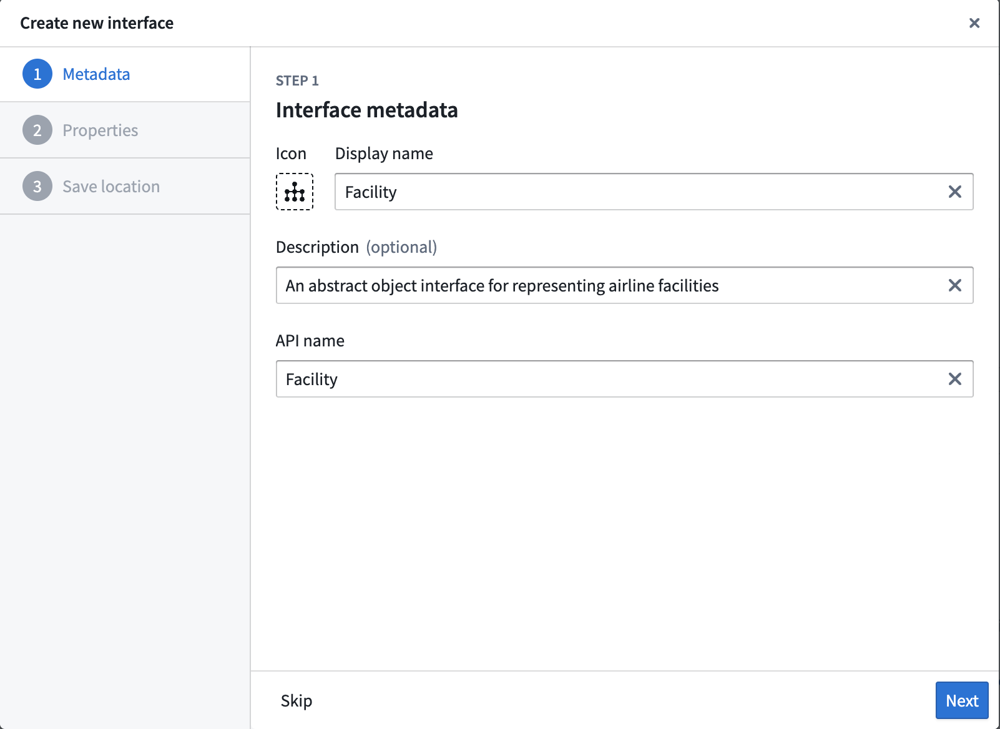
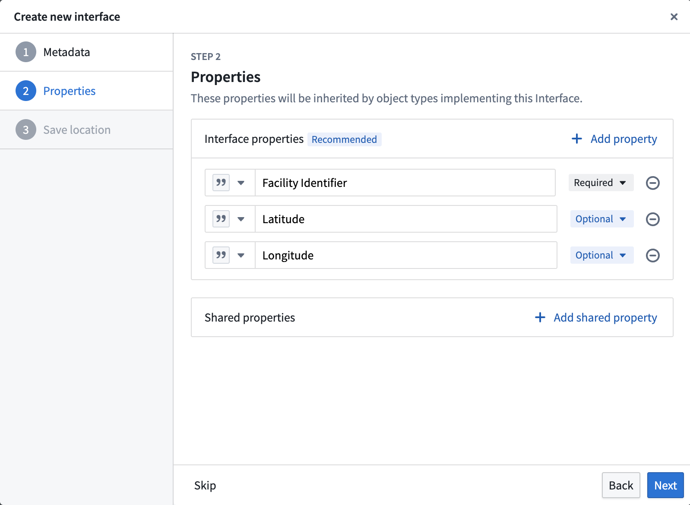
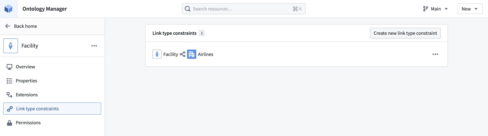
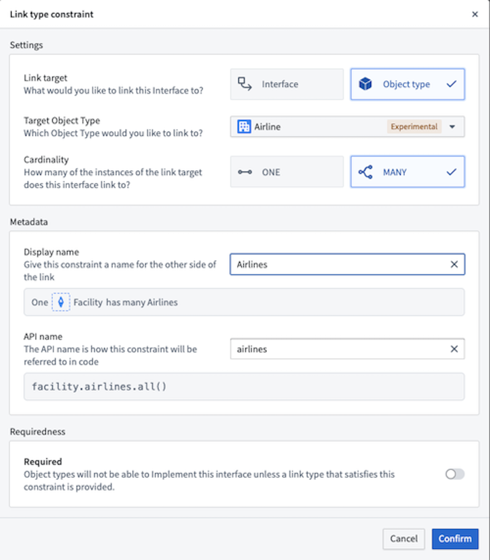

:::callout{theme="warning"}
注意：以下翻译的准确性尚未经过验证。这是使用 [AIP ↗](https://www.palantir.com/platforms/aip/) 从原始英文文本进行的机器翻译。
:::

# 创建界面

按照以下步骤在[Ontology Manager](../../%E5%BA%94%E7%94%A8/%E6%9C%AC%E4%BD%93%E7%AE%A1%E7%90%86%E5%99%A8/%E6%A6%82%E8%BF%B0.md)中创建一个新界面。

1. 首先，通过检查左侧面板顶部的**Ontologies**下拉菜单，确认您正在使用所选的Ontology。

2. 在同一左侧面板的**Resources**部分下选择**Interfaces**。在**Interfaces**页面，从屏幕右上角选择**New interface**。

或者，您可以从Ontology Manager导航栏右上角选择**New**下拉菜单，并选择**Interface**。

3. 输入界面的显示名称和API名称。您还可以非必填地提供界面的描述并选择合适的图标。

4. 选择界面的共享属性。

任何实现该界面的Object类型必须具有这些共享属性，或提供从本地属性到界面共享属性的映射。如果界面所需的共享属性不存在，您必须[创建它](../%E5%AF%B9%E8%B1%A1%E9%93%BE%E6%8E%A5%E7%B1%BB%E5%9E%8B/Shared%20properties/%E5%88%9B%E5%BB%BA%E5%85%B1%E4%BA%AB%E5%B1%9E%E6%80%A7.md)。

5. 选择右上角的**Save**以更改您的Ontology。

## 创建界面链接类型（非必填）

如果您希望此界面链接到另一个界面或Object类型，您可以非必填地向界面添加任何[界面链接类型](%E6%8E%A5%E5%8F%A3%E9%93%BE%E6%8E%A5%E7%B1%BB%E5%9E%8B.md)。

1. 在左侧面板中选择**Link type constraints**。
2. 然后，在右上角选择**Create new link type constraint**。

如果您的建模应用案例需要界面链接类型，任何实现该界面的Object类型必须添加一个新链接类型或满足界面链接类型约束的现有链接类型。
