:::callout{theme="warning"}
注意：以下翻译的准确性尚未经过验证。这是使用 [AIP ↗](https://www.palantir.com/platforms/aip/) 从原始英文文本进行的机器翻译。
:::

# 实现接口

一旦定义，符合接口定义的任何对象类型都可以实现接口。这意味着对象类型必须包含接口的共享属性（或映射并满足接口共享属性的本地属性），并且拥有满足接口上定义的所有所需链接类型约束的链接。

使用对象类型实现接口表明该对象类型是Ontology中接口的具体实例。此声明为对象类型提供了额外的功能，即：

* 针对接口的对象集服务搜索将返回实现对象类型的匹配对象。
* 实现对象类型的对象可以通过其本地API名称（当类型为具体对象类型时）和接口API名称（当类型为接口类型时）与属性和链接进行交互。

简而言之，实现接口允许应用程序消费者通过接口定义与任何和所有实现对象进行交互。这使得应用程序代码可以使用接口作为API层，而不需要应用程序单独支持每个实现对象类型。此外，通过使用接口作为应用程序API层，可以通过让新对象类型实现应用程序接口来将其添加到应用程序中，而不需要更改代码以显式支持新对象类型。

## 如何在Ontology Manager中实现接口

按照以下步骤使用对象类型实现接口。

### 1. 选择您的接口和对象类型

首先，导航到Ontology Manager中的对象类型并打开**接口**选项卡。在页面右上角选择\*\*+ 实现新接口\*\*。

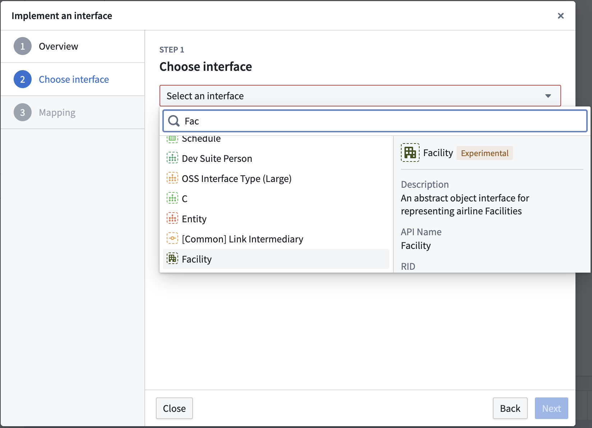

在出现的对话框中，选择要实现的接口。

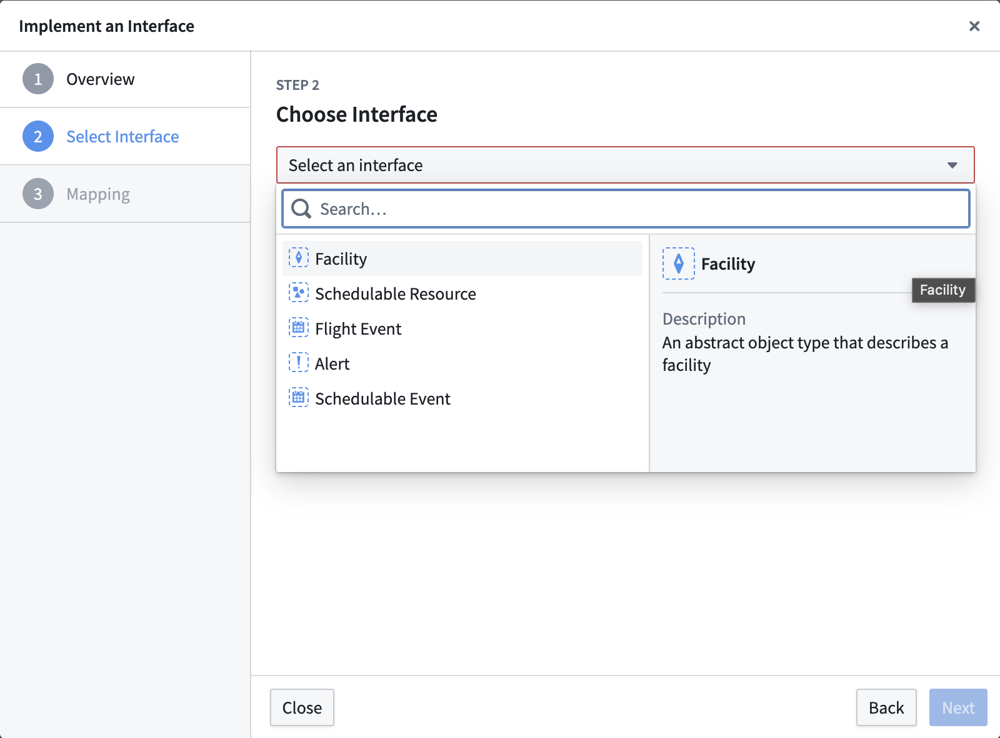

或者，导航到接口概述页面，在**实现**部分选择\*\*+ 新建\*\*。

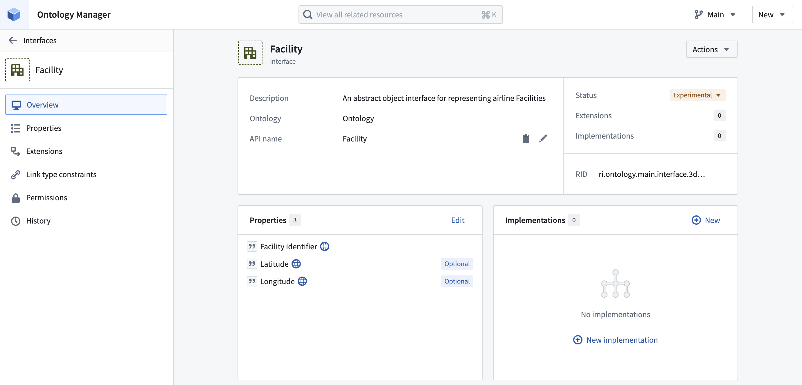

然后，选择要实现接口的对象类型。

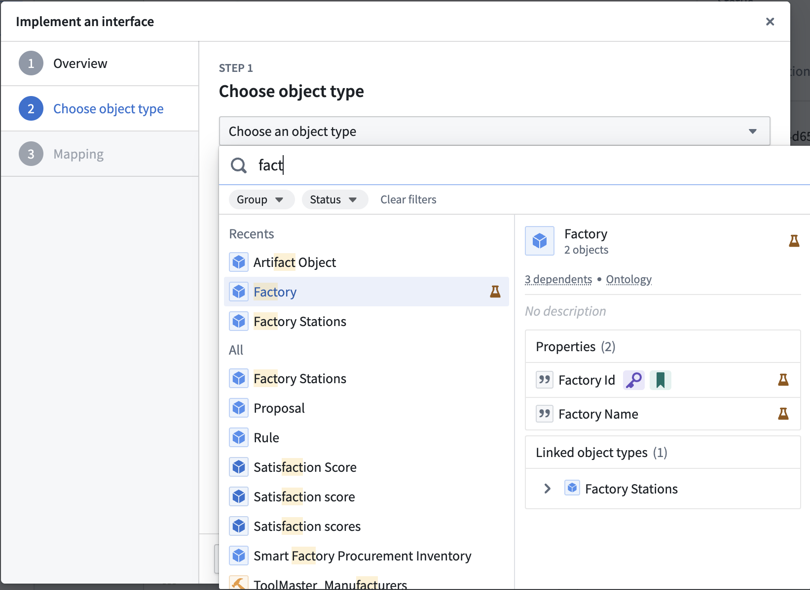

### 2. 映射本地属性

要实现接口，对象类型必须包含接口的共享属性**或**声明将现有对象属性映射到接口共享属性的映射。接口和对象类型上都存在的共享属性将自动映射。任何不在对象类型上的共享属性将需要您手动输入映射以满足接口定义。

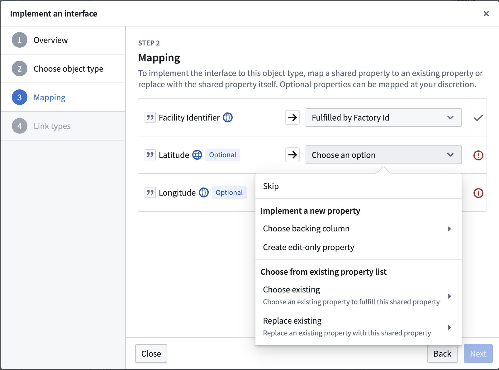

### 3. 映射链接类型约束

如果在接口上声明了任何所需的[链接类型约束](%E6%8E%A5%E5%8F%A3%E9%93%BE%E6%8E%A5%E7%B1%BB%E5%9E%8B.md)，您必须在对象类型上选择一个链接类型来满足每个所需的链接类型约束。您还可以选择性地为任何非必需的链接类型约束提供链接映射。您可以选择现有的链接类型或创建一个新的来满足每个约束。

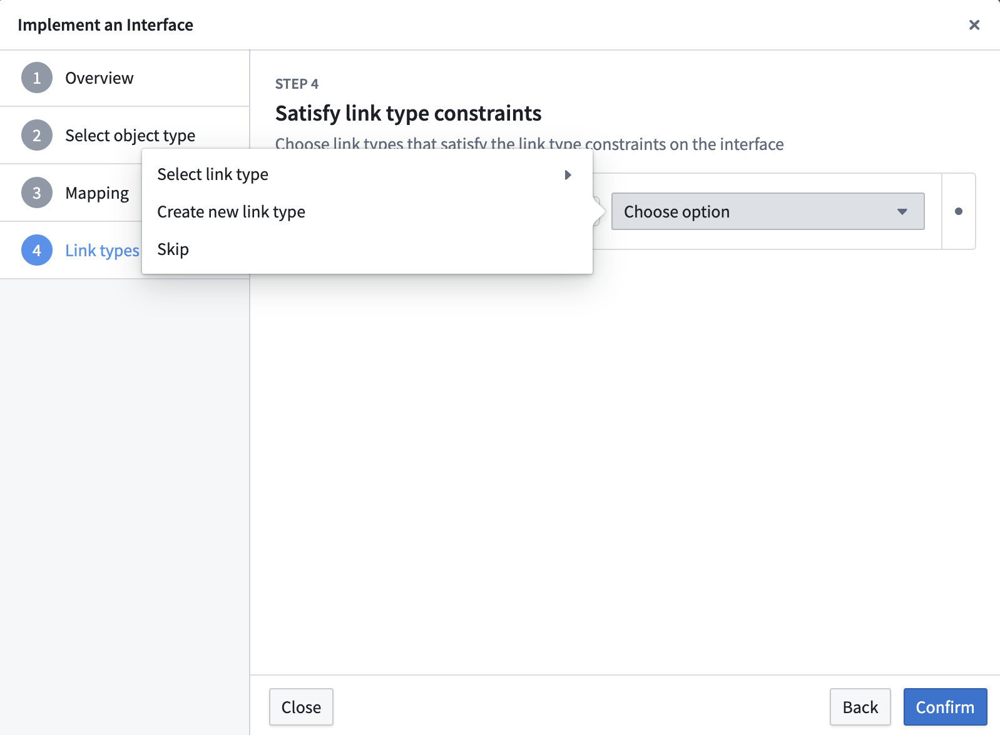

### 4. 保存更改

选择**保存**以更改您的Ontology。

## 如何在Pipeline Builder中实现接口

按照以下步骤在Pipeline Builder中的[对象类型输出](https://www.palantir.com/docs/foundry/pipeline-builder/outputs-add-ontology-output/#add-an-object-type-output)上实现接口。

### 1. 打开输出类型配置

选择您想实现接口的对象类型输出，然后选择**编辑**选项。

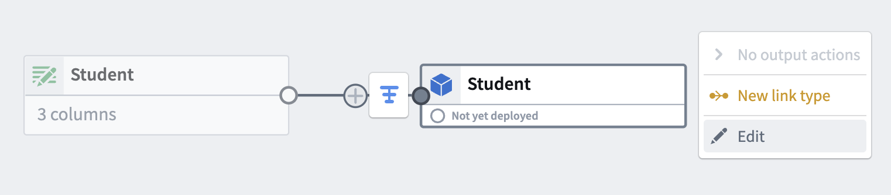

### 2. 选择要实现的接口

选择**实现接口**。

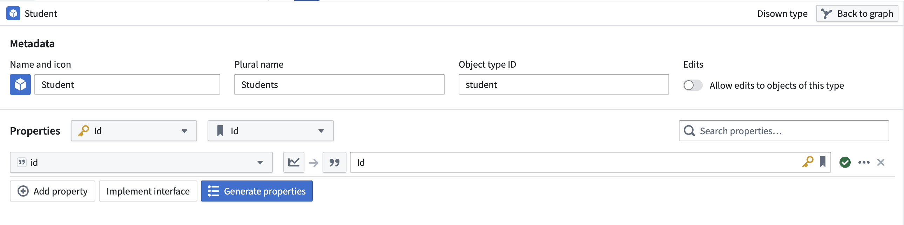

然后，选择要实现的接口并选择**实现并进行映射**。

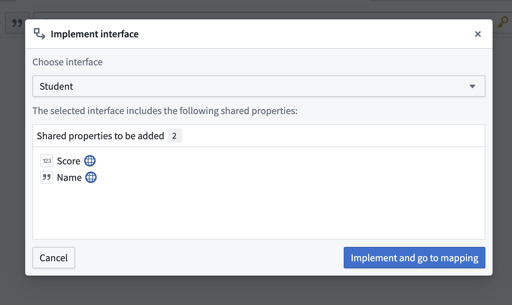

### 3. 映射本地属性

要实现接口，对象类型必须包含接口的共享属性**或**声明将现有对象属性映射到接口共享属性的映射。接口和对象类型上都存在的共享属性将自动映射。任何不在对象类型上的共享属性将需要您手动输入映射以满足接口定义。

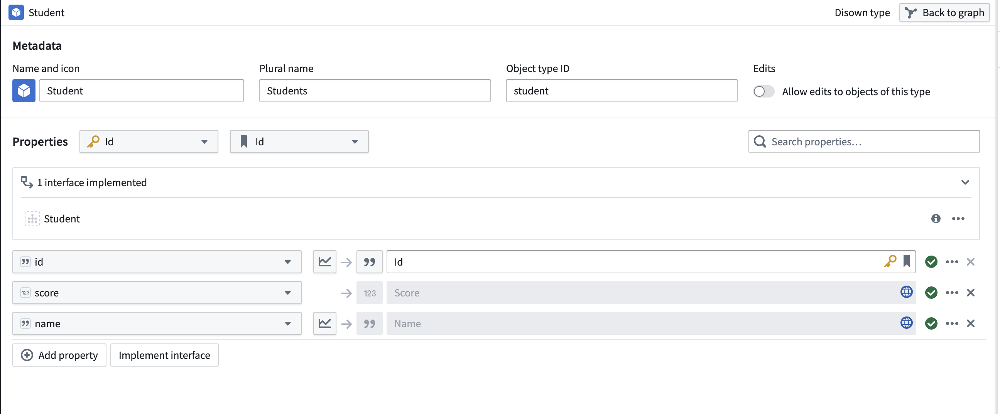

### 4. 查看已实现的接口

您可以从输出类型配置面板查看该对象类型输出已实现的接口。

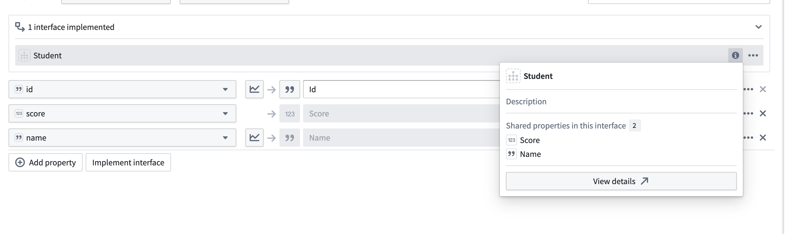

:::callout{theme="neutral"}
Pipeline Builder当前不支持在实现接口时的链接类型约束映射。如果您的接口包含所需的链接类型约束，则必须通过Ontology Manager实现接口。
:::
