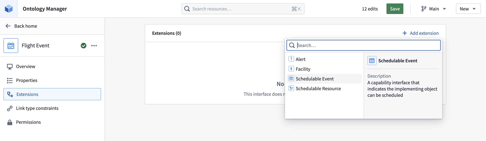
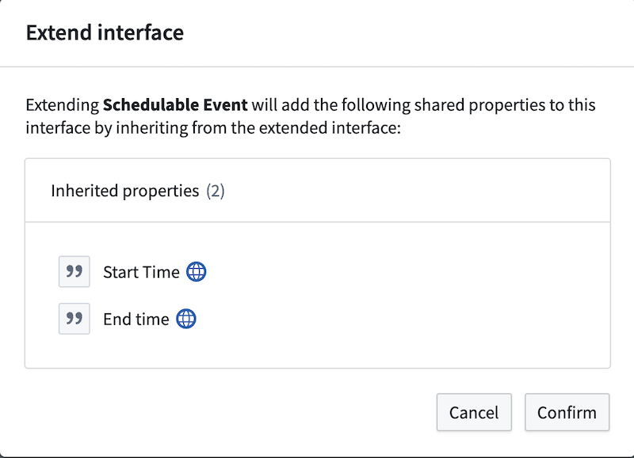
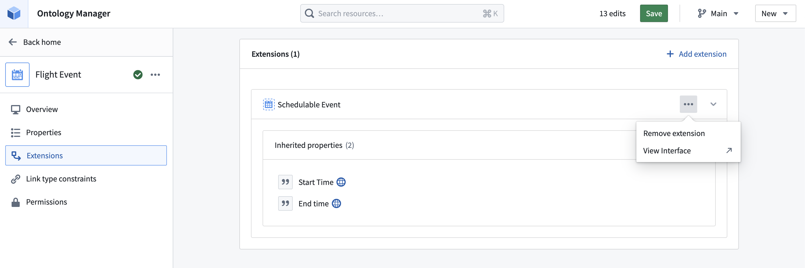

:::callout{theme="warning"}
注意：以下翻译的准确性尚未经过验证。这是使用 [AIP ↗](https://www.palantir.com/platforms/aip/) 从原始英文文本进行的机器翻译。
:::

# 扩展接口

扩展接口使您可以将多个接口组合在一起，创建一个新的、更具体的接口。这对于构建实现多个[功能接口](%E6%A6%82%E8%BF%B0.md#capability-interface)的[抽象Object接口](%E6%A6%82%E8%BF%B0.md#abstract-object-interface)特别有用。一个接口会继承其扩展接口的共享属性和链接。一个接口可以扩展任意数量的其他接口。

要扩展接口，请按照以下步骤进行。

1. 在Ontology Manager中，选择您希望扩展的接口以打开接口概览页面。

2. 在概览页面，从左侧面板中选择**扩展**。

3. 在接口扩展页面，选择**添加扩展**。

4. 从下拉菜单中，选择要从当前接口扩展的接口。

5. 在确认对话框中，查看将添加到接口扩展的共享属性和链接，然后选择**确认**。

6. 在右上角选择**保存**以将接口扩展添加到Ontology中。

您还可以移除扩展以将一个接口与另一个接口分离。此操作将移除接口中所有继承的共享属性，移除所有继承的链接类型约束，并将扩展接口与基础接口解除关联。

