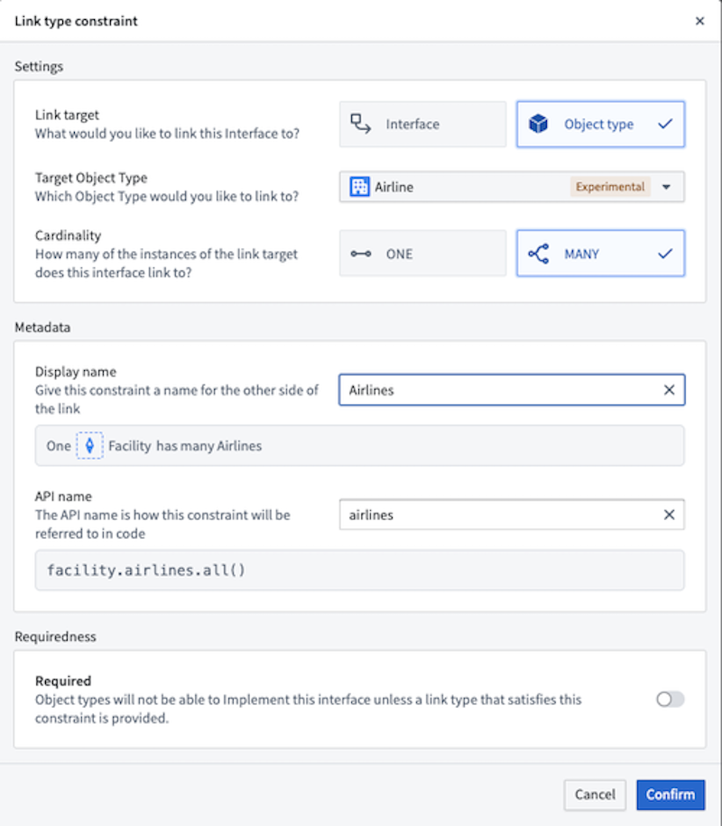

:::callout{theme="warning"}
注意：以下翻译的准确性尚未经过验证。这是使用 [AIP ↗](https://www.palantir.com/platforms/aip/) 从原始英文文本进行的机器翻译。
:::

# 接口链接类型

接口链接类型定义了实现接口的所有对象类型之间的对象到对象的关系。用户可以为接口链接指定描述，并为接口链接类型指定一个API名称，以便在代码中引用。当一个对象实现带有接口链接类型的接口时，接口上的所有接口链接类型都由对象类型上的具体链接类型支持。任何本体论修改都将验证具体链接类型是否符合关联链接类型约束所指定的参数。

如上例所示，为了建模一个设施与其服务的航空公司之间的关系，`Facility`接口声明了在实现`Facility`接口的任何对象与`Airline`对象类型之间的非必填一对多链接类型约束。这意味着如果实现的对象类型（例如`Airport`）具有到`Airlines`对象类型的具体链接类型，则可以通过接口链接类型API名称访问该链接。

## 链接类型约束

链接类型约束定义了接口链接类型的参数。如果链接类型是必需的，所有实现的对象类型必须有一个满足这些约束的链接。这些参数包括：

* **链接目标类型：** 接口或对象类型。
* **目标：** 一个具体的接口或对象类型。
* **基数：** 一对一或一对多。
* 链接是否作为对象类型实现的一部分是必需的。

## 接口链接目标

当你想要建模两个抽象对象类型之间的关系时，你应该使用接口链接目标。

例如，你可以使用接口链接目标来建模`Facility`与发生的`Alert`之间的关系。因为有几种设施和几种警报，如果你只能为链接的每一端使用单一对象类型，那么就不可能建模两者之间的连接。相反，你可以通过定义一个`Facility`接口，一个`Alert`接口，以及在`Facility`上设置链接到`Alert`接口的接口链接来建模这种关系。然后，你可以定义一个实现`Facility`接口的`Airport`对象类型和一个实现`Alert`接口的`Flight Alert`对象。从那里，你可以定义一个从`Airport`到`Flight Alert`的具体链接类型，以满足`Facility`接口的链接类型。

## 对象类型链接目标

当接口和目标之间的关系是具体的，并且应由链接类型约束来强制执行其特异性时，你应该使用对象类型链接目标。

例如，你可以定义一个链接到`Airlines`对象类型的`Facility`接口。这个接口链接将建模无论设施类型是什么，你都期望它有一个链接到其服务的具体航空公司。

## 接口链接类型基数

接口链接类型可以进一步被指定为`ONE`或`MANY`基数。这些基数分别类似于一对一和一对多建模，其中接口链接类型是关系的左侧。`ONE`基数表示一个具体对象（一个对象类型的行）应该链接到正好一个其他具体对象。`MANY`基数表示一个具体对象可以有一个或多个链接到其他具体对象。

你应该根据本体论的建模需求在`ONE`或`MANY`之间做出决定。在某些情况下，限制链接的基数为单个对象可能更有意义。例如，你可能希望将`Driver's License`与`Person`之间的关系建模为`SINGLE`基数链接，因为任何给定的许可证只能属于单个具体个人。如果关系允许更多的灵活性，例如公司与其股东的关系，你可能希望使用`MANY`基数链接，以表示给定公司可以有一个或多个具体股东。
