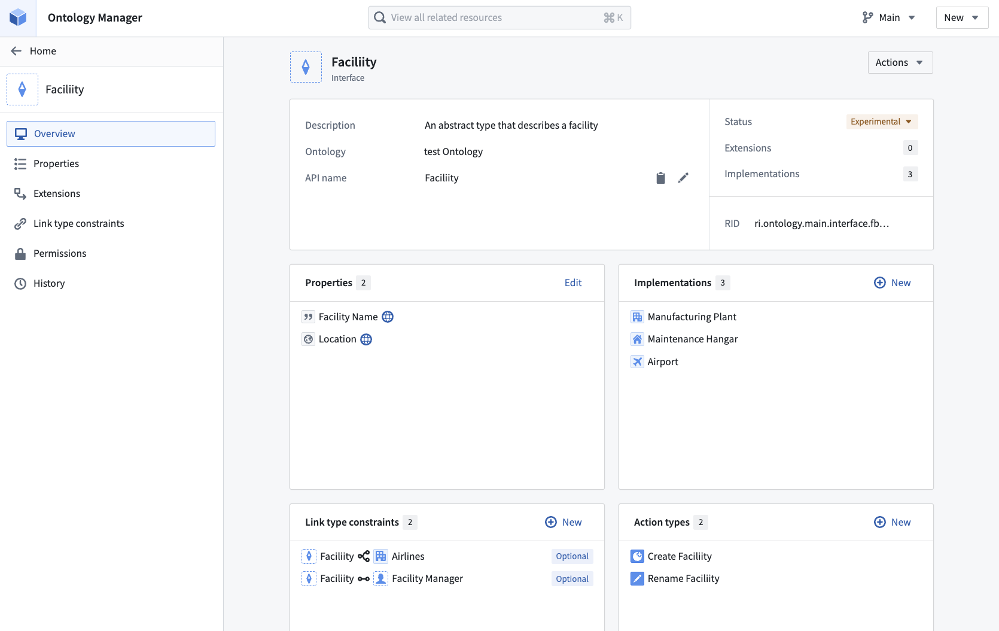

:::callout{theme="warning"}
注意：以下翻译的准确性尚未经过验证。这是使用 [AIP ↗](https://www.palantir.com/platforms/aip/) 从原始英文文本进行的机器翻译。
:::

# 概述

:::callout{theme="warning" title="Beta"}
接口处于测试阶段，功能支持在Palantir平台上有所不同。查看[当前支持级别](%E6%A6%82%E8%BF%B0.md#current-levels-of-support)以获取更多详细信息。
:::

**接口**是一种Ontology类型，用于描述对象类型的形状及其功能。接口提供对象类型的多态性，允许对具有共同形状的对象类型进行一致的建模和交互。

一个接口由[共享属性](../%E5%AF%B9%E8%B1%A1%E9%93%BE%E6%8E%A5%E7%B1%BB%E5%9E%8B/Shared%20properties/%E6%A6%82%E8%BF%B0.md)、[接口链接类型](%E6%8E%A5%E5%8F%A3%E9%93%BE%E6%8E%A5%E7%B1%BB%E5%9E%8B.md)和关于接口的[元数据](%E5%85%83%E6%95%B0%E6%8D%AE%E5%8F%82%E8%80%83.md)组成。一个接口可以由多个对象类型实现，并可以相互扩展以允许组合性。一个接口可以扩展任意数量的其他接口。

类似于编程语言中的接口，你可以[扩展一个接口](%E6%89%A9%E5%B1%95%E6%8E%A5%E5%8F%A3.md)来将接口组合在一起，并让对象类型[实现接口](%E5%AE%9E%E7%8E%B0%E6%8E%A5%E5%8F%A3.md)以表明这些对象类型符合接口定义。当与实现接口的对象交互时，你可以通过其本地API名称以及其实现的任何接口的API名称来引用对象、其属性和链接。

## 接口和对象类型之间的区别

在Ontology中，接口和对象类型之间存在功能和风格上的区别。

对象类型是具体的；它们具有由共享或本地属性定义的架构，由包含属性值的数据集支持，并可以实例化为对象。

相比之下，接口是抽象的；它们仅具有由共享属性定义的架构，不由数据集支持，且无法实例化。

在风格上，平台中通过在图标周围使用虚线将接口与对象类型视觉上区分开来。

## 接口类型

接口类型通常分为两种概念类型：**功能**接口和**抽象对象**接口。在Ontology中，这两者都不是显式的子类型，但它们是讨论和理解接口如何被频繁使用的有用术语。

### 功能接口

**功能接口**代表了一种独特的功能，并促进该功能在所有实现对象类型上的重用。功能接口通常具有一小组特定于所表示功能的属性和/或链接。通过实现一个功能接口，对象类型可以在相关功能中使用。

例如，`Schedulable Resource`接口可以表示支持对象类型调度所需的属性和链接。实现对象类型可以包括`Employee`、`Conference room`、`Equipment`或任何被建模为具有必要属性和链接的对象类型的资源。

### 抽象对象接口

**抽象对象接口**代表了两个或多个共享共同属性和链接的对象类型的“超类型”。与功能接口相比，实现抽象对象接口的对象类型可能有更多的相似之处，而不是差异，并且可能经常被聚集在一起以表示更通用的超类型。

抽象对象接口包含与所有相关对象类型共有的任何属性和链接。例如，`Employee`接口可能包括`Name`、`Email`和`Start Date`属性，以及与另一个`Employee`的`Lead/Manager`链接。实现`Employee`的对象类型可以是`Full Time Employee`、`Intern`或`Contractor`。所有这些单独的对象类型将有三个共同的属性和一个共同的链接，因此确保这些可以互换表示对于一致性和重用性是有帮助的。

## 接口示例

在下面的示例中，我们展示了一个`Facility`抽象对象接口，其中包含三个共享属性（`Latitude`、`Longitude`和`Facility Identifier`），并应用于两个对象类型（`Runway`和`Airport`）。

构建为与`Facility`接口一起使用的应用程序可以通过接口的共享属性和链接与实现接口的任何对象类型交互。如果第三个对象类型使用相同的接口（例如，`Weather Station`），应用程序可以使用这些共享属性进行额外的对象类型交互，而无需对应用程序进行代码更改。

## 接口权限

通过[Ontology角色](../%E6%9C%AC%E4%BD%93/%E6%9D%83%E9%99%90.md#ontology-roles)对接口进行权限设置。

## 当前支持级别

随着接口Ontology类型支持的扩展，Palantir平台上的可用性将有所不同。

接口目前在以下应用程序和服务中得到支持：

* [**Ontology Manager:**](../../%E5%BA%94%E7%94%A8/%E6%9C%AC%E4%BD%93%E7%AE%A1%E7%90%86%E5%99%A8/%E6%A6%82%E8%BF%B0.md): 定义、编辑和实现接口。
* [**Marketplace:**](https://www.palantir.com/docs/foundry/marketplace/overview/): 打包和安装接口。

接口支持正在以下方面开发中：

* [**Ontology SDK:**](https://www.palantir.com/docs/foundry/ontology-sdk/overview/): 将接口用作API层来与实现对象类型交互。支持因语言而异（Typescript、Python和Java）。
* [**Object Set Service:**](../../%E6%9C%AC%E4%BD%93%E6%9E%B6%E6%9E%84/%E5%AF%B9%E8%B1%A1%E5%90%8E%E7%AB%AF/%E6%A6%82%E8%BF%B0.md#object-set-service-oss): 通过接口搜索、排序和聚合对象。
* [**Actions**](../%E5%8A%A8%E4%BD%9C%E7%B1%BB%E5%9E%8B/%E6%A6%82%E8%BF%B0.md): 定义以接口为输入的操作以进行对象创建、修改和删除操作，以便所有实现接口的对象类型可以使用该操作。

接口尚未在以下方面得到支持：

* [**Workshop**](https://www.palantir.com/docs/foundry/workshop/overview/)
* [**Functions**](../%E5%87%BD%E6%95%B0/%E6%A6%82%E8%BF%B0.md)

## 开始使用接口

要将接口添加到您的Ontology中，您可以[创建](%E5%88%9B%E5%BB%BA%E7%95%8C%E9%9D%A2.md)新接口或[扩展](%E6%89%A9%E5%B1%95%E6%8E%A5%E5%8F%A3.md)现有接口。一旦有了接口，您就可以将该接口与适当形状的对象类型[实现](%E5%AE%9E%E7%8E%B0%E6%8E%A5%E5%8F%A3.md)，或者[编辑](%E7%BC%96%E8%BE%91%E6%8E%A5%E5%8F%A3%E5%AE%9A%E4%B9%89.md)它以更好地适应您的组织随着Ontology的发展。
