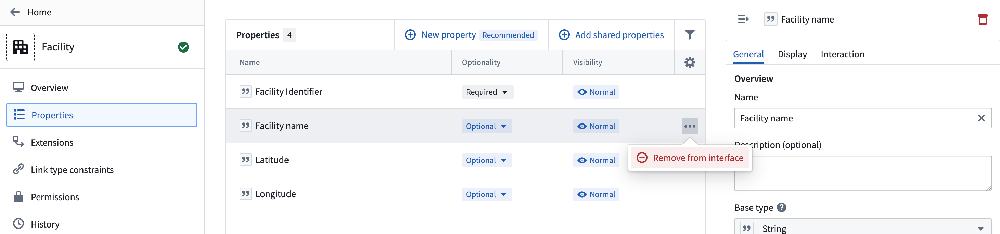
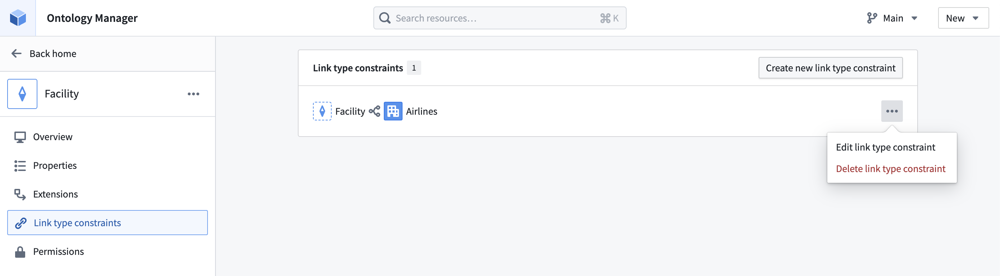

:::callout{theme="warning"}
注意：以下翻译的准确性尚未经过验证。这是使用 [AIP ↗](https://www.palantir.com/platforms/aip/) 从原始英文文本进行的机器翻译。
:::

# 编辑接口定义

:::callout{theme="warning" title="重大更改"}
由于接口暴露API名称，对接口定义的任何更改都有可能破坏下游应用，并且必然会破坏现有的Object实现。当向接口添加新的共享属性或链接类型约束时，所有使用该接口的Object类型的实现**必须**在同一次更新中完成到您的Ontology。我们还建议同时更新您的接口定义和消费者。    
如果您的下游应用程序不能与接口更改同时更新，您可以选择创建一个新版本的接口（作为[扩展](%E6%89%A9%E5%B1%95%E6%8E%A5%E5%8F%A3.md)或独立接口），并尽快迁移到新的接口定义。
:::

## 添加共享属性

在接口配置的**属性**选项卡中，选择**添加共享属性**并选择要添加到接口的共享属性。

## 添加链接类型约束

在**链接类型约束**选项卡中，选择**创建新链接类型约束**并添加必要的[约束元数据](%E5%88%9B%E5%BB%BA%E7%95%8C%E9%9D%A2.md#create-interface-link-types-optional)。

## 移除共享属性

在**属性**选项卡中，选择您希望从接口中移除的属性旁边的\*\*...\*\*。

## 移除或编辑链接类型约束

在**链接类型约束**选项卡中，选择您希望编辑或移除的链接类型约束旁边的\*\*...\*\*。

如果编辑约束，您可以像[首次创建链接类型约束](%E5%88%9B%E5%BB%BA%E7%95%8C%E9%9D%A2.md#create-interface-link-types-optional)时一样更新元数据。
