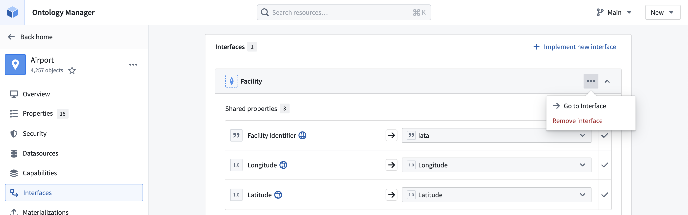
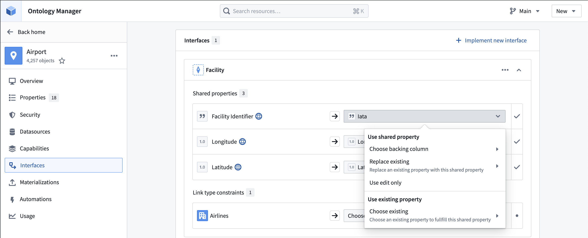

:::callout{theme="warning"}
注意：以下翻译的准确性尚未经过验证。这是使用 [AIP ↗](https://www.palantir.com/platforms/aip/) 从原始英文文本进行的机器翻译。
:::

# 编辑接口实现

一旦在Object上实现后，您可以通过删除或更改映射来更新实现。

首先，打开Ontology管理器并导航到您希望编辑接口实现的Object。

## 1. 删除接口实现

选择 **...** 图标并选择 **移除接口** 以删除该Object类型的接口实现。

选择右上角的 **保存** 以更新Ontology。

## 更新实现映射

选择下拉菜单以更新用于实现接口的属性或链接类型。

选择右上角的 **保存** 以更新Ontology。
