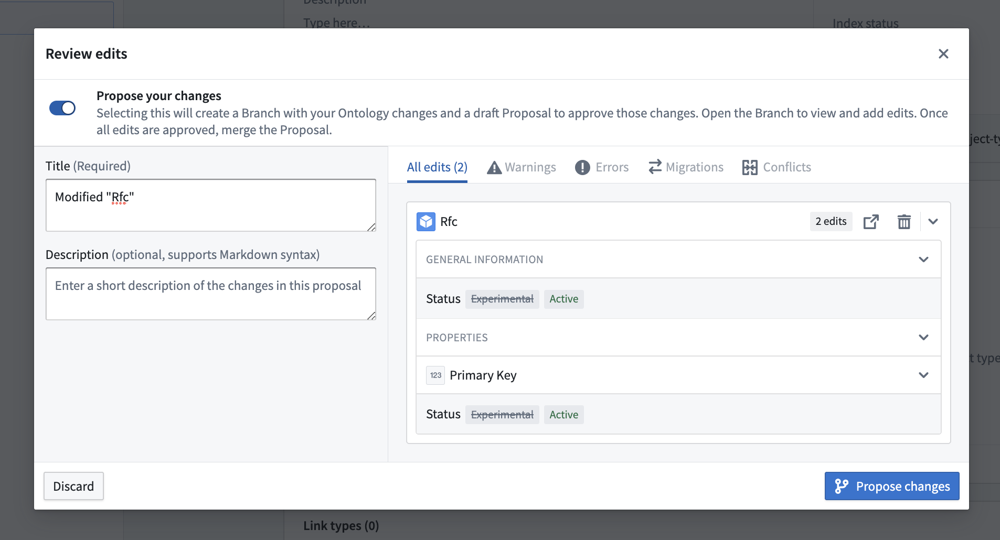
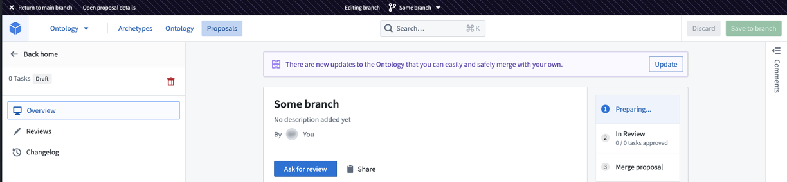
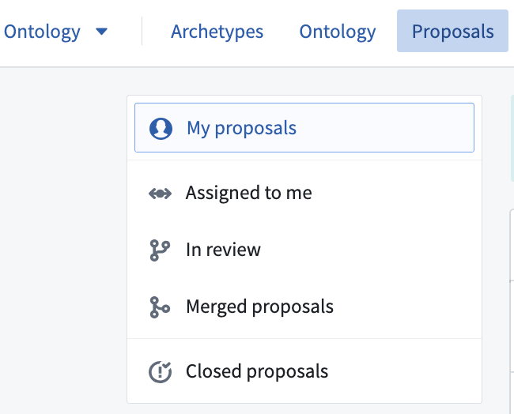
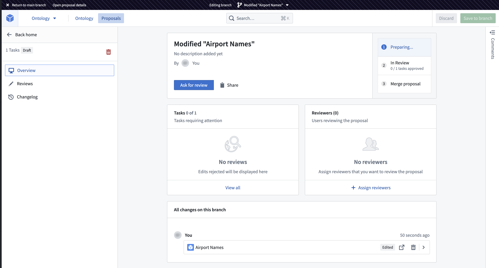
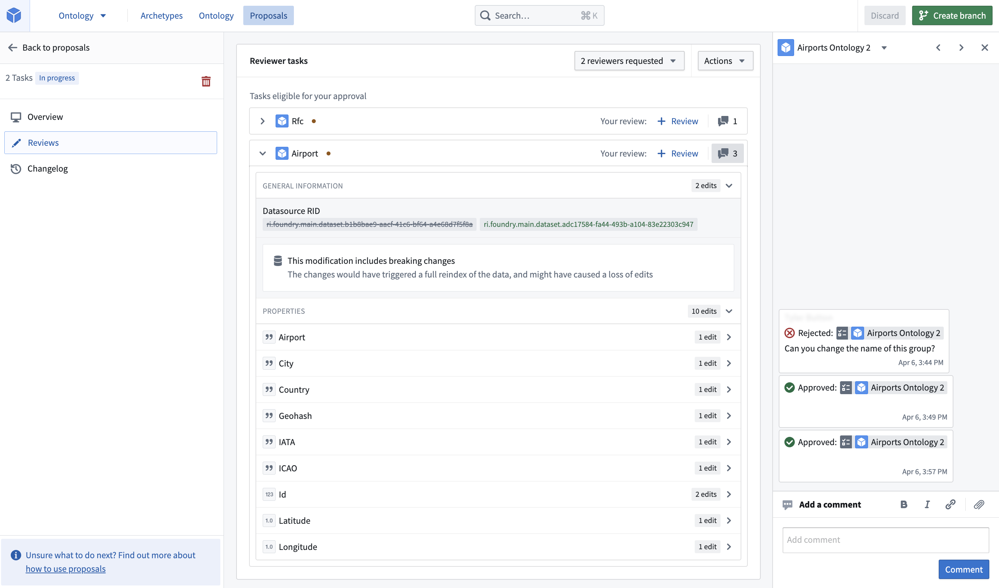

:::callout{theme="warning"}
注意：以下翻译的准确性尚未经过验证。这是使用 [AIP ↗](https://www.palantir.com/platforms/aip/) 从原始英文文本进行的机器翻译。
:::

# Ontology 提案

Ontology 提案允许您在一个基于该 Ontology 主版本的分支上对 Ontology 进行更改。此过程确保所有修改在合并到主 Ontology 之前都经过审查和批准。

[了解更多关于 Foundry 的分支。](https://www.palantir.com/docs/foundry/data-integration/overview/)

## 定义

* **分支**：Ontology 上的一个*分支*是从主版本派生出的独立版本，旨在进行实验和更改而不影响主分支。这允许用户在合并回主分支之前，在隔离的环境中测试和完善对 Ontology 的调整。

* **提案**：*提案*类似于版本控制系统中的拉取请求，专门为 Ontology 分支量身定制。提案在分支创建时自动生成，并包含诸如审查、名称和更改描述等元数据。提案作为一种机制，用于在将更改集成到主 Ontology 之前，对其进行审查和批准。

## 提案工作流程

1. **创建分支**

您可以通过选择 **创建分支** 来打开一个对话框，在其中您可以选择提案的标题和描述来创建分支。

或者，如果您已经有想要包含在提案中的 Ontology 更改，可以选择保存并在保存对话框中切换 **提议更改**。

如果您在 Ontology 的主分支上，并且没有更改，您也可以通过选择分支选择组件并输入新分支的名称来创建分支。

提案分支只能在主 Ontology 配置上创建。您不能基于另一个提案创建新分支。

在分支上，工作区界面上方的分支导航顶部栏反映了您当前的分支。

2. **准备您的提案以供审查**

此时，根据您创建提案的方式，您可能已经在您的分支上进行了一些更改。在您的分支上，您可以继续对 Ontology 资源进行更改，包括创建和删除。

每个修改的 Ontology 实体将在您的提案中构成一个单独的**任务**，并可供审查。

对于已迁移以使用 [Ontology 角色](%E6%9D%83%E9%99%90.md#ontology-roles) 的资源，访客可以在提案中更改资源。如果资源基于数据源派生权限，则只有编辑者或所有者可以在提案中更改它们。

:::callout{theme="neutral"}
在分支上，当持有编辑者或所有者权限时，您可以编辑资源。如果这些资源已迁移以使用新的 [Ontology 角色](%E6%9D%83%E9%99%90.md#ontology-roles)，您也可以使用访客权限编辑资源。要将您的资源迁移以使用 Ontology 角色，请遵循 [Ontology 角色迁移指南](../../%E5%BA%94%E7%94%A8/%E6%9C%AC%E4%BD%93%E7%AE%A1%E7%90%86%E5%99%A8/Ontology%20%E8%A7%92%E8%89%B2%E8%BF%81%E7%A7%BB.md)。
:::

3. **请求审查**

在对分支进行更改后，您可以将审查者添加到您的提案中。为此，请通过选择位于顶部栏的 **打开提案详情** 导航到您的 [提案视图](#proposal-view)。

如果您退出了分支，您可以通过导航到 **提案** 标签并选择您的提案，或使用分支选择组件，进入您的提案概览。

从那里，在 **审查者** 部分指派审查者。

审查者只有在提案处于 `审查中` 阶段时才会收到通知。

:::callout{theme="neutral"}
您还可以在提案的各个任务上留下评论，以提供有关建议更改的背景信息。通过选择 **审查** 标签，然后选择最右侧的评论侧边栏，访问您任务的评论部分。
:::

4. **审查提案**

审查者可以在 **审查** 标签中批准或拒绝各个任务，并可以通过添加评论来支持他们的审查。

审查者必须拥有所有者或编辑权限才能批准更改。

没有权限的用户仍然可以审查任务，例如，表达他们对更改的意见，但这不会影响任务的批准状态。

如果提案的创建者对所有编辑的资源具有所有者或编辑者权限，他们将能够批准自己的更改。

:::callout{theme="warning"}
即使编辑者或所有者没有被明确添加为审查者，他们仍然可以批准您的提案。我们建议使用审查者列表来跟踪谁应该审查更改，而不是作为保护 Ontology 的方式，这应该通过仔细指派角色或权限来完成。
:::

5. **发布提案**

一旦您的更改已被审查和批准，提案就可以合并到 Ontology 中。

:::callout{theme="neutral"}
将更改合并到 Ontology 中不需要特殊权限。提案被批准后，任何可以编辑分支的人都可以将提案合并到 Ontology 中。
:::

提案被合并后，它将从侧边栏的 **审查中** 部分移至 **已合并** 部分。

在合并提案之前的任何时候，您都可以通过从侧边栏选择 **删除** 来关闭提案。

提案只能合并到主 Ontology 配置中。

提案不能自动恢复。要撤销提案，您必须撤销其中的不同更改。

:::callout{theme="warning"}
一旦提案被关闭，它就不能重新打开。
:::

[官方图片已失效：关闭提案](https://www.palantir.com/docs/resources/foundry/ontologies/close-proposal.png)

## 提案导航

* **分支导航栏**：在您编辑分支时，出现在工作区顶部。从这里您可以：

* 返回主分支 (1)

* 查看提案详情 (2)

* 使用分支选择器选择要导航到的特定分支 (3)

[官方图片已失效：分支导航顶部栏](https://www.palantir.com/docs/resources/foundry/ontologies/annotated-topbar.png)

* **选择分支**：直接从 Ontology 管理器首页的分支选择部分选择要编辑或查看的分支。

[官方图片已失效：分支选择关闭](https://www.palantir.com/docs/resources/foundry/ontologies/branch-select-closed.png)

[官方图片已失效：分支选择打开](https://www.palantir.com/docs/resources/foundry/ontologies/branch-select-open.png)

* **提案标签**：
  从提案标签中，您可以选择查看不同状态的提案。状态定义如下：

  * **我的提案**：由您创作的提案。
  * **指派给我**：您被指派为审查者的提案。
  * **审查中**：正在进行或已批准的提案。
  * **已合并提案**：已合并到 Ontology 的提案。
  * **关闭的提案**：已关闭且未合并的提案。

  

* **提案视图**：访问概览、审查和变更记录标签以获取有关您提案的更多信息。

## 提案视图

提案概览集中展示您的提案信息，包括其所处阶段、已做出的更改、需要审查的任务以及选定的审查者。要访问您当前正在编辑的提案的此视图，请选择位于顶部栏的 **转到提案概览**。要访问任何提案的概览页面，可以通过导航到 **提案** 标签并选择您希望查看的提案来实现。

* **提案阶段**：提案的第一个阶段是准备阶段。选择 **请求审查** 将您的提案移动到 **审查中** 阶段。在所有任务都已审查和批准后，提案进入其最终阶段，**合并提案**。从这一点起，您可以使用相同的选项将更改合并到主 Ontology。

* **查看分支上的更改**：编辑显示在概览页面底部。编辑按作者和任务分类，其中任务对应于一个 Ontology 资源。您可以查看更改、导航到资源或丢弃该更改。通过 **变更记录** 标签也可以访问更改历史，其中还显示了更改的确切时间。

* **查看和添加审查者**：指派特定同事审查您的提案。只有在提案进入审查阶段后，审查者才会收到通知。

* **查看需要关注的任务**：此部分将显示审查阶段中所有被拒绝的任务。

复制提案链接以便于与同事共享。

### 审查

审查标签显示提案中的所有任务。
在这里，您可以执行以下操作：

* 展开每个任务的详细信息以查看已修改的内容
* 在任务级别留下评论，并与同事协作
* 在任务级别批准或拒绝任务，或批量处理所有符合条件的任务
* 请求额外的审查者

### 变更记录

变更记录标签显示分支上的详细更改历史。任务可以展开以显示某个用户在某个时间点所做的编辑。您还可以直接导航到相关的 Ontology 资源。

[官方图片已失效：变更记录](https://www.palantir.com/docs/resources/foundry/ontologies/changelog.png)

## 提案权限

* **查看提案**：提案的标题和描述对任何有权访问 Ontology 的人都是可发现的。任何对提案中的某些资源至少有访客访问权限的用户都可以查看与这些资源相关的更改。

* **创建提案**：任何对 Ontology 有访客访问权限的人都可以创建提案。

* **编辑分支**：创建者和对提案中任何编辑的资源拥有编辑者或所有者权限的任何用户都可以编辑分支。

* **编辑分支上的实体**：任何可以编辑分支的人（见上文）都可以编辑该分支上的实体，如果他们对实体至少有访客访问权限。

* **在提案中接受或拒绝任务**：任何人都可以批准或拒绝更改，或在提案上留下评论。为了使任务被视为已批准，批准者必须是底层资源的编辑者或所有者。

* **发布提案**：一旦提案被批准，任何可以编辑分支的人都可以发布提案。

## 提案设置

Ontology 提案默认是禁用的。组织管理员可以在控制面板的 Ontology 设置中为他们的组织启用此功能。

Ontology 提案将可供用户使用，如果：

1. 对他们的主组织启用了 Ontology 提案。
2. 他们的主组织通过控制面板中的空间访问要求被添加到 Ontology。
3. 他们有权访问 Ontology。

如果组织的主组织已禁用 Ontology 提案，则组织的访客用户将无法使用 Ontology 提案。即使他们所在的组织已启用 Ontology 提案，这一规则仍然适用。

例如：

* `用户 A` 的主组织是 `组织 X`。
* `用户 B` 的主组织是 `组织 Y`。
* `组织 X` 启用了 Ontology 提案。
* `组织 Y` 未启用 Ontology 提案。
* `空间 Z` 在控制面板的访问要求中列出了 `组织 X` 和 `组织 Y`。
* `用户 A` 将在 `空间 Z` 的 Ontology，`Ontology Z` 中看到 Ontology 提案。
* `用户 B` 将**不会**在 `Ontology Z` 中看到 Ontology 提案。
* 即使 `用户 B` 是 `组织 X` 的访客，他们仍然不会在 `Ontology Z` 中看到 Ontology 提案。

> 配图缺失说明：本页有 5 个官方图片地址在抓取及重试时失效（返回 HTML 错误页）。下列地址保留用于溯源，未替换成其他版本的图片。

- 官方图片已失效：<https://www.palantir.com/docs/resources/foundry/ontologies/annotated-topbar.png>
- 官方图片已失效：<https://www.palantir.com/docs/resources/foundry/ontologies/branch-select-closed.png>
- 官方图片已失效：<https://www.palantir.com/docs/resources/foundry/ontologies/branch-select-open.png>
- 官方图片已失效：<https://www.palantir.com/docs/resources/foundry/ontologies/changelog.png>
- 官方图片已失效：<https://www.palantir.com/docs/resources/foundry/ontologies/close-proposal.png>
