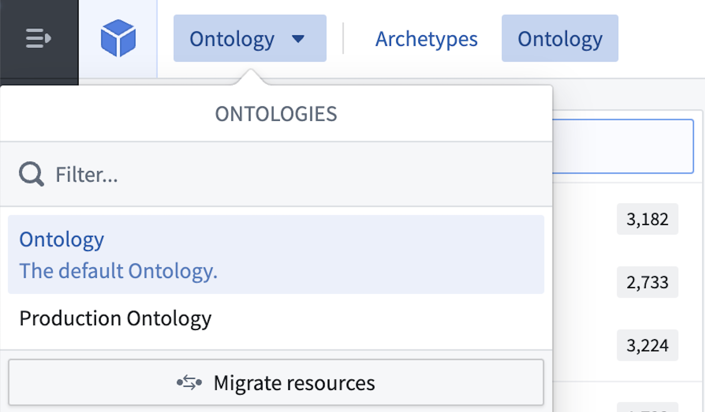
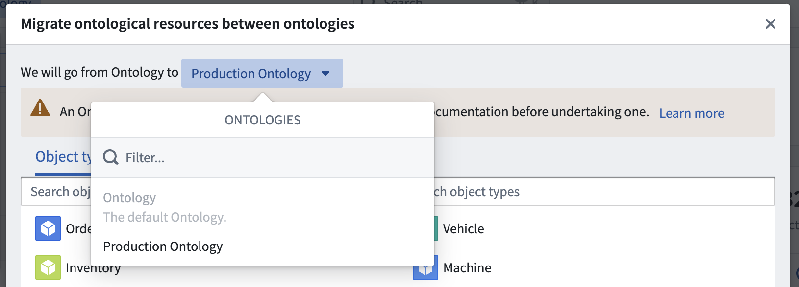
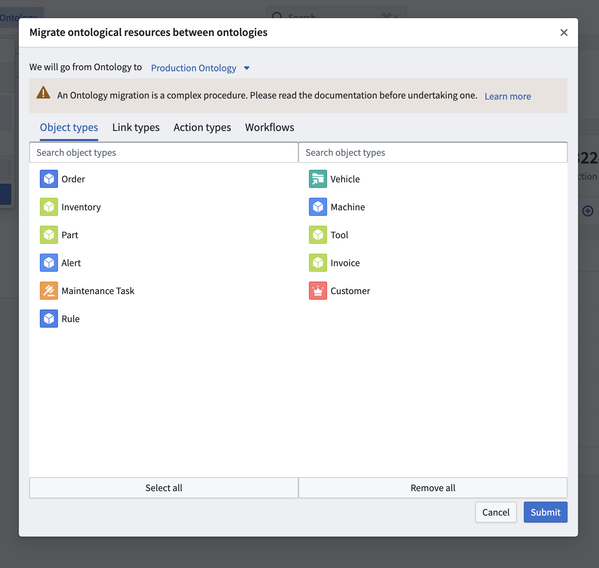

:::callout{theme="warning"}
注意：以下翻译的准确性尚未经过验证。这是使用 [AIP ↗](https://www.palantir.com/platforms/aip/) 从原始英文文本进行的机器翻译。
:::

# 在Ontologies之间迁移本体资源

每个本体资源都会自动链接到其创建的Ontology中。在创建后，资源可以在Ontologies之间移动。在Ontologies之间迁移资源时，也会更改资源的权限，但不会影响底层数据和输入数据源的权限。在Ontologies之间迁移Object时，所有编辑默认会被保留。

要将资源从一个Ontology迁移到另一个Ontology，请执行以下操作：

1. 通过位于**Ontology Manager**右上角的Ontology切换器导航到拥有资源的Ontology。

   

2. 在同一个Ontology中点击**迁移资源**以开始迁移过程。然后，使用Ontology选择下拉菜单在顶行中选择目标Ontology。

   

3. 选择要迁移的Object类型、链接类型、操作类型和工作流。要迁移资源的选择预览显示在其当前的Ontology（左侧）和目标Ontology（右侧）。请注意，无法将Object类型从私人Ontology迁移到默认Ontology，除非该Object类型最初是在默认Ontology中创建的。

   

:::callout{theme="warning" title="迁移到默认Ontology"}
确保您正在迁移连接的资源。如果选择中缺少相关的本体资源，迁移将失败。
:::

4. 完成选择后，点击**提交**以迁移资源。
