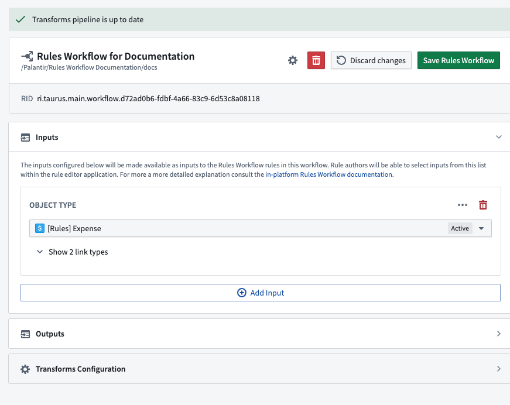
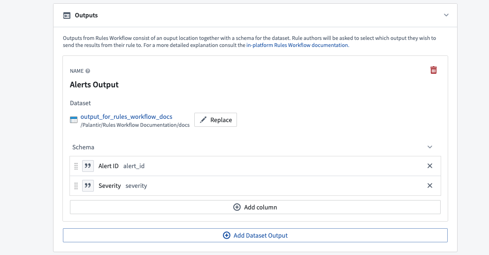
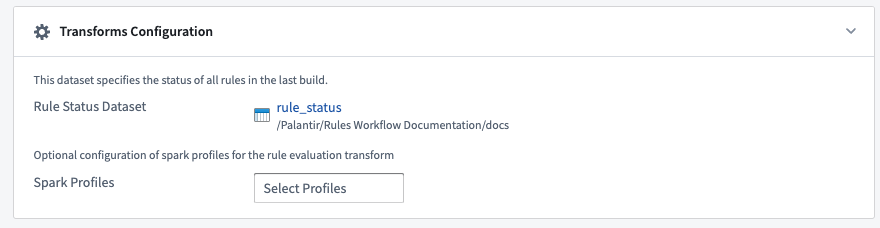
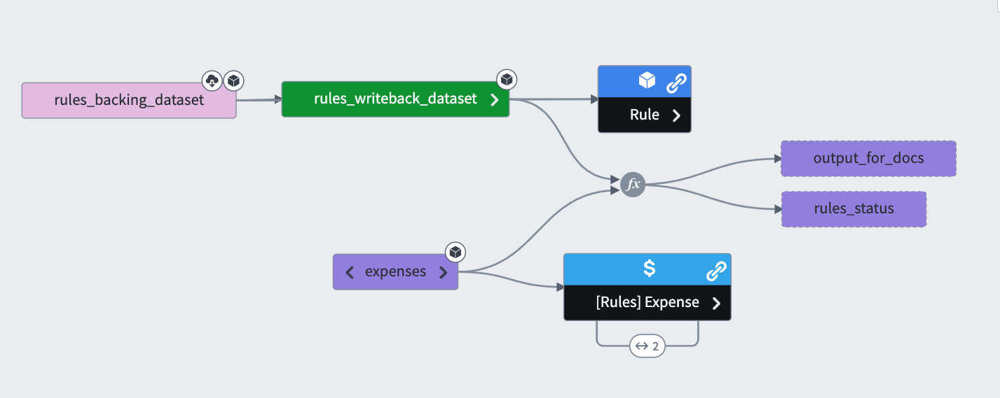

:::callout{theme="warning"}
注意：以下翻译的准确性尚未经过验证。这是使用 [AIP ↗](https://www.palantir.com/platforms/aip/) 从原始英文文本进行的机器翻译。
:::

# Foundry Rules 工作流配置

**工作流配置编辑器**用于更改整个 Foundry Rules 工作流的配置方式；例如，添加新的[输入](%E8%A7%84%E5%88%99%E9%80%BB%E8%BE%91.md#inputs)以便规则作者使用，或修改[工作流输出](#workflow-outputs)。一旦 Foundry Rules 工作流[部署](../Deploy/%E9%83%A8%E7%BD%B2%20Foundry%20Rules.md)后，可从[Ontology Manager](../../%E6%9C%AC%E4%BD%93%E7%AE%A1%E7%90%86%E5%99%A8/%E6%A6%82%E8%BF%B0.md)访问工作流配置编辑器。Foundry Rules 工作流与项目绑定，并作为资源显示在项目文件夹中。这控制了对工作流配置的权限，并允许用户重命名、移动或删除工作流。

## 工作流输入

如[规则逻辑输入](%E8%A7%84%E5%88%99%E9%80%BB%E8%BE%91.md#inputs)部分所述，配置编辑器的**输入**窗格是工作流所有者可以添加供规则作者使用的额外输入的地方。在添加 Object 输入时，所有者还可以选择希望提供的关联链接类型。

## 工作流输出

工作流输出指定所有 Foundry 规则输出的目的地和格式。每个输出对应一个不同的**Foundry 数据集**，当构建时，将包含所有引用它的 Foundry 规则的结果。在每个输出中，可以配置输出列的名称和类型。您还可以限制输出列[允许和默认接受的值](../Settings%20%26%20customization/%E5%85%81%E8%AE%B8%E5%92%8C%E9%BB%98%E8%AE%A4%E8%BE%93%E5%87%BA%E5%80%BC.md)。

## 变换配置

本节包含配置生成 Foundry 规则结果的**变换**的附加信息。它包括规则状态数据集的位置以及应用于变换的任何**Spark 配置文件**。该部分代表高级配置，首次设置 Foundry Rules 工作流时可以忽略。

## 规则执行

Foundry Rules 工作流配置还生成一个变换管道以应用规则。变换管道是规则生效的地方；例如，通过创建警报或分类/标记数据。下面的[数据沿袭](https://www.palantir.com/docs/foundry/data-lineage/overview/)图表概述了一个示例 Foundry Rules 管道；管道的确切结构取决于应用案例，并可能根据需求和情况显著变化。

该管道将支持[工作流输入](#workflow-inputs)的数据集与规则的数据输出数据集合并，并将这些规则应用于输入。然后，它将规则输出的行填充到由[工作流输出](#workflow-outputs)指定的输出数据集中。
