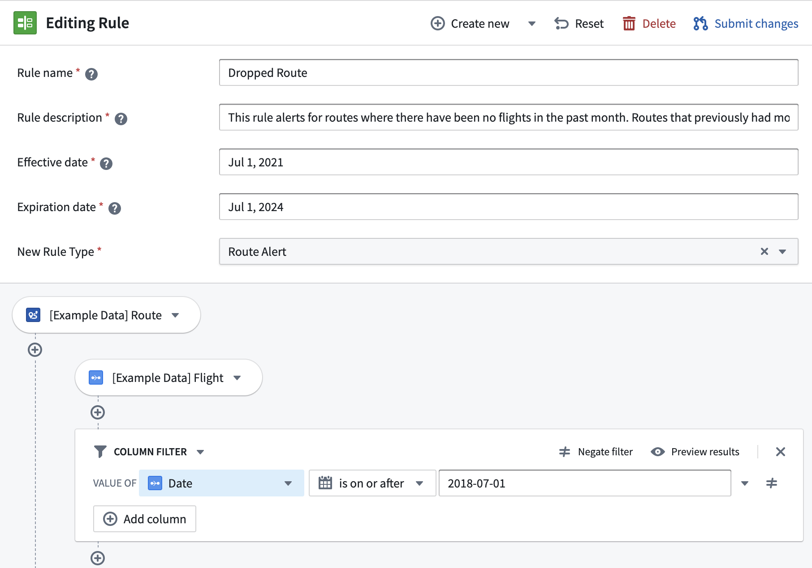
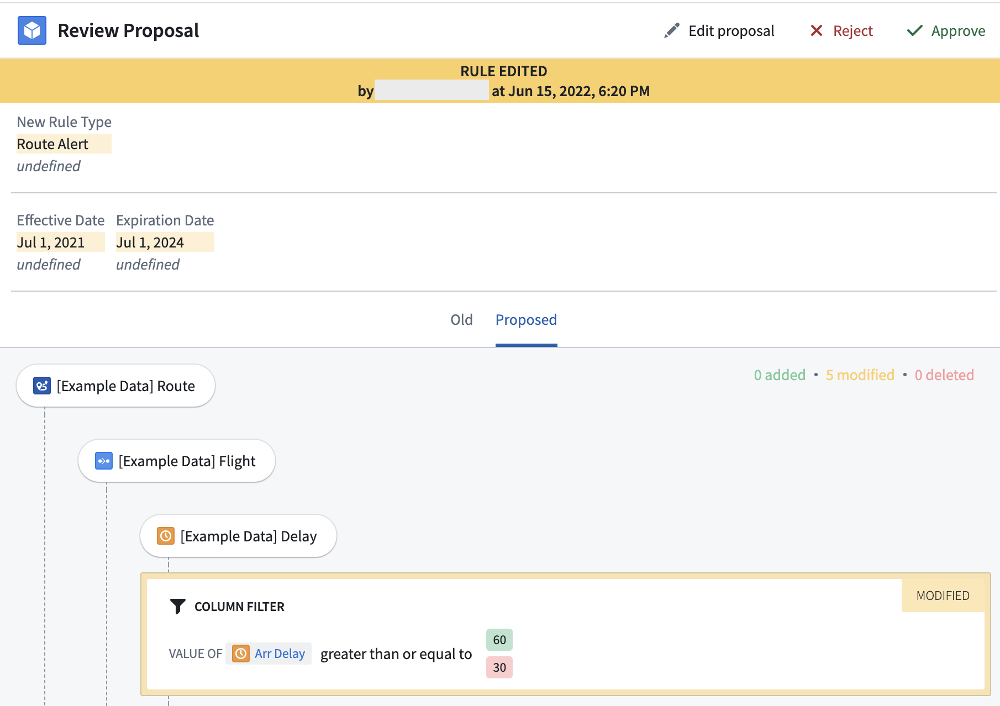

:::callout{theme="warning"}
注意：以下翻译的准确性尚未经过验证。这是使用 [AIP ↗](https://www.palantir.com/platforms/aip/) 从原始英文文本进行的机器翻译。
:::

# Object模型

有两个主要的Object模型概念与Foundry Rules相关：

* [规则](#rules)，应用于数据，和
* [提案](#proposals)，提供更改规则的方式。

### 规则

规则是标准的Object，由以下部分组成：

* 一组*规则元数据属性*，例如名称、描述、作者、规则类型等。
* 一组*自定义属性*，以应用于筛选后的数据集或传递给变换。
  * 对于“告警”模式，可能包括`alert_severity`、`alert_assignee`或`priority`。
  * 对于“分类”模式，可能包括`group`、`sub-group`等。
* 包含该规则匹配条件的*逻辑属性*。
  * 逻辑以压缩的JSON块存储，符合特定语法以确保一致的序列化。

了解如何为您自己的工作流[自定义属性](../Settings%20%26%20customization/%E6%B7%BB%E5%8A%A0%E8%87%AA%E5%AE%9A%E4%B9%89%E5%B1%9E%E6%80%A7.md)。

### 提案

许多规则管理应用案例都有相应的审计和审核流程要求，以管理规则的创建、编辑和删除。为满足这些需求，Foundry Rules支持**规则提案**，作为提交、审核和监控规则更改的方法。规则提案类似于软件开发概念中的[“拉取请求” ↗](https://en.wikipedia.org/wiki/Distributed_version_control#Pull_requests)，因此每个规则在给定时间可以有多个提案。

:::callout{theme="neutral"}
提案是Foundry Rules的一个功能，而不是一个要求。由于Foundry Rules使用标准Object和操作来创建此审批流程，因此可以根据需要自定义工作流，以匹配任何操作或监管要求的规则更改管理。
:::

提案被表示为包含以下内容的Object：

* 要编辑、创建或删除的*规则ID*。
* *提案元数据*，例如提案作者、时间戳、状态（开放、批准、拒绝）和审核员。
* 提案中的*更改差异*（即更改列表），以属性形式捕获：`old_rule_name`、`new_rule_name`、`old_logic`、`new_logic`等。

