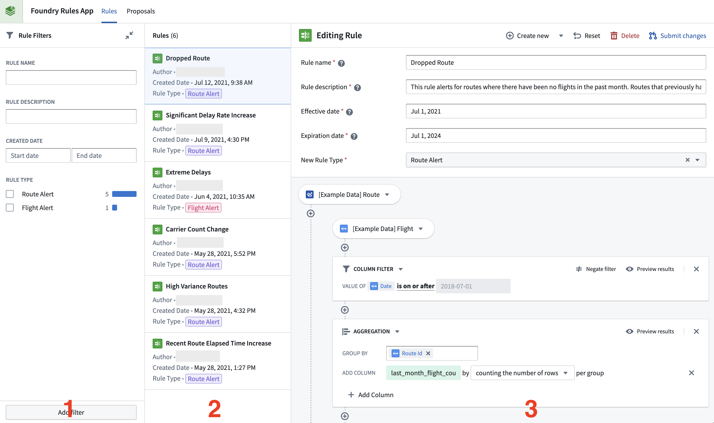
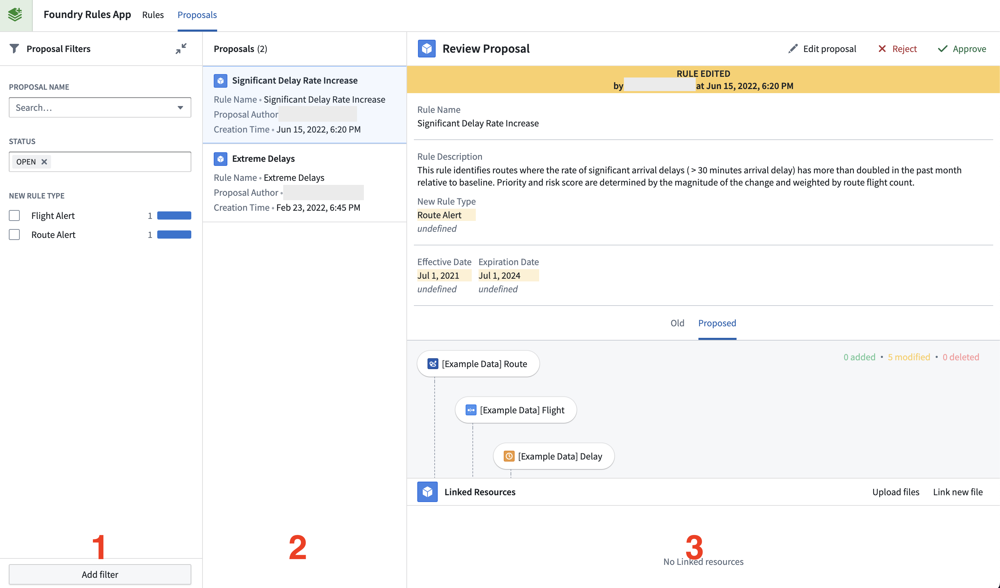

:::callout{theme="warning"}
注意：以下翻译的准确性尚未经过验证。这是使用 [AIP ↗](https://www.palantir.com/platforms/aip/) 从原始英文文本进行的机器翻译。
:::

# Workshop 应用

一个标准的 Foundry Rules 应用是一个 Workshop 应用，通常包括两个页面：规则编辑器页面和提案审核页面。

* **[规则编辑器](#rule-editor)** 页面用于创建、编辑和删除规则。
* **[提案审核](#proposal-reviewer)** 页面用于审查和批准/拒绝规则提案。

另外提供了一个 **规则查看器** 微件，用于创建一个只读规则逻辑查看器。

## 规则编辑器

规则编辑器页面的目的是允许创建和维护规则。下图显示了一个示例规则编辑器页面，其中包含以下微件（编号用于识别）：

1. **筛选列表：** 一组选定的筛选，用于筛选显示的规则。
2. **Object 列表：** 一个现有规则的列表，这些规则由筛选列表（1）筛选，并可以选择填充规则编辑器（3）。
3. **规则编辑器：** 一个接受 Foundry 操作的微件，用于创建提案并自动生成所需的字段参数。规则编辑器中显示的表单元素由用于创建新规则的 Ontology 中配置的操作决定。

   

在创建或编辑一个*规则*后，使用 **提交更改** 按钮创建一个新的*提案*。这个提案可以在提案审核页面查看和审查。

## 提案审核

提案审核页面允许对规则提案进行审查和批准/拒绝。与规则编辑器类似，它包含三个部分（在下面的截图中按编号标识）：

1. **筛选列表：** 一组选定的筛选，更改显示的提案（1）。
2. **Object 列表：** 一个提案的列表（2），由筛选列表筛选，可以选择填充提案审核器（3）。
3. **提案审核器：** 一个接受 Foundry 操作的微件，用于批准或拒绝提案。微件显示已编辑属性的差异， 更改的值显示为黄色，之前的值显示为浅灰色。当用户批准提案时，编辑将被应用，提案将被创建、编辑或删除（取决于提案）。

   
