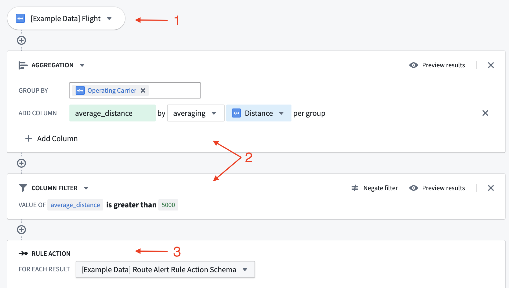
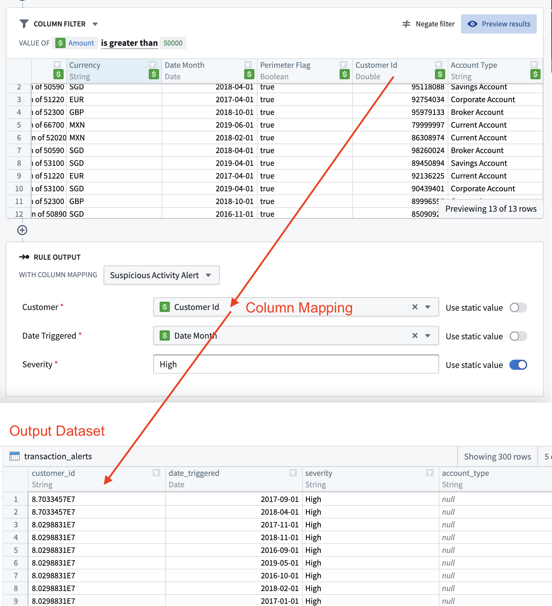

:::callout{theme="warning"}
注意：以下翻译的准确性尚未经过验证。这是使用 [AIP ↗](https://www.palantir.com/platforms/aip/) 从原始英文文本进行的机器翻译。
:::

# 规则逻辑

每个 Foundry 规则都关联有逻辑。该逻辑由三部分组成：

1. [输入:](#inputs) Foundry 规则的数据输入。
2. [逻辑块:](#logic-blocks) 应用于选定输入的变换。
3. [规则输出:](#rule-output) 规则的输出格式。

*所有截图使用的是假想数据。*

## 输入

Foundry 规则的输入可以是数据集或对象，具体取决于应用案例。然而，使用对象作为输入提供了更加用户友好的界面以及额外功能，例如筛选值的自动完成下拉菜单。

规则作者可用的数据集和对象由工作流所有者在[Foundry 规则工作流配置](Foundry%20Rules%20%E5%B7%A5%E4%BD%9C%E6%B5%81%E9%85%8D%E7%BD%AE.md)中进行配置。

:::callout{theme="warning"}
Foundry 规则不支持由多个数据源支持、具有多个物化视图或仅使用编辑属性的对象类型。
:::

:::callout{theme="neutral"}
受限视图支持的对象不能直接用作输入。相反，配置支持受限视图的数据集作为[备用支持数据集](../Deploy/%E9%85%8D%E7%BD%AE%E5%B7%A5%E4%BD%9C%E6%B5%81.md#alternate-backing-datasets)。
:::

## 逻辑块

应用于规则输入的变换表示为一系列逻辑块。可用的变换包括筛选、表达式、聚合和合并。还可以配置这些变换中的哪些对最终用户可用。了解更多关于[启用非必填功能](../Settings%20%26%20customization/%E5%90%AF%E7%94%A8%E9%9D%9E%E5%BF%85%E5%A1%AB%E5%8A%9F%E8%83%BD.md)。

每个逻辑块从前一个块/源输出的行中获取数据并应用变换，输出一组新的行和列。可以通过点击块右上角的**预览**按钮查看输出。

## 规则输出

规则末尾是规则输出。每个规则输出对应一个输出数据集，如在[Foundry 规则工作流配置](Foundry%20Rules%20%E5%B7%A5%E4%BD%9C%E6%B5%81%E9%85%8D%E7%BD%AE.md)中配置的。所选输出因此指定了 Foundry 规则输出行的目标和格式。每个字段的界面可以[根据其接受的值类型进行定制](../Settings%20%26%20customization/%E5%85%81%E8%AE%B8%E5%92%8C%E9%BB%98%E8%AE%A4%E8%BE%93%E5%87%BA%E5%80%BC.md)。*生成的输出数据集将包含使用该输出的所有规则输出的行*。此行为旨在简化不同规则输出的一致性。

规则输出允许工作流所有者强制执行规则作者必须从其逻辑中输出的确切列和类型。视觉上，这种强制执行表示为一个表单，其中每个表单输入对应于输出数据集中的一列。

如果同一应用程序中的不同 Foundry 规则必须输出具有不同模式的行，则可以配置多个不同规则输出的选择。或者，如果模式相似，则可以更容易地将一些操作参数配置为非必填，而不是创建新的规则操作。

了解更多关于[配置规则输出](Foundry%20Rules%20%E5%B7%A5%E4%BD%9C%E6%B5%81%E9%85%8D%E7%BD%AE.md#workflow-outputs)。

