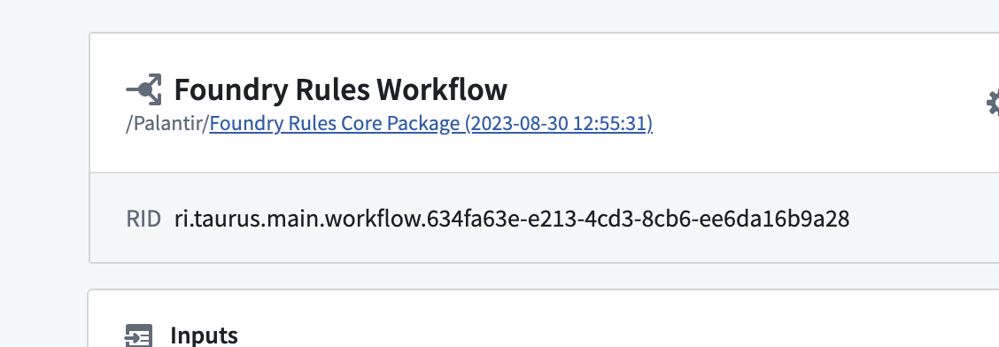
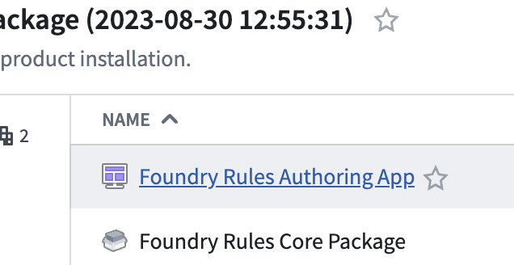
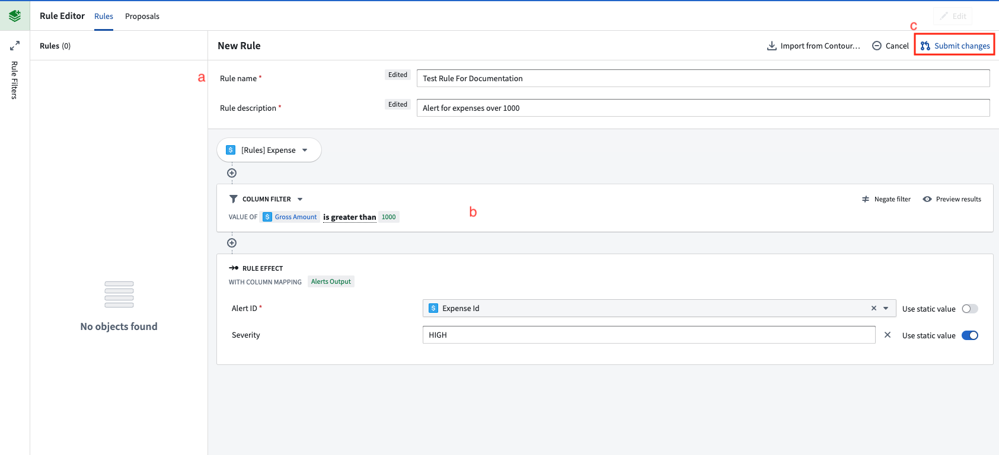
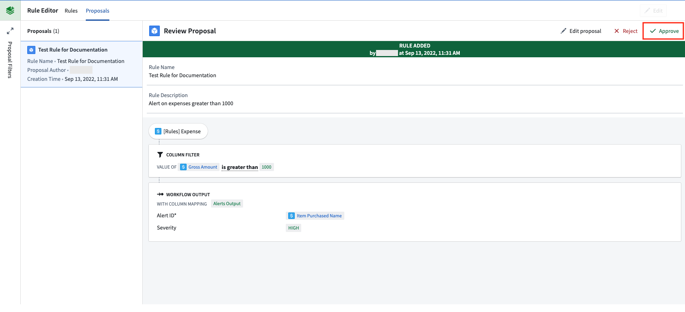
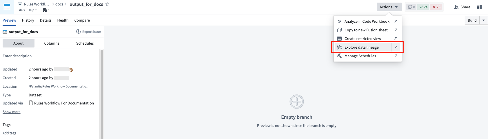
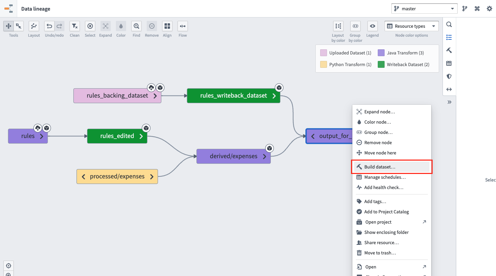

:::callout{theme="warning"}
注意：以下翻译的准确性尚未经过验证。这是使用 [AIP ↗](https://www.palantir.com/platforms/aip/) 从原始英文文本进行的机器翻译。
:::

# 编写并运行规则

以下步骤将指导您在Workshop应用程序中编写和运行规则的过程。

1. **找到Workshop Rule应用程序：** 从工作流配置屏幕中，选择文件夹并选择Workshop应用程序。

2. **编写规则：** 在上一步创建的Workshop应用程序中，点击**创建新建**按钮开始创建规则。

   * (a) 在规则顶部的表单中填写名称、描述和其他信息。
   * (b) 编写您希望规则执行的逻辑。例如，这可以是一个简单的筛选。
   * (c) 点击**提交更改**以为此新规则创建一个提案。

   

3. **批准提案：** 在Workshop应用程序的**提案**选项卡内，选择左侧新创建的提案。

   * 选择**批准**以激活它作为规则。

   

4. **搭建规则数据输出和规则输出数据集：** 导航到[配置工作流](%E9%85%8D%E7%BD%AE%E5%B7%A5%E4%BD%9C%E6%B5%81.md)时创建的输出数据集。

   * 选择**操作**，然后**探索数据沿袭**以查看输入数据集。

   

   * 选择规则数据输出数据集(d)和输出数据集(e)。
   * 右键点击选择的两个数据集并选择**搭建**。

   

   * 一旦搭建完成，输出数据集将包含您新规则的结果。未来，这两个数据集可以被放置在一个[计划](https://www.palantir.com/docs/foundry/data-lineage/manage-schedules/)上以保持输出的更新。
