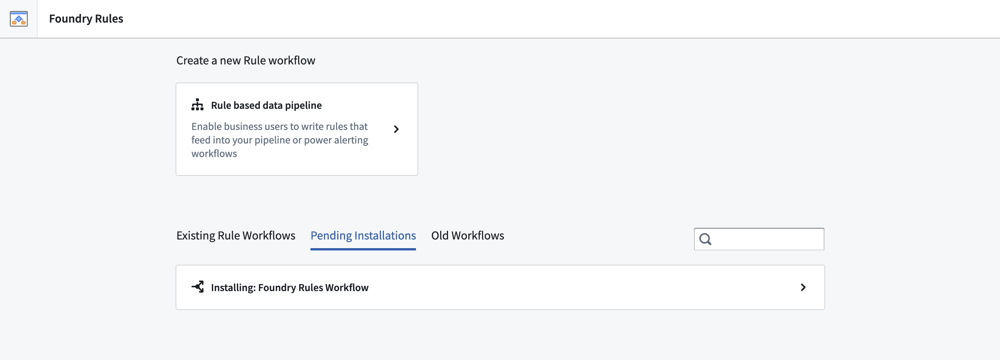
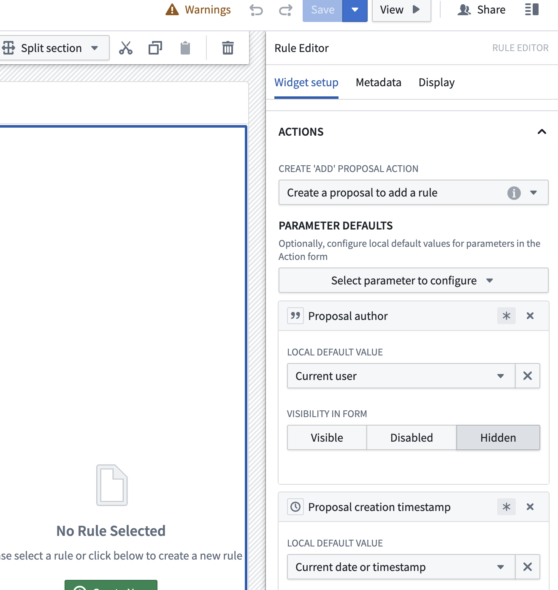
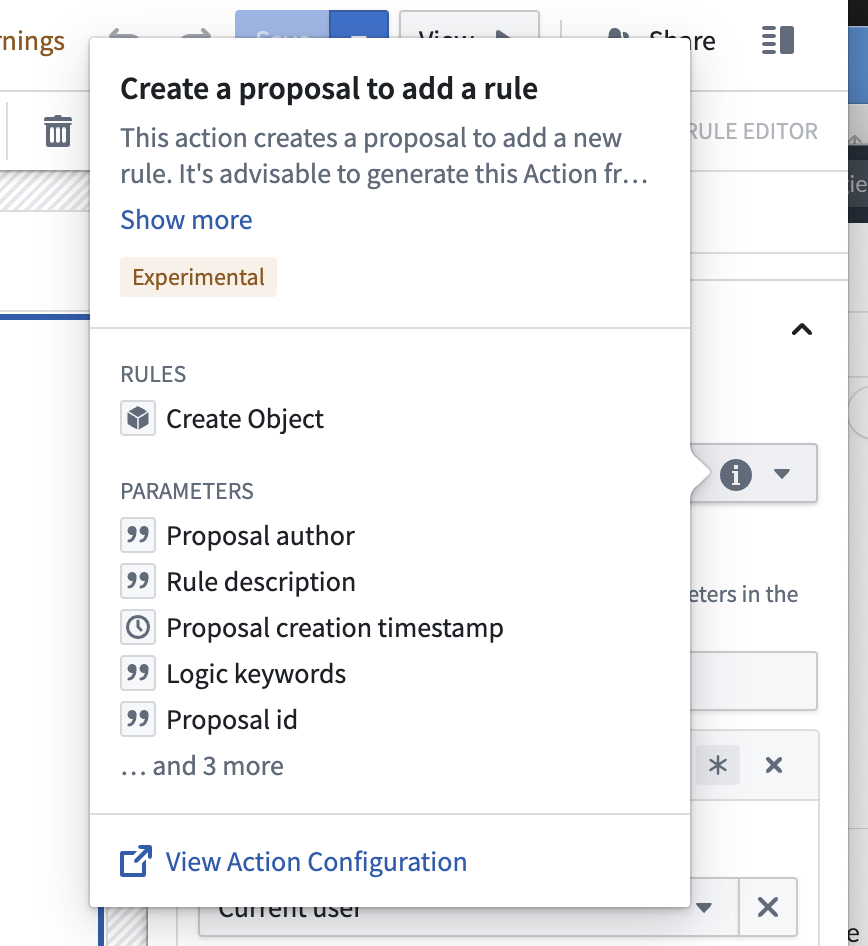

:::callout{theme="warning"}
注意：以下翻译的准确性尚未经过验证。这是使用 [AIP ↗](https://www.palantir.com/platforms/aip/) 从原始英文文本进行的机器翻译。
:::

# 部署工作流

您可以从Rules应用程序中部署一个新的Foundry Rules工作流。在应用程序中，为您的工作流生成[必需的Object](../Core%20concepts/Object%E6%A8%A1%E5%9E%8B.md)和操作。

1. **部署新的Rules工作流：** 在侧边栏中找到并选择Foundry Rules应用程序，然后选择**基于规则的数据管道**。

   

2. **提供配置：** 应用程序将为您创建一个新项目，其中包括相关的支持数据集、Foundry Rules工作流和Workshop应用程序资源。

   

   * 选择相关的[空间](https://www.palantir.com/docs/foundry/security/orgs-and-spaces/)。
   * 选择相关的[Ontology](../../../Ontology%E6%90%AD%E5%BB%BA.md)。如果您有多个Ontology，请选择包含您想要定义规则的所有Object类型的Ontology。
   * 规则编辑器组用于操作的提交标准。此组中的用户可以创建提案以添加、编辑、删除规则，并决定提案。此配置作为起始点，因为您可以稍后在规则操作上配置提交标准。要更改操作类型上的提交标准，请查看[FAQ](#faq)。

3. **部署：** 完成字段后，选择**部署**。部署过程在后台大约需要两到三分钟，此期间您可以安全地导航离开。待定和已完成的安装可以在主页面的**待定安装**或**现有规则工作流**下找到。所有工作流在现有工作流列表中都有默认名称“Foundry Rules Workflow”和时间戳。您可以通过重命名项目文件夹中的相应资源来重命名工作流。

   

完成上述步骤后，学习如何[配置工作流](%E9%85%8D%E7%BD%AE%E5%B7%A5%E4%BD%9C%E6%B5%81.md)。

## 常见问题

### 如何更改操作类型上的提交标准？

要更新操作类型上的提交标准，请导航到Workshop应用程序，选择**编辑**。然后，查看右侧的规则编辑器配置面板，如下所示。

然后，将光标悬停在与**创建添加提案操作**的“创建添加规则的提案”下拉选项行内的“i”图标上。

从新的弹出窗口中，选择**查看操作配置**。

从这里，您将能够更改[提交标准](../../../%E5%AE%9A%E4%B9%89%E6%9C%AC%E4%BD%93/%E5%8A%A8%E4%BD%9C%E7%B1%BB%E5%9E%8B/%E6%8F%90%E4%BA%A4%E6%A0%87%E5%87%86.md)。
