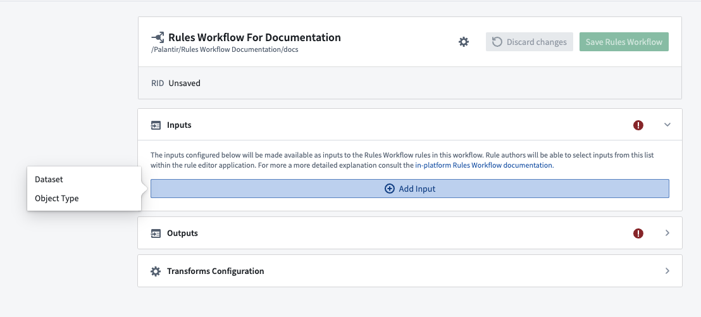
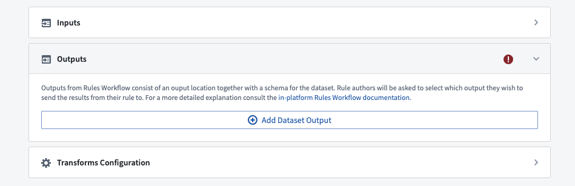
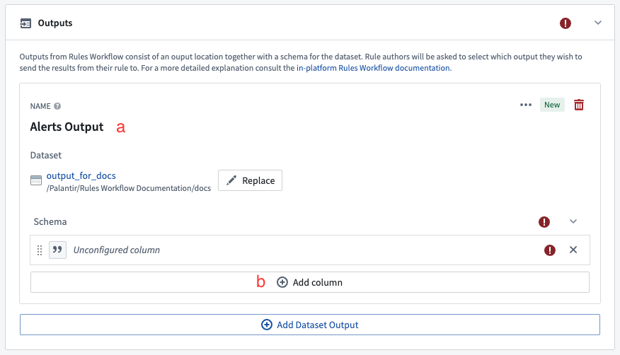
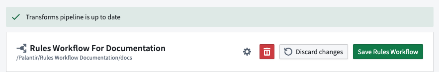
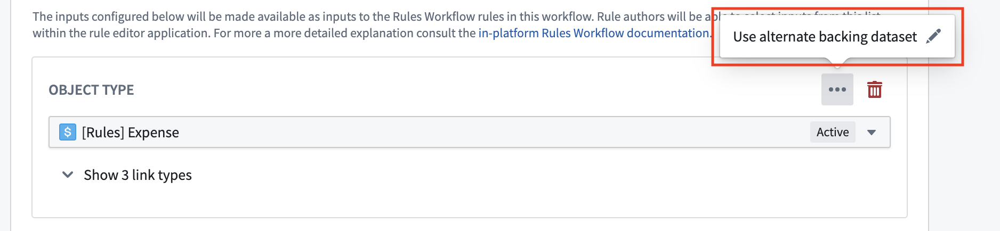

:::callout{theme="warning"}
注意：以下翻译的准确性尚未经过验证。这是使用 [AIP ↗](https://www.palantir.com/platforms/aip/) 从原始英文文本进行的机器翻译。
:::

# 配置工作流

完成[部署工作流模板](%E9%83%A8%E7%BD%B2%E5%B7%A5%E4%BD%9C%E6%B5%81.md)后，以下步骤将指导您完成[配置工作流](../Core%20concepts/Foundry%20Rules%20%E5%B7%A5%E4%BD%9C%E6%B5%81%E9%85%8D%E7%BD%AE.md)的过程。

1. **访问现有规则：** 从Foundry Rules主页中，通过选择项目从现有规则列表中选择一个。或者，您也可以在**文件**中找到相应项目并选择它。

   

2. **添加工作流输入：** 查看规则时，选择**添加输入**按钮以添加Object或数据集输入到工作流中。这将成为下一部分中编写的规则的输入。

   * 您可以在此处添加任意数量的输入，但所有工作流必须至少包含一个输入。
   * 当添加Object类型输入时，链接类型部分将显示在每个Object类型下方。选择的任何链接将在[规则管理应用程序](../Core%20concepts/Workshop%20%E5%BA%94%E7%94%A8.md)中用于合并不同的Object。

   

:::callout{theme="neutral"}
受限视图支持的Object不能直接用作输入。相反，将支持受限视图的数据集配置为[备用支持数据集](%E9%85%8D%E7%BD%AE%E5%B7%A5%E4%BD%9C%E6%B5%81.md#alternate-backing-datasets)。
:::

3. **添加工作流输出：** 在编辑器的第三部分，点击**添加数据集输出**并提供数据集的名称和位置，以输出规则结果。

   

   * 提供将在**规则管理应用程序**中显示给规则作者的输出名称 (a)。
   * 点击**添加列**以向输出添加至少一列 (b)。为此列提供一个将在数据集中使用的名称和一个将在规则应用程序中显示给规则作者的显示名称。您可以配置列的类型并确定在编写规则时是否需要提供此列。了解更多关于[允许和默认输出值](../Settings%20%26%20customization/%E5%85%81%E8%AE%B8%E5%92%8C%E9%BB%98%E8%AE%A4%E8%BE%93%E5%87%BA%E5%80%BC.md)的信息。
   * 为您希望从规则结果中捕获的每条信息添加一列。例如，警报工作流可能包含`Alert ID`、`Severity`和`Assignee`的列，以及捕获触发警报的Object的标识符的列（例如`Machine ID`）。

   

4. **保存工作流：** 在配置编辑器的右上角，点击保存按钮。

   * 保存工作流后，您应该会看到编辑器顶部出现绿色横幅，表示[变换管道](../Core%20concepts/Foundry%20Rules%20%E5%B7%A5%E4%BD%9C%E6%B5%81%E9%85%8D%E7%BD%AE.md#rule-execution)已成功创建。

   

完成上述步骤后，了解如何[编写和运行规则](%E7%BC%96%E5%86%99%E5%B9%B6%E8%BF%90%E8%A1%8C%E8%A7%84%E5%88%99.md)。

## 高级配置

### 备用支持数据集

您可以为Object输入配置备用支持数据集。这意味着您的规则将在提供的备用支持数据集上进行评估，而不是在Ontology中配置的数据输出（或支持）数据集上。

这在以下情况中很有用：

* 编写基于受限视图的Object的规则
* 在Object的支持数据的子集上运行规则

