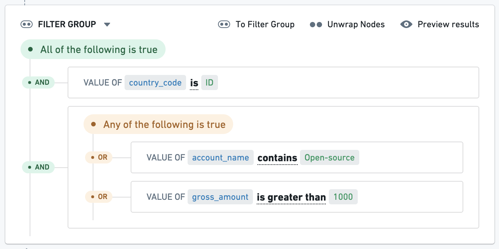

:::callout{theme="warning"}
注意：以下翻译的准确性尚未经过验证。这是使用 [AIP ↗](https://www.palantir.com/platforms/aip/) 从原始英文文本进行的机器翻译。
:::

# Foundry Rules

Foundry Rules（以前称为Taurus）通过点选、低代码界面使用户能够在Foundry中主动管理复杂的业务逻辑。借助Foundry Rules，用户可以创建规则并将这些规则应用于数据集、Objects和时间序列，以支持多种应用案例，如警报生成或数据分类。

Foundry Rules包括一组用于创建、管理和应用规则的组件：

* **规则** 是一组 *条件*，共同作用可以指定数据集中特定的数据行。
* 形成规则的 **条件** 应用于数据集的列，可以从简单的筛选到复杂的聚合、合并或其他运算符。

以下页面描述了几个[核心概念](Core%20concepts/%E6%A6%82%E8%BF%B0.md)，并提供了有关如何[部署](Deploy/%E9%83%A8%E7%BD%B2%20Foundry%20Rules.md)和[自定义](Settings%20%26%20customization/%E5%AE%9A%E5%88%B6%20Foundry%20Rules.md) Foundry Rules的说明。

## 应用案例示例

Foundry Rules可以简化涉及复杂规则集的应用案例管理过程，例如：

* **反洗钱（AML）：** 通过针对每笔交易和聚合指标的规则标记可疑交易。
* **设备监控：** 根据传感器数据（例如，当某些测量值达到特定值时）提升潜在设备退化的警报。
* **分组：** 根据规则将实体分类到组或“群组”中。例如，创建具有特定特征的客户组以便更好地进行目标营销。
