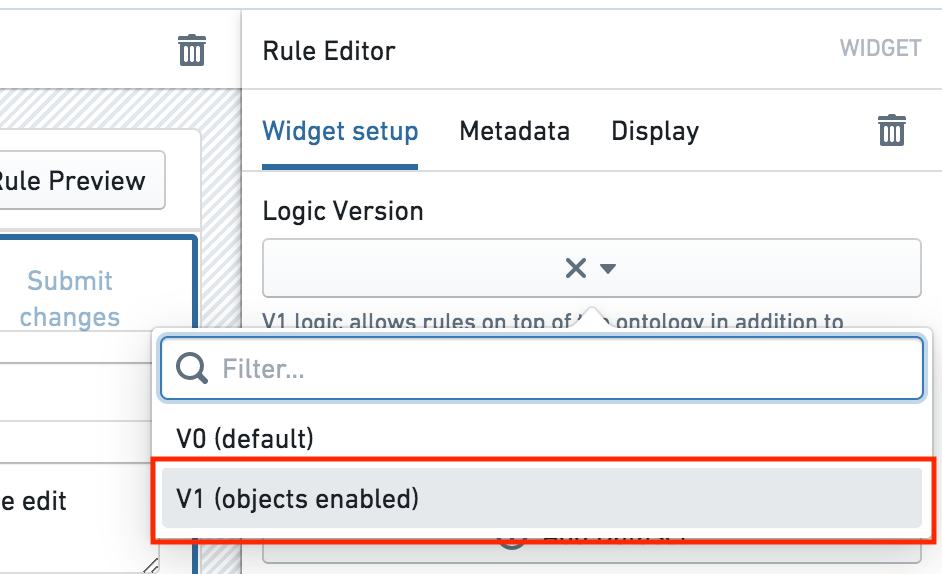
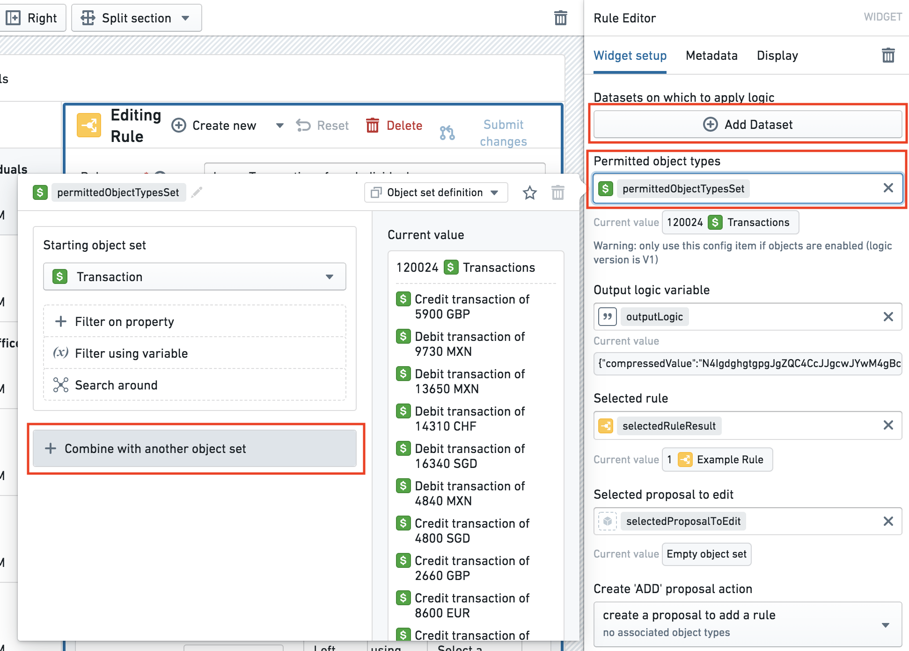
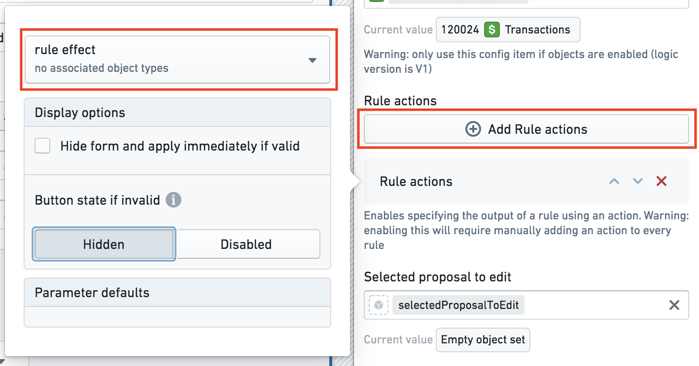

:::callout{theme="warning"}
注意：以下翻译的准确性尚未经过验证。这是使用 [AIP ↗](https://www.palantir.com/platforms/aip/) 从原始英文文本进行的机器翻译。
:::

# 升级以使用规则操作

:::callout{theme="warning"}
这些步骤适用于旧版本的Foundry Rules（以前称为Taurus）。如果您刚刚开始部署Foundry Rules，那么以下步骤是不必要的，并且已包含在[默认设置](../Deploy/%E9%83%A8%E7%BD%B2%20Foundry%20Rules.md)中。除非您被特别指示查看此部分，否则您可能不需要遵循这些步骤。
:::

之前，Foundry Rules仅支持数据集[输入](../Core%20concepts/%E8%A7%84%E5%88%99%E9%80%BB%E8%BE%91.md#inputs)到规则中，并且没有[规则操作](%E9%85%8D%E7%BD%AE%E8%A7%84%E5%88%99%E6%93%8D%E4%BD%9C.md)的概念。虽然在对象上编写规则是一个非必填功能，但我们强烈建议升级以使用**规则操作**，特别是如果您升级以使用对象。

要在Foundry Rules中启用对象和规则操作，请按照以下步骤操作：

*所有截图使用的是假想数据。*

1. **升级您的Foundry Rules变换库版本：** 确保在项目级别的`build.gradle`文件中，`tau-execution:tau-execution-core`的版本*至少*为`0.60.4`：
   * `compile "com.palantir.tau-execution:tau-execution-core:0.60.4"`
   * 如果找不到`build.gradle`文件，请在**文件**侧边栏中的齿轮图标下检查**显示隐藏文件和文件夹**选项。

2. **更新逻辑版本：** 在Foundry Rules工作坊应用程序中使用编辑模式，导航到**规则编辑器微件**并将**逻辑版本**更改为"V1"。虽然更改此选择器没有破坏性效果，但在更改为V1后无法将版本更改回V0。然而，返回到V0没有任何好处。

    

3. **将对象添加到工作坊应用程序：** 在同一个工作坊应用程序中，将您希望在Foundry Rules中可用的任何对象类型添加到**允许的对象类型**对象集变量中。该变量应为您希望公开的所有对象类型的合并对象集，如下所示。

   * 如果您正从数据集切换到对应的对象，那么您应该在Foundry Rules中保持数据集可用，直到所有现有规则已迁移以使用该对象。然而，没有必要立即切换为使用该对象，因为变换可以继续在两个声明的情况下工作。

    

4. **添加规则操作：** 在[Ontology管理器](../../%E6%9C%AC%E4%BD%93%E7%AE%A1%E7%90%86%E5%99%A8/%E6%A6%82%E8%BF%B0.md)中创建合适的Foundry操作后，通过点击**添加规则操作**将操作添加到工作坊应用程序中。

   了解更多关于[配置](%E9%85%8D%E7%BD%AE%E8%A7%84%E5%88%99%E6%93%8D%E4%BD%9C.md)规则操作的信息。

    

   :::callout{theme="neutral"}
   将规则操作添加到工作坊配置后，所有现有规则在下次编辑时将需要您配置规则操作。然而，重要的是要注意，即使没有为每个规则配置规则操作，旧的变换管道也将继续工作。因此，与迁移相关的停机时间为零，迁移可以按照用户适合的节奏进行。
   :::

5. **更新变换管道代码：** 更新变换管道的最简单方法是通过在Ontology管理器中添加缺少的对象和操作来更新您现有的规则工作流程模板实例。然后，部署更新后的变换以用作参考。在部署参考后，您可以[配置变换管道](%E9%85%8D%E7%BD%AE%E5%8F%98%E6%8D%A2%E7%AE%A1%E9%81%93.md)以将此新代码映射到您现有的工作流程。

   :::callout{theme="neutral"}
   如上所述，为了使新的变换代码工作，所有规则必须配置规则操作。因此，我们建议在分支上进行变换更改，并在合并之前测试这些变换更改。
   :::
