:::callout{theme="warning"}
注意：以下翻译的准确性尚未经过验证。这是使用 [AIP ↗](https://www.palantir.com/platforms/aip/) 从原始英文文本进行的机器翻译。
:::

# 迁移到 Foundry Rules

尽管长期支持Taurus持续进行中，但一些组织可能希望将现有的Taurus工作流迁移到Foundry Rules，以便从附加功能中受益，例如更容易进行更改和执行管道维护，以及进一步的开发更新。请注意，Taurus仍继续获得长期支持。

通过将Taurus应用案例迁移到Foundry Rules，您可以受益于：

* 简化的部署，可以在一个Foundry Rules配置页面上完成，仅需几分钟。
* 通过对Foundry Rules配置的一步更改进行修改和维护。
* 即时执行，无需与管道代码交互，包括流式工作流。
* 内置代码生成器，支持需要自定义管道代码的高级Foundry Rules应用案例。

最佳的Foundry Rules工作流针对一个特定的应用案例，并包含一个您希望用户撰写的规则类型。如果您有多个用户组和多个规则撰写应用程序，可以考虑通过多次使用迁移向导创建多个规则工作流。

## 迁移注意事项

在迁移到Foundry Rules之前，请考虑以下事项：

* 如果您将Taurus用作更大的产品供应，例如供应链优化、反洗钱或用于汽车行业的QMOS，目前无需进行迁移。

* 如果您有一个复杂的Taurus应用案例，包括以下任意组合，迁移将需要一些重构工作，您应权衡之前概述的好处和所需更改的程度：
  * 您的Taurus工作室模块有多个规则编辑器微件，为不同的用户组配置不同。
  * 您的Taurus库使用了Taurus包的高级功能或以特定方式应用了规则逻辑。使用中的高级功能的一个例子可能是库运行提议以创建潜在影响分析。
  * 您的[规则操作](%E9%85%8D%E7%BD%AE%E8%A7%84%E5%88%99%E6%93%8D%E4%BD%9C.md)实现了非必填可见性、使用object定位器、对象集或附件字段类型。

* 如果您正在积极添加更多输入数据集、对象类型或规则输出到您的Taurus应用案例中，Foundry Rules提供的新配置界面可能会增加可维护性。即使您选择将Java库与Foundry Rules工作流结合使用，也会受益于部分代码生成。

### 将Taurus工作流迁移到Foundry Rules工作流

以下过程使用您现有的对象类型和工作室模块，但会创建一个并行管道和新的输出数据集，以防止对正在运行的管道造成干扰。

在升级到V2时，将执行以下过程：

* 检查工作流中的时间序列
* 升级现有应用程序
* 如有必要，取消链接旧应用程序
* 需要手动操作以完成迁移

要开始，请按照以下说明进行操作：

1. 从Foundry工作区导航侧栏进入**Foundry Rules**，然后进入**旧工作流**选项卡。

2. 选择Ontology，并从列表中找到V1原型，或使用搜索字段。

   

3. 选择**从旧版本迁移**。

4. 选择主要规则编辑器工作室资源，并查看保存新Foundry Rules工作流的目标文件夹。如有必要，请重命名工作流。然后，选择**开始**。

   

5. Foundry Rules迁移向导将检查您的现有设置中是否包含[时间序列](../Time%20series/%E6%97%B6%E9%97%B4%E5%BA%8F%E5%88%97%E8%A7%84%E5%88%99.md)。如果是，您将需要配置链接类型和时间序列同步。一旦完成附加配置，选择**保存规则工作流**。

   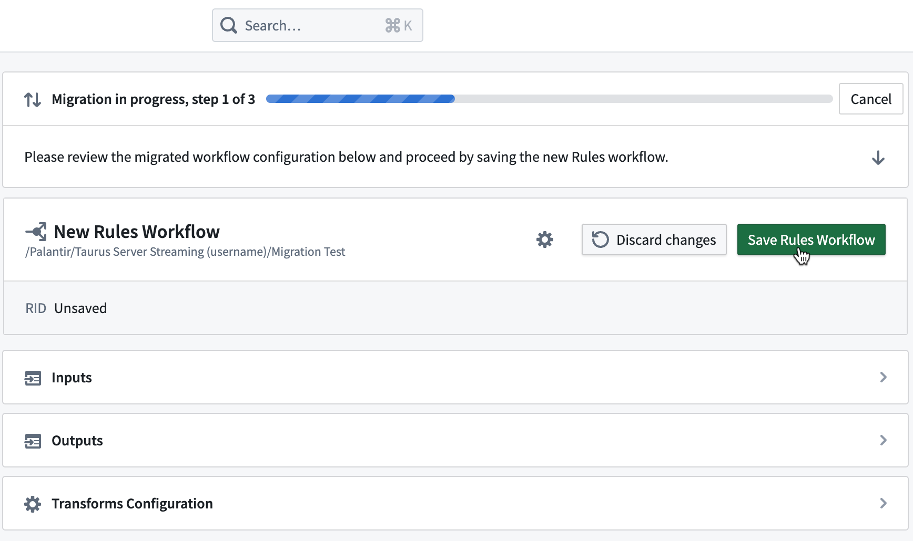

6. 某些资源可能需要导入项目。查看并展开以验证资源列表，然后完成所需的屏幕操作，然后选择**保存**。

    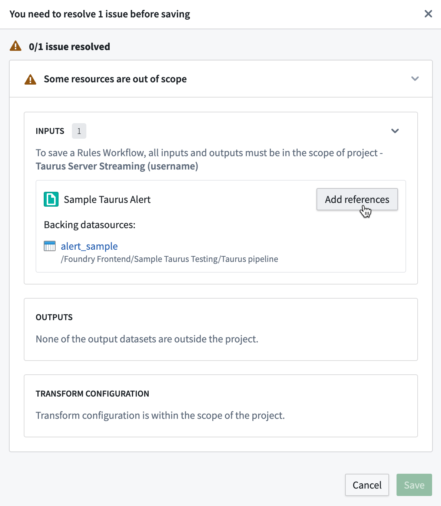

    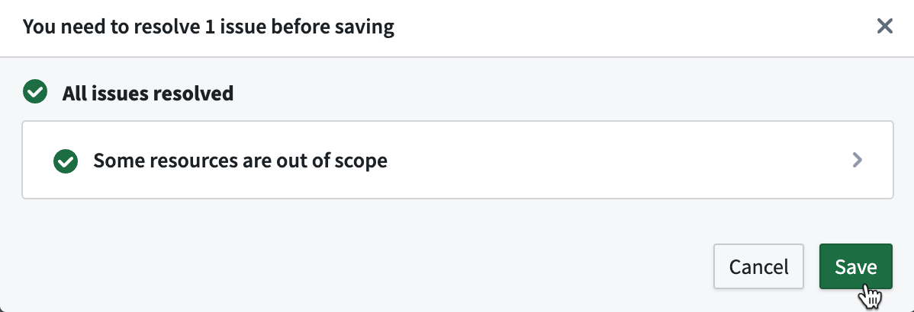

7. 选择**升级规则应用程序**。

    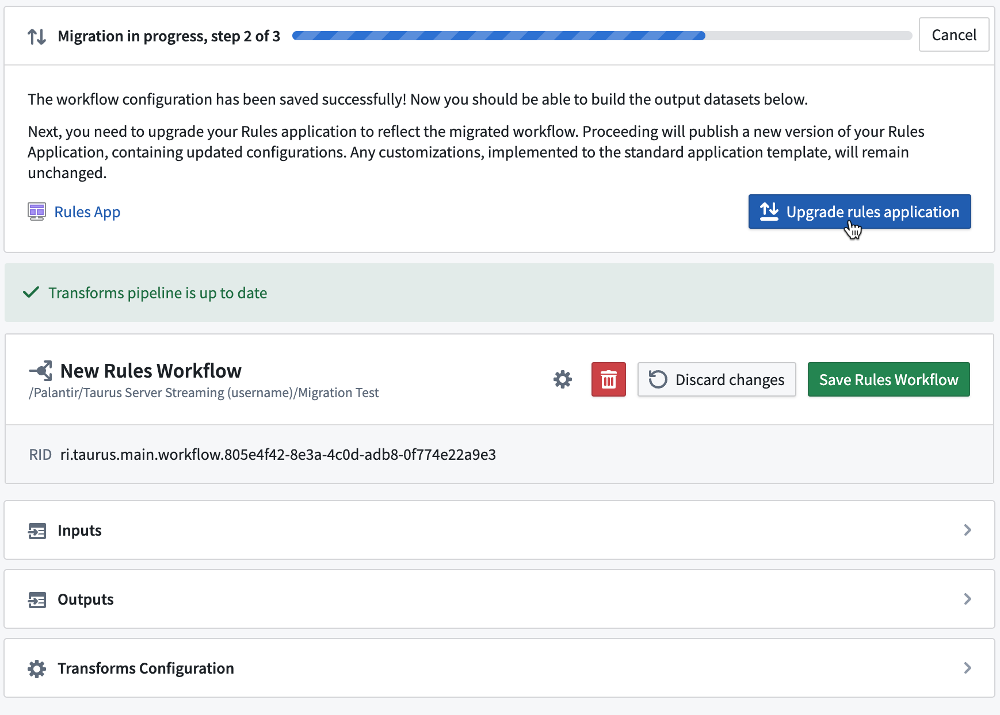

8. 如果要求，选择**取消链接旧应用程序**。

    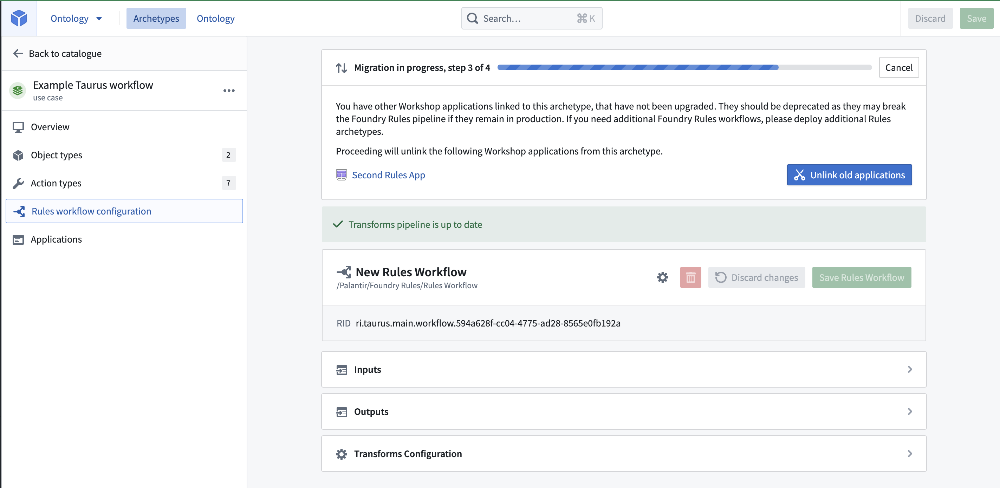

9. 最后，注意屏幕上的指导，并根据您的应用案例为新升级的管道遵循适当的说明：

    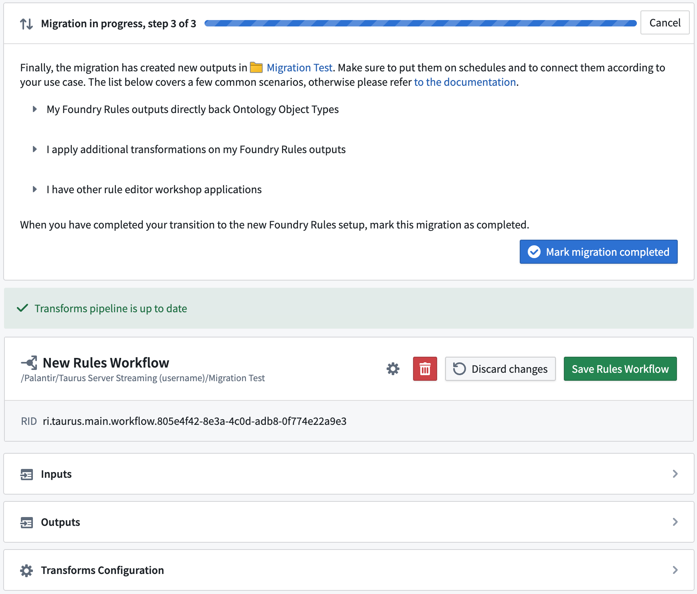

   * 我的Foundry Rules输出直接传输到Ontology对象类型。
     * 如果您的输出直接传输到Ontology对象类型（例如，没有任何附加变换），则需要替换该对象类型的[对象支持数据集](../../../%E5%AE%9A%E4%B9%89%E6%9C%AC%E4%BD%93/%E5%AF%B9%E8%B1%A1%E9%93%BE%E6%8E%A5%E7%B1%BB%E5%9E%8B/Object%20types/%E5%88%9B%E5%BB%BA%20Object%20%E7%B1%BB%E5%9E%8B.md#add-a-backing-datasource-to-a-new-object-type)，以便警报将来自新版本的Foundry Rules。

:::callout{theme="warning"}
此选项将导致[对象编辑丢失，如果对象类型是V1](../../../%E5%AE%9A%E4%B9%89%E6%9C%AC%E4%BD%93/%E5%AF%B9%E8%B1%A1%E9%93%BE%E6%8E%A5%E7%B1%BB%E5%9E%8B/Object%20types/%E7%BC%96%E8%BE%91Object%E7%B1%BB%E5%9E%8B.md)。否则，如果您必须保留编辑，您可以[保留支持数据集 ↗](https://stackoverflow.com/questions/72477419/how-to-safely-delete-an-object-property-without-losing-the-object-edits)，并确保其内容是新规则输出的直接副本。
:::

* 我对Foundry Rules输出应用了附加变换。
  * 您应该使用新的输出数据集替换转换中的先前规则输出。对于高级应用案例，您可以注册一个[自定义库来计算规则输出](../Settings%20%26%20customization/%E8%87%AA%E5%AE%9A%E4%B9%89%E6%82%A8%E7%9A%84%20Foundry%20Rules%20%E6%B5%81%E6%B0%B4%E7%BA%BF.md)。
* 我有其他规则编辑器工作室应用程序。
  * 如果您的规则编辑器具有相同的输入和输出，您可以让所有编辑器引用此规则工作流。您可以使用原型的部署菜单在左侧的**应用程序**选项卡中部署更多规则编辑器工作室应用程序。如果您的规则编辑器服务于不同的应用案例并且具有不同的配置，您应该通过部署新的规则原型在专用工作流中迁移每一个。

10. 一旦完成步骤，选择**标记迁移完成**。您的应用案例现在在新的Foundry Rules设置中已可操作。

## 验证迁移

要检查迁移到Foundry Rules是否成功，访问保存规则输出数据集的项目链接。

打开规则输出数据集并选择**搭建**或进入计划选项卡并**添加搭建计划**。

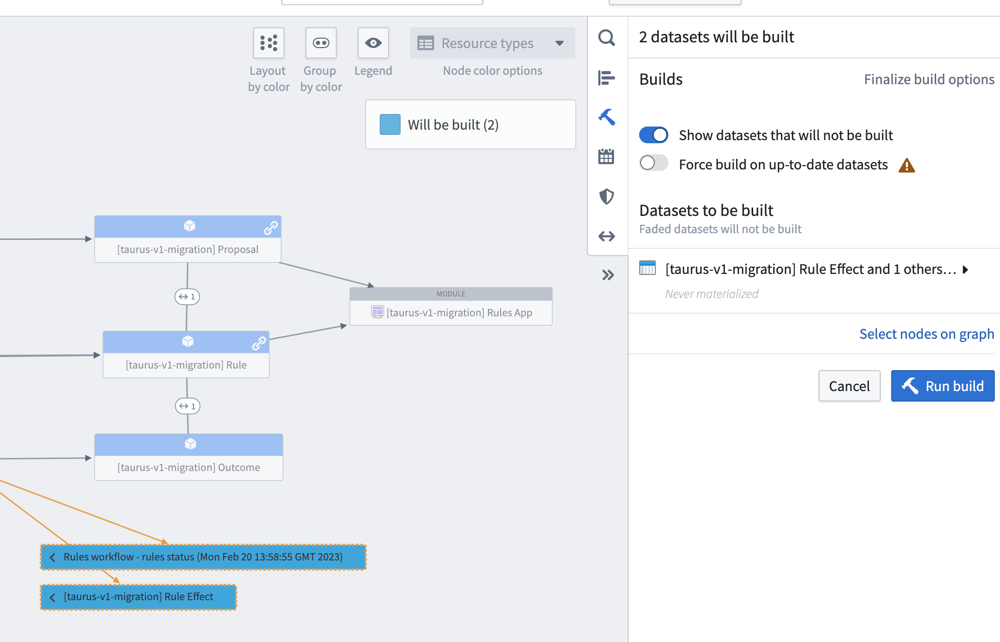

成功的搭建表示升级过程到Foundry Rules已成功完成。

## 常见问题

* 我被警告说我的输出包含在V2中不同的配置。我该如何解决？

操作类型表单可以配置为接受各种类型的输入。这可以是简单的数字或日期，也可以是附件、对象属性或来自其他表单参数的派生值。虽然迁移向导会尽可能接近原始配置重新创建配置，但此消息警告表明配置可能已更改。

要解决此问题，请查看您的规则效果的输出配置，如下所示：

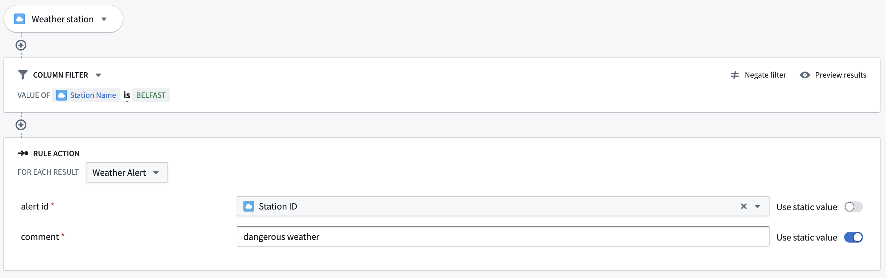

然后，在完成迁移的第五步后，检查规则编辑器表单以确保其继续根据您的应用案例正常工作，如下所示：

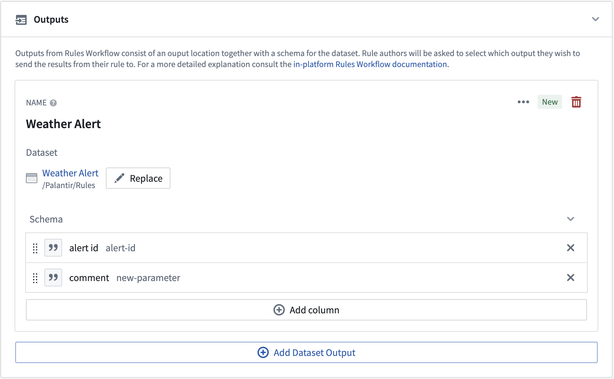

* 为什么我的数据集构建成功但其中没有数据？

  构建任务包括另一个名为规则状态数据集的数据集，该数据集包含每个规则的信息以及它未正确运行的原因。此外，您可能尚未重新运行您的数据输出数据集；请参阅[撰写和运行规则指南](../Deploy/%E7%BC%96%E5%86%99%E5%B9%B6%E8%BF%90%E8%A1%8C%E8%A7%84%E5%88%99.md#author-and-run-a-rule)中的第四步。该数据集也可以在构建页面的**变换配置**部分找到：

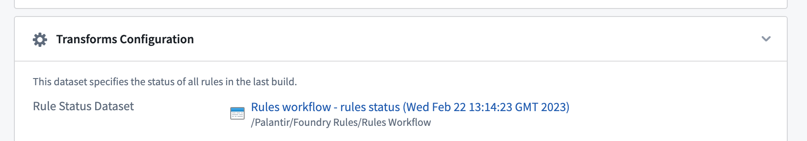

* 如果其他人在同时对Rules应用程序进行更改，我为什么无法取消迁移？

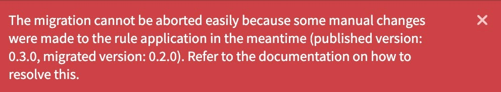

如果您已完成升级规则应用程序的阶段，而在您尝试**取消**迁移时，另一个用户对Rules应用程序进行了更改，则会发生此错误。

要解决此问题，请打开Rules工作室应用程序并发布较旧的迁移版本以撤销所做的手动更改。然后，您将能够成功取消升级过程。

* 为什么迁移在没有正好一个规则编辑器和提议审查微件的情况下无法继续？

  * 规则应用程序可以设计为具有任意数量的规则编辑器微件和任意数量的提议微件，但在Taurus和Foundry Rules之间配置有所不同。在Taurus中，可以通过独特属性配置微件，例如在每个微件中提供不同的输入。迁移不会合并多个微件的配置，而是将一个规则编辑器微件翻译为一个规则工作流。然而，在新的Foundry Rules设置中，不同的配置应各自成为自己的规则工作流。
  * 要解决您的迁移问题，您应考虑以下场景和适当的解决方案。之后，再次完成迁移向导。请注意，工作室更改是版本化的，以便在必要时支持还原更改：
    * 您偶然拥有多个规则编辑器微件，并且只有一个是相关的。您应从工作室模块中移除不相关的微件并再次尝试迁移。
    * 您有多个具有相同配置的微件。您应移除除一个以外的所有微件。迁移后，您可以复制并粘贴更新的微件以重建应用程序的设计。
    * 您有多个具有不同配置的微件。在这种情况下，您应将工作室模块拆分为多个模块，每个模块包含一个规则编辑器微件，并为每个微件创建一个规则原型。在向导中选择**从旧版本迁移**以从每个工作室模块创建配置以节省时间。
