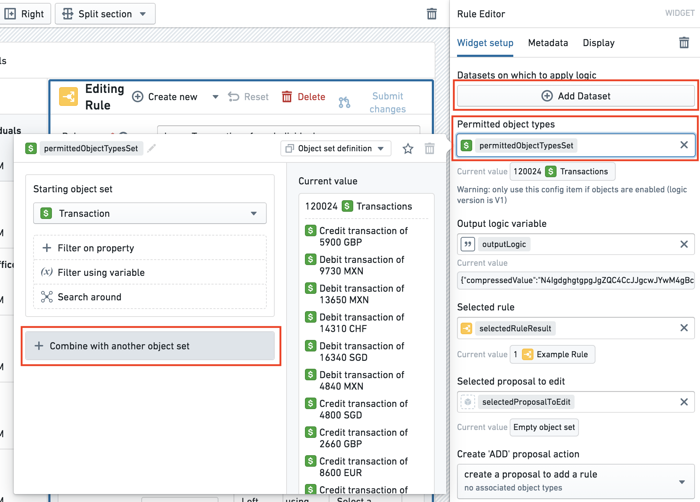
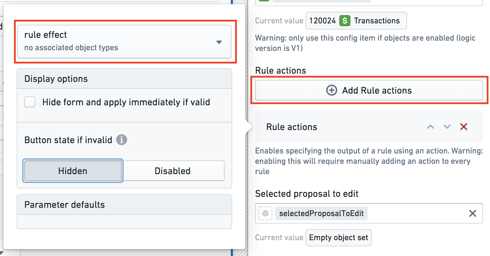
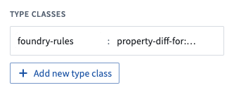

:::callout{theme="warning"}
注意：以下翻译的准确性尚未经过验证。这是使用 [AIP ↗](https://www.palantir.com/platforms/aip/) 从原始英文文本进行的机器翻译。
:::

# 配置 Workshop 应用程序

:::callout{theme="warning"}
在 2022 年 7 月之前，Foundry Rules（以前称为 Taurus）要求用户在 Workshop 应用程序中提供额外的配置。如果您是在 2022 年 7 月之前部署的 Foundry Rules，那么此部分才相关。
:::

在[部署规则工作流模板](../Deploy/%E9%83%A8%E7%BD%B2%E5%B7%A5%E4%BD%9C%E6%B5%81.md)后，按照以下步骤配置 Rules Workshop 应用程序：

*所有截图使用假设数据。*

1. **配置输入：** 在通过部署工作流模板生成的 Workshop 模块中，选择 **Rules** 选项卡中的 **Rule Editor** 微件。

   * **允许的对象类型**集默认会包含来自工作流模板的已选定**源**对象。但是，为了在 Foundry Rules 中提供更多的对象类型，请选择对象集变量，然后选择**与另一个对象集合并**。
   * 如果您希望添加数据集而不仅仅是对象，请选择 **Add Dataset** 按钮，然后输入输入数据集 RID 和显示名称，这将在管道中用于引用输入数据集。
   * 此处添加的任何额外对象或数据集稍后还需要添加到变换管道中，作为[配置变换管道](%E9%85%8D%E7%BD%AE%E5%8F%98%E6%8D%A2%E7%AE%A1%E9%81%93.md)的一部分。

   

2. **添加规则操作：** 如果在[部署工作流模板](../Deploy/%E9%83%A8%E7%BD%B2%E5%B7%A5%E4%BD%9C%E6%B5%81.md)时已配置了规则操作，那么将已有一个规则操作配置。要添加额外的规则操作，首先在 Ontology Manager 中创建它们，然后通过点击 **Add Rule actions** 添加它们。

   

   了解更多关于[配置规则操作](%E9%85%8D%E7%BD%AE%E8%A7%84%E5%88%99%E6%93%8D%E4%BD%9C.md)的信息

3. **启用非必填功能：** 要自定义 Foundry Rules 的功能，可以在 Workshop 应用程序中的 Rule Editor 微件配置中使用多个选项。切换这些选项以启用或禁用高级功能，如[非必填功能](../Settings%20%26%20customization/%E5%90%AF%E7%94%A8%E9%9D%9E%E5%BF%85%E5%A1%AB%E5%8A%9F%E8%83%BD.md)文档中所述。

4. **配置查看提案时的差异：** 为了让提案微件正确显示差异，请向相关的**提案对象**属性添加以下类型类。这些类型类被添加到**对象类型**的属性，而不是任何**操作参数**。

   * 对于您希望在 Proposal Reviewer 微件中显示的每个属性，向**当前**属性添加 `foundry-rules.property-diff-for:ID_OF_NEW_PROPERTY` 类型类。
   * 例如，假设提案对象上的属性 `new_rule_name` 代表规则名称的新值，而提案对象上的属性 `current_rule_name` 代表旧值。`current_rule_name` 属性应标注为 `foundry-rules.property-diff-for:new_rule_name`。

   

完成上述步骤后，了解如何配置您创建的[变换管道](%E9%85%8D%E7%BD%AE%E5%8F%98%E6%8D%A2%E7%AE%A1%E9%81%93.md)以适应您的工作流。
