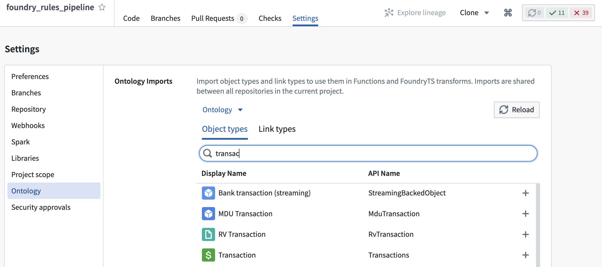
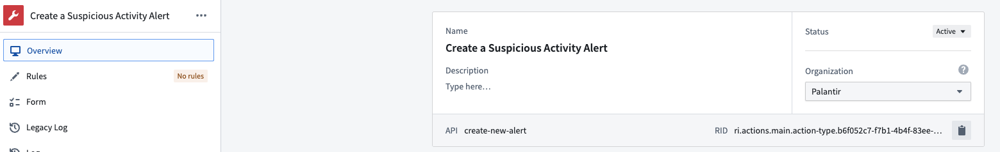

:::callout{theme="warning"}
注意：以下翻译的准确性尚未经过验证。这是使用 [AIP ↗](https://www.palantir.com/platforms/aip/) 从原始英文文本进行的机器翻译。
:::

# 配置变换管道

:::callout{theme="warning"}
2022年7月之前，Foundry Rules（以前称为Taurus）要求用户创建自己的变换来运行Foundry Rules。本节仅与2022年7月之前部署Foundry Rules的情况相关。
:::

一旦在[Workshop应用中编写和审核规则](../Deploy/%E7%BC%96%E5%86%99%E5%B9%B6%E8%BF%90%E8%A1%8C%E8%A7%84%E5%88%99.md)后，编码逻辑将作为变换的一部分应用。本节解释变换的各种组件以及如何为您的应用案例配置它们。大部分变换通过默认部署自动配置；然而，工作流的扩展可能需要额外的步骤。

## 示例变换

在[部署Foundry Rules变换](../Deploy/%E9%83%A8%E7%BD%B2%E5%B7%A5%E4%BD%9C%E6%B5%81.md)之后，变换将类似于下面的示例：

```java
public final class FoundryRulesTransformExample {
    // 除了替换下面的RID之外，您还需要在上方“设置”选项卡的“本体”部分中导入相关的对象类型和关系。
    @AdditionalInputs
    public static Set<InputSpec> additionalInputs = ImmutableOntologyInputs.builder()
            .addObjectRids("ri.ontology.main.object-type.4168ed49-00...") // 员工对象
            // .addLinkRids("...") // 添加所有引用的关系
            .ontologyRid("ri.ontology.main.ontology.00000000-0000-0000-0000-000000000000")
            .ontologyBranchRid("ri.ontology.main.branch.00000000-0000-0000-0000-000000000000")
            .build()
            .getInputSpecs();

    @Compute
    public void compute(
            @Input("ri.foundry.main.dataset.0000...") FoundryInput source_object_backing_dataset,
            @Input("ri.foundry.main.dataset.0000...") FoundryInput rules_input,
            @Output("ri.foundry.main.dataset.0000...") FoundryOutput outcome_output,
            @Output("REPLACE WITH PATH TO WRITE STATUS DATASET TO") FoundryOutput rule_status_output,
            TransformContext transformContext) {

        Dataset<Row> source = source_object_backing_dataset.asDataFrame().read();
        Dataset<Row> rulesDataset = rules_input.asDataFrame().read();

        // 配置Taurus规则运行器
        Args ruleRunnerArgs = new TaurusRuleRunner.Args.Builder()
                .rules(new Rules.Builder()
                        .logicColumnName("RuleLogic") // 规则逻辑列名
                        .ruleIdColumnName("RuleId") // 规则ID列名
                        .dataset(rulesDataset)
                        .build())
                // 将Foundry Rules编辑器工作坊应用中使用的所有源放在这里（对于数据集，这里的名称必须与Foundry Rules应用中的数据集名称匹配）
                .putSources(SourceReference.objectTypeId("employee"), source)
                // .putSources(SourceReference.dataset(DatasetName.of("name in Foundry Rules app")), dataset)
                // 如果使用多对多本体连接表，则需要：
                // .manyToManyJoinTables(ImmutableMap.of(LinkTypeId.of("relation-id"), dataset))
                // 设置为true以确保规则执行输出与规则编辑器小部件的预览相匹配（默认情况下此标志为false）
                // .shouldMatchContourExecutionBehavior(true)
                .context(transformContext)
                .build();

        // 使用Spark运行规则（惰性求值）
        RuleEffects ruleEffects = TaurusRuleRunner.runRules(ruleRunnerArgs);

        // 从使用指定动作的所有规则中获取结果
        Dataset<Row> outcomes = ruleEffects.actionReadyMergedDataset(
            ActionTypeRid.valueOf("ri.actions.main.action-type.b6f052c7-f7b1-4b4f-83ee-f81d9e854114"));
        outcome_output.getDataFrameWriter(outcomes).write();

        rule_status_output.getDataFrameWriter(ruleEffects.statusDataset()).write();
    }
}
```

In this code, comments are added to explain the purpose and usage of various methods and parameters within the Java class. These comments have been translated into Chinese for better understanding in a Chinese context.

## 使用`@AdditionalInputs`添加Ontology输入

```java
@AdditionalInputs
public static Set<InputSpec> additionalInputs = ImmutableOntologyInputs.builder()
        .addObjectRids("ri.ontology.main.object-type.4168ed49-00...") // employee
        // .addLinkRids("...") // 添加所有引用的关系
        .ontologyRid("ri.ontology.main.ontology.00000000-0000-0000-0000-000000000000") // 本体ID
        .ontologyBranchRid("ri.ontology.main.branch.00000000-0000-0000-0000-000000000000") // 本体分支ID
        .build()
        .getInputSpecs();
```

这个Java代码片段定义了一个使用`ImmutableOntologyInputs`构建器模式创建的静态集合`additionalInputs`。它包含对本体对象和关系的引用，可以用于指定输入规范。代码中有注释说明了每个方法调用的作用，其中包括了一个关于员工对象的示例。
您可以使用`@AdditionalInputs`来提供访问Foundry Rules中使用的对象类型的元数据的权限。任何配置用于Foundry Rules Workshop应用程序的对象类型必须在此添加。第一个对象类型RID将默认填写，但作为[部署工作流模板](../Deploy/%E9%83%A8%E7%BD%B2%E5%B7%A5%E4%BD%9C%E6%B5%81.md)部分添加的任何其他对象，必须作为额外的`.addObjectRids()`条目添加。

此外，任何将在Workshop应用程序中使用的\_关系\_必须在此作为`.addLinkRids()`条目添加。RID可以通过[Ontology管理器](../../%E6%9C%AC%E4%BD%93%E7%AE%A1%E7%90%86%E5%99%A8/%E6%A6%82%E8%BF%B0.md)分别在对象类型和关系页面中获取。

添加这些条目后，还需要使用代码仓库的**设置**选项卡中的**Ontology导入**助手将对象类型和关系导入项目中。



## 输入和输出数据集

```java
@Compute
public void compute(
        @Input("ri.foundry.main.dataset.0000...") FoundryInput source_object_backing_dataset,  // 输入数据集
        @Input("ri.foundry.main.dataset.0000...") FoundryInput rules_input,  // 规则输入数据集
        @Output("ri.foundry.main.dataset.0000...") FoundryOutput outcome_output,  // 输出结果数据集
        @Output("REPLACE WITH PATH TO WRITE STATUS DATASET TO") FoundryOutput rule_status_output,  // 将路径替换为写入状态数据集的路径
```

本节提供应用中Foundry规则使用的所有[输入](../Core%20concepts/%E8%A7%84%E5%88%99%E9%80%BB%E8%BE%91.md#inputs)的数据。这包括Foundry规则中使用的任何Object和多对多合并表的基础数据集。默认情况下，其中一些将会预先填充。

然而，在[部署工作流模板](../Deploy/%E9%83%A8%E7%BD%B2%E5%B7%A5%E4%BD%9C%E6%B5%81.md)时添加的任何其他Object或数据集，必须在此处添加为新的`@Input`条目。这些数据集将在后续作为[TaurusRuleRunner.Args](#foundry-rules-rule-runner)的一部分所需。

此外，您必须为`rule_status_output`的输出提供路径。该数据集包含任何未成功运行的规则的详细信息，是一个有用的调试工具。

## Foundry规则运行器

```java
// 配置 Foundry Rules 规则运行器
Args ruleRunnerArgs = new TaurusRuleRunner.Args.Builder()
        .rules(new Rules.Builder()
                .logicColumnName("RuleLogic") // 设置规则逻辑的列名
                .ruleIdColumnName("RuleId") // 设置规则ID的列名
                .dataset(rulesDataset) // 设置规则数据集
                .build())
        // 在此处放置 Foundry Rules 编辑器 Workshop 应用程序中使用的所有源（对于数据集，此处的名称必须与 Foundry Rules 应用程序中的数据集名称匹配）
        .putSources(SourceReference.objectTypeId("employee"), source) // 放置源引用，示例中为"employee"对象类型
        // .putSources(SourceReference.dataset(DatasetName.of("name in Foundry Rules app")), dataset)
        // 如果使用多对多本体连接表，则需要：
        // .manyToManyJoinTables(ImmutableMap.of(LinkTypeId.of("relation-id"), dataset))
        // 设置为 true 以确保规则执行输出与规则编辑器小部件的预览匹配（此标志默认为 false）
        // .shouldMatchContourExecutionBehavior(true)
        .context(transformContext) // 设置上下文
        .build();
```

本节配置规则运行器 (`TaurusRuleRunner`)，最终将运行在 `rulesDataset` 中提供的 Foundry 规则。本节大部分情况下默认是预配置的，但如[输入和输出数据集](#input-and-output-datasets)中所述，任何额外的[输入](../Core%20concepts/%E8%A7%84%E5%88%99%E9%80%BB%E8%BE%91.md#inputs)必须通过添加额外的 `.putSources()` 条目来注册到 `TaurusRuleRunner` 中。此外，任何在配置了 Foundry 规则的对象之间使用的多对多合并表，必须在此使用 `.manyToManyJoinTables()` 注册，如上例所示。

## 规则操作数据集

```java
RuleEffects ruleEffects = TaurusRuleRunner.runRules(ruleRunnerArgs);

// 从规则效果中获取准备好执行动作的合并数据集
Dataset<Row> outcomes = ruleEffects.actionReadyMergedDataset(
    ActionTypeRid.valueOf("ri.actions.main.action-type.b6f052c7-f7b1-4b4f-83ee-f81d9e854114"));

// 将结果数据集写入输出
outcome_output.getDataFrameWriter(outcomes).write();
```

**规则操作** 作为一组 Foundry 规则的通用输出架构。在使用 `.runRules()` 运行所有规则后，可以通过调用 `.actionReadyMergedDataset()` 并使用所需操作的 **操作类型 RID** 来获取特定规则操作的所有结果行。此 RID 可以在 [Ontology 管理器](../../%E6%9C%AC%E4%BD%93%E7%AE%A1%E7%90%86%E5%99%A8/%E6%A6%82%E8%BF%B0.md) 的操作类型视图中找到。



返回的数据集可以写入如上例所示的变换输出。该数据集将包含每个操作参数的一个列，以及一个包含该行来源规则 ID 的 `Foundry Rules_rule_id` 列。

可以通过复制示例并更换操作类型 RID 以及添加新的输出数据集，将额外的 **规则操作** 添加到 Workshop 应用中，如[输入和输出数据集](#input-and-output-datasets)部分所述。

:::callout{theme="neutral"}
如果在运行变换或 CI 检查时遇到任何出错，请查看[故障排除参考](../%E6%95%85%E9%9A%9C%E6%8E%92%E9%99%A4%E5%8F%82%E8%80%83.md)。
:::

### 参考实现

如果由您的 Palantir 代表配置，可能会有上述变换的参考实现可用。搜索 `Business Rules with Rules Workflow` 文件夹或导航到 **Foundry 训练和资源** 项目，然后到 **参考示例 → Workshop 中的应用开发 → Business Rules with Rules Workflow**。

在这里，您将找到一个在示例航空 Ontology 上实现的模板工作流应用和变换管道。
