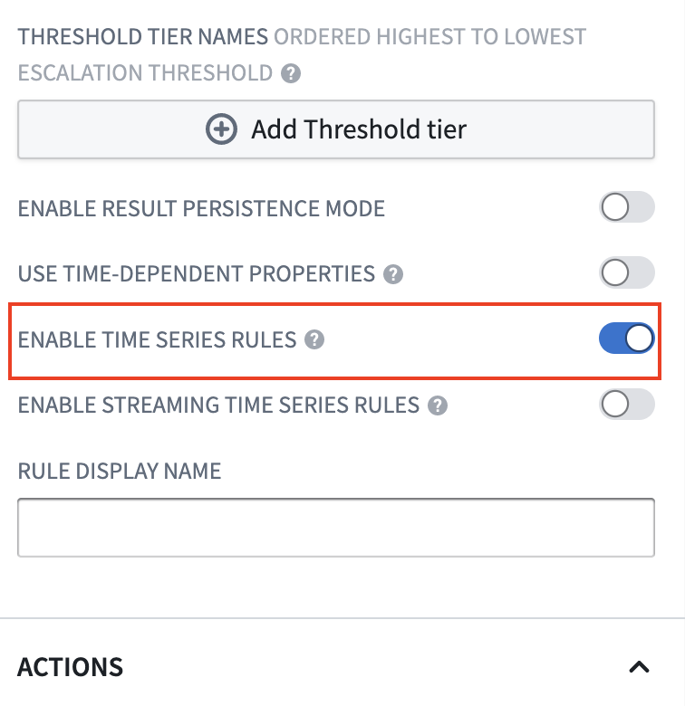
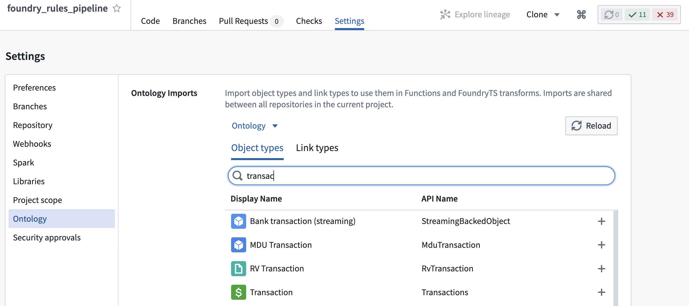
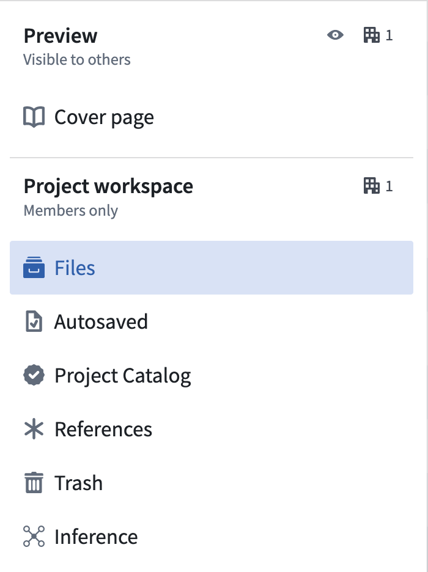
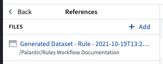

:::callout{theme="warning"}
注意：以下翻译的准确性尚未经过验证。这是使用 [AIP ↗](https://www.palantir.com/platforms/aip/) 从原始英文文本进行的机器翻译。
:::

# 配置时间序列

:::callout{theme="neutral"}
2022年7月之前，Foundry Rules（以前称为Taurus）要求用户创建自己的变换来运行Foundry Rules。本节仅在您于2022年7月之前部署了Foundry Rules时相关。
:::

:::callout{theme="neutral"}
这些说明假设您的平台已经设置了时间序列。了解更多关于[在Foundry中使用时间序列](https://www.palantir.com/docs/foundry/time-series/time-series-overview/#use-time-series-in-foundry)的信息。
:::

如果您正在创建一个新的工作流，请按照步骤[部署Foundry Rules](../Deploy/%E9%83%A8%E7%BD%B2%20Foundry%20Rules.md)。如果您在2022年7月之前部署了Foundry Rules，则需要以下描述的额外步骤来启用时间序列支持。

## Workshop应用程序

在Workshop应用程序中开始编写时间序列规则有两个步骤：

1. 必须开启规则编辑器中的**启用时间序列规则**配置。要导航到此处，请编辑您的Workshop模块，点击规则编辑器微件，并找到标记为**启用时间序列规则**的选项。

    

2. 要创建时间序列规则，源Object必须是根Object类型。将所有需要的根Object类型添加到**允许的Object类型**集合中。这里添加的所有Object也需要添加到变换管道中。

## 变换管道

Foundry规则作为变换的一部分运行。确保您已经按照说明设置了[管道](%E9%85%8D%E7%BD%AE%E5%8F%98%E6%8D%A2%E7%AE%A1%E9%81%93.md)。

## 额外输入

本节提供访问时间序列元数据的权限。为了运行时间序列规则，您必须将更多项目添加到额外输入中：

* 对于支持时间序列数据的每个时间序列同步，使用`.addTimeseriesSyncRids`添加同步RID。
* 对于上面时间序列同步中使用的每个tick数据集，使用`.addBackingDatasetRids`添加tick数据集的RID。这些是包含实际时间序列数据的数据集。
* 使用`.addObjectRids`添加根Object和传感器Object的RID。
* 使用`.addLinkRids`添加根Object和传感器Object之间关系的RID。

### 示例

```java
@AdditionalInputs
public static Set<InputSpec> additionalInputs = ImmutableOntologyInputs.builder()
    .addObjectRids("ri.ontology.main.object-type.adc4f61c-7ddd-4be2-9ade-a3a0483e63e4") // 根对象
    .addObjectRids("ri.ontology.main.object-type.98f40fe0-d36f-4fcc-b36c-dc3824be17b5") // 传感器对象
    .ontologyBranchRid("ri.ontology.main.branch.00000000-0000-0000-0000-000000000000") // 本体分支ID
    .ontologyRid("ri.ontology.main.ontology.00000000-0000-0000-0000-000000000000") // 本体ID

    // 时间序列输入
    .addLinkRids("ri.ontology.main.relation.6e82c6be-2a9a-42be-9cf0-c84a706b4101") // 根对象 <-> 传感器对象
    .addTimeseriesSyncRids("ri.time-series-catalog.main.sync.8023a1b6-bae0-4dbf-8df5-9a879d8e0be0") // 时间序列同步
    .addBackingDatasetRids("ri.foundry.main.dataset.7041bedc-c475-46f6-81b6-8b989f099447") // ticks 数据集
    .addBackingDatasetRids("ri.foundry.main.dataset.7ee6741c-ea3d-48aa-9ba3-ec43b2ce42e4") // 传感器对象的备份数据集
    .build()
    .getInputSpecs();
```

此代码片段定义了一个`additionalInputs`集合，用于描述不同的对象、关系和数据集在本体论中的输入规格。注释中包含了对每个标识符的解释，例如根对象、传感器对象、时间序列同步等。

### 项目引用

还需要使用[代码库](https://www.palantir.com/docs/foundry/code-repositories/ontology-imports/)的**设置**选项卡中的**Ontology Imports**助手，将根Object类型、传感器Object类型及其关系导入项目。



此外，如果时间序列同步或其支持的ticks数据集与变换不在同一项目中，则还必须使用[项目视图](https://www.palantir.com/docs/foundry/projects/use-project-navigation-panel/#references)的**项目引用**部分将它们导入项目。




