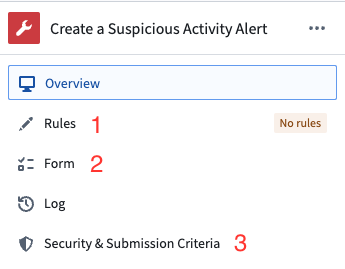

:::callout{theme="warning"}
注意：以下翻译的准确性尚未经过验证。这是使用 [AIP ↗](https://www.palantir.com/platforms/aip/) 从原始英文文本进行的机器翻译。
:::

# 配置规则操作

:::callout{theme="warning"}
在2022年7月之前，Foundry Rules（以前称为Taurus）使用Foundry操作作为规则输出。仅当您在2022年7月之前部署了Foundry Rules时，此部分才相关。
:::

规则操作是在Foundry Rules中用于对规则的输出实施输出模式的一种方法。这是通过使用Foundry操作作为指定列名和类型的机制来实现的。规则操作是将被用于Foundry Rules中的Foundry操作。

上面截图中的操作仅[被用于在变换内](%E9%85%8D%E7%BD%AE%E5%8F%98%E6%8D%A2%E7%AE%A1%E9%81%93.md#rule-action-datasets)，不会自行运行。方便的是未为操作配置任何操作规则（上面截图中的**1**），因此即使操作被运行，也不会产生任何效果。

操作的参数将在Foundry Rules Workshop应用程序中呈现给最终用户，并可用于映射到规则逻辑输出的列（上面截图中的**2**）。

* 参数类型将被用于实施正确的列类型。例如，如果使用日期类型参数，则只有日期和时间戳类型的列可用于映射到此参数。此外，如果参数ID与您的规则中的列名或Object属性ID匹配，它将用于预填充此列/属性的参数。
* 任何标记为必需的参数在Foundry Rules Workshop应用程序中也将是必需的。同样，非必填参数可以留空，没有列映射到它们，这等同于为参数提供`null`值。
* 参数名称将在Foundry Rules Workshop应用程序中用作标签，参数ID将在[变换中的结果数据集中](%E9%85%8D%E7%BD%AE%E5%8F%98%E6%8D%A2%E7%AE%A1%E9%81%93.md#rule-action-datasets)用作列名。
* 除了参数ID外，输出数据集还将包含一个`taurus_rule_id`列，以指示行所来源的规则ID。

定义**提交标准**（**3**）是保存操作的要求。规则操作最常见的提交标准是检查**当前用户**是否属于具有编辑Foundry Rules工作流程权限的用户组。在Foundry Rules应用程序中编辑规则时将应用此验证。
