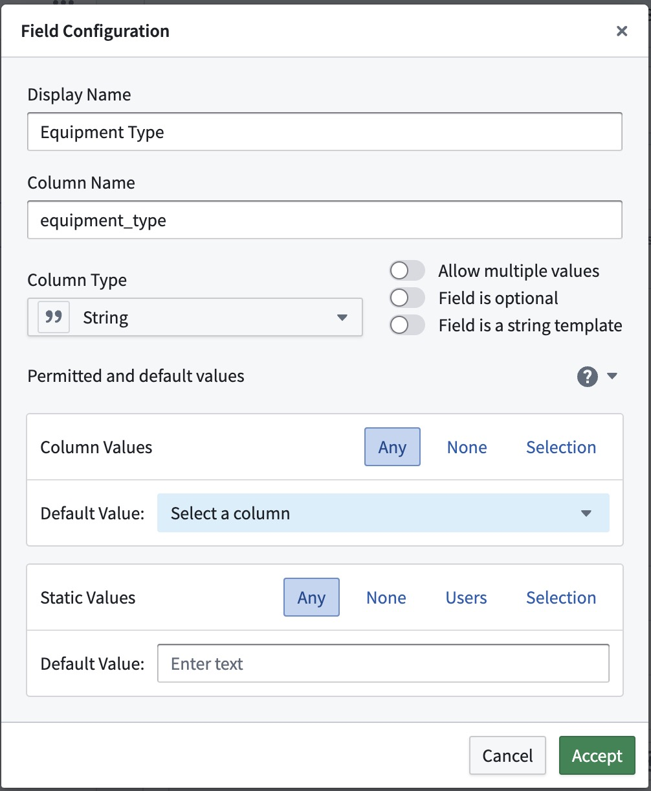
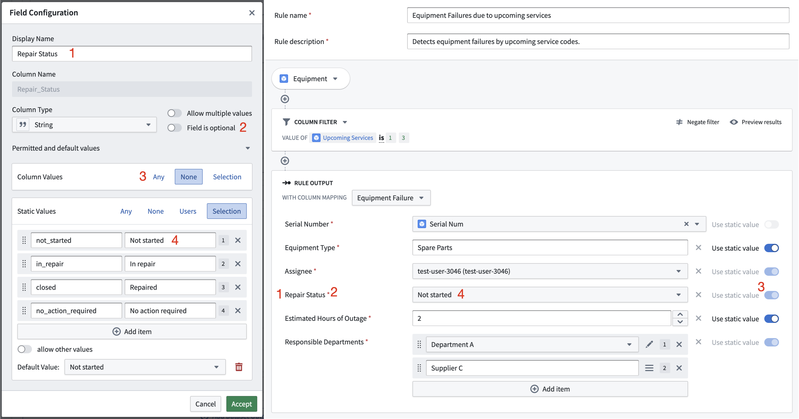
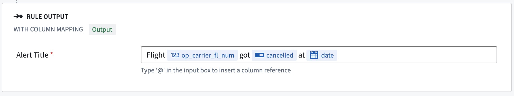

:::callout{theme="warning"}
注意：以下翻译的准确性尚未经过验证。这是使用 [AIP ↗](https://www.palantir.com/platforms/aip/) 从原始英文文本进行的机器翻译。
:::

# 允许和默认输出值

工作流输出指定了所有 Foundry 规则在工作流中的输出目的地和格式。在 **规则编辑器**中的每个规则结束时，在\*\*规则输出[逻辑块](../Core%20concepts/%E8%A7%84%E5%88%99%E9%80%BB%E8%BE%91.md#logic-blocks)\*\*中，作者将为每个工作流输出指派一个列或一个静态值。指派值可确保当需要其值时规则输出已被定义，并且数据可以以正确的数据类型安全地流入工作流输出数据集中。

**允许和默认输出值**部分可以用来简化指派过程，并进一步自定义规则输出逻辑块。默认值将在创建新规则时自动指派，并且可以限制指派选项为仅允许列值或静态值中的一种。

截图显示了标准配置，这是最宽松的配置，并未指定任何默认值。除非对标准配置进行了更改，否则**允许和默认输出值**部分将被折叠。

## 行为和应用案例

每个输出字段可以有其自身的配置。以下示例最好地说明了这一点：

如果一个`设备故障警报`应链接回特定设备项，则该字段应限制为不允许静态值（`无`），仅允许来自对象属性`Serial Num`的列值。

警报是操作性工作流的核心，因此它们通常与一个过程相关联。设备故障将需要某种维修，因此警报可以处于多种可能状态之一。工作流输出将有一个字段`Repair Status`（1），这是一个必填字段（2），类型为`字符串`。假设一些设备故障具有与警报一起触发的自动服务程序，但其他故障需要人工干预。这一信息仅规则作者可以确定，因此输入数据中的列值被禁用（3，`无`）。状态需要设置为多个可能状态之一（4），默认状态应为`Not started`。规则作者将看到的规则输出逻辑块反映了这一配置。静态值和列值之间的切换被禁用，并显示所有可能状态选项的选择菜单。

## 配置选项

配置分为两个部分：列值和静态值。这两部分都依赖于输出字段类型。如果任何配置不完整或无法满足要求，错误图标将指示问题。如果规则作者提供不符合要求的值，例如一个不在所需范围内的整数，规则输出逻辑块中也会显示相同的错误图标。
对于类型为`字符串`的输出值，可以选择将该字段设为字符串模板。字符串模板是静态值和列值的组合。如果选择了**字段是字符串模板**选项，则无法进行进一步配置。

### 列值

列值是指规则逻辑应用后来自底层数据集某列的值。当规则作者编写规则逻辑时，实际数据尚未确定，输出列只能通过类型或输入属性名称进行限制。以下选项可用于配置列值：

* \*\*任何：\*\*任何现有列都可以指派给此输出字段。
* \*\*无：\*\*此输出字段将仅接受静态值。不允许列引用。
* \*\*选择：\*\*指定列选项集中的任何列都可以指派给此字段。

### 静态值

静态值是指规则作者在创建或编辑规则时手动输入的值。您可以限制这些值，使其在某个数字或日期范围内，或者多个值的输入具有正确的长度。用户输入和值的选择将以下拉菜单显示，以便规则作者更容易输入正确的值。以下选项可用于配置静态值：

* \*\*任何：\*\*任何正确字段类型的值都可以指派给此输出字段。
* \*\*无：\*\*此输出字段将仅接受列引用。不允许静态值。
* \*\*选择：\*\*指定值集中的任何值都可以指派给此输出字段。可选地，可以允许其他值。选项将按其标签显示。
* \*\*范围：\*\*仅允许在指定范围内的静态值。此选项仅适用于数字和日期类型。
* \*\*用户：\*\*可以将指定的 Foundry 用户集中的任何用户指派给此字段。如果未选择任何用户，则不应用限制。此选项仅适用于字符串类型。

对于**允许多个值**的类型，限制适用于输入中的每个项。例如，输入中的每个整数必须在所需范围内，每个用户必须是预先选择的用户之一，或者每个项必须是标记选择项之一。
