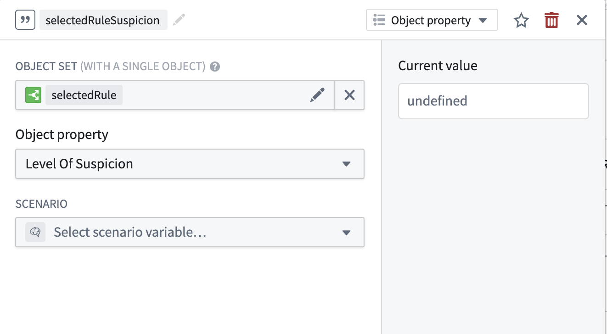
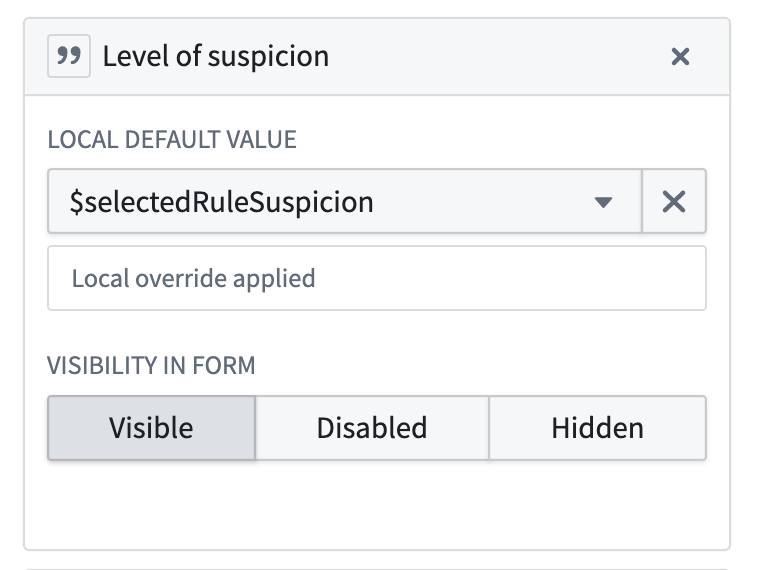
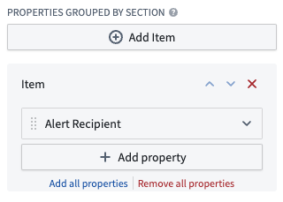

:::callout{theme="warning"}
注意：以下翻译的准确性尚未经过验证。这是使用 [AIP ↗](https://www.palantir.com/platforms/aip/) 从原始英文文本进行的机器翻译。
:::

# 添加自定义属性

在 Foundry Rules 中，一个常见的定制操作是向您的规则和提案对象添加自定义属性。自定义属性可以让您跟踪超出默认配置的额外元数据。要添加自定义属性，请按照以下步骤操作：

1. 在 Ontology 管理器中，将属性（例如 `severity`）添加到规则对象中。

:::callout{theme="neutral"}
对象属性必须由输入数据集中的列支持。

对于空的自动生成输入数据集，可以通过在 **详细信息** 选项卡中直接编辑架构来复制和修改现有列定义。

对于来自现有管道的规则，在变换中添加新列。
:::

2. 向提案对象添加相应的 `current_<PROPERTY>` 和 `new_<PROPERTY>` 属性（例如 `current_severity` 和 `new_severity`）。
3. 使用类型类 `foundry-rules.property-diff-for:new_<PROPERTY>`（例如 `foundry-rules.property-diff-for:new_severity`）注释 `current_<PROPERTY>` 提案对象属性。

:::callout{theme="neutral"}
类型类由 *种类* 和 *名称* 特征化，写成 `kind.name` 的形式。对于 `foundry-rules.property-diff-for:new_<PROPERTY>`，种类是 `foundry-rules`，名称是 `property-diff-for:new_<PROPERTY>`。
:::

4. 通过添加新自定义属性的参数，编辑 Foundry Rules 设置中修改或创建规则或提案对象的每个操作类型。参考类似属性如 *rule\_name* 的示例，查看所需的添加内容。

5. 在 Workshop 应用程序中，添加一个 Workshop 变量，该变量获取所选规则的自定义属性。您可以通过使用现有的 `selectedRule` 变量作为对象集输入来定义一个新的 objectProperty 变量来实现这一点。

    

   将此 Workshop 变量设置为规则编辑器配置侧栏中“创建编辑规则的提案”操作的默认值。

    

6. 如果提案微件未正确显示差异，请按照以下步骤操作：

   * 在 Workshop 应用程序中，在提案审查微件配置中的**按节分组的属性**中添加 `new_<PROPERTY>` 属性。此处不需要选择“当前”值。
   * 如有需要，编辑属性名称以移除“new”前缀。
   * 将 `foundry-rules.property-diff-for:ID_OF_NEW_PROPERTY` 类型类添加到**提案对象**的**当前**属性中。

       
