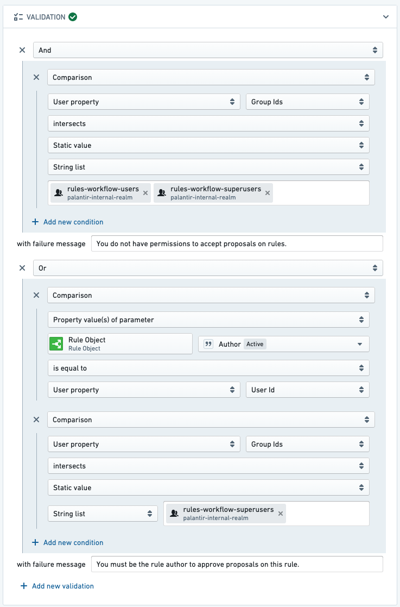
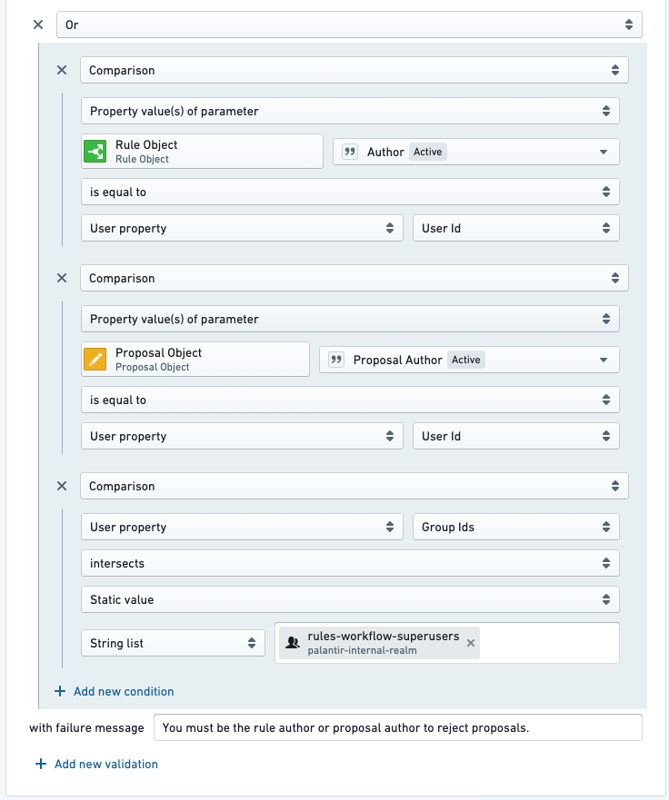

:::callout{theme="warning"}
注意：以下翻译的准确性尚未经过验证。这是使用 [AIP ↗](https://www.palantir.com/platforms/aip/) 从原始英文文本进行的机器翻译。
:::

# 编辑规则的权限

在某些工作流程中，您可能希望限制可以编辑或修改规则的用户集。以下示例展示了如何设置权限，以便规则的作者对任何影响其规则的更改拥有最终批准权。

权限设置如下：

* 只有规则作者（和超级用户）可以批准编辑其规则的提案。
* 只有规则作者（和超级用户）可以批准删除其规则的提案。
* 只有规则作者、提案创建者（和超级用户）可以拒绝关于规则所有者规则的提案。
  * 为了减轻意外提案的问题，提案创建者也可以拒绝提案。例如，如果用户A意外在用户B的规则上创建了提案，用户A可以拒绝（有效地撤销）该提案。

按照以下步骤实现此权限设置：

1. 配置*批准编辑规则提案*操作，以便用户必须是与提案相关的规则作者或超级用户。

   

2. 配置*批准删除规则提案*操作，以便用户必须是与提案相关的规则作者或超级用户。

3. 配置*拒绝提案*操作，以便用户必须是与提案相关的规则作者、提案作者或超级用户。

   

:::callout{theme="neutral"}
如果您没有看到基于规则Object进行验证的选项，您可能没有将规则Object添加为操作的参数。将新的规则Object参数添加到*拒绝提案*操作中，就像您添加其他Foundry Rules操作的规则Object参数一样。
:::
