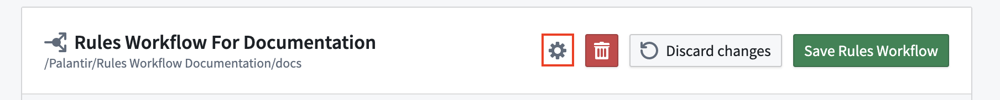
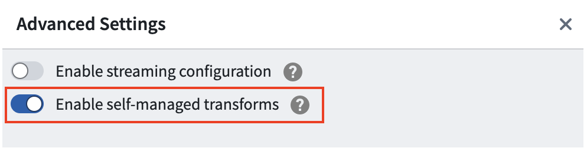
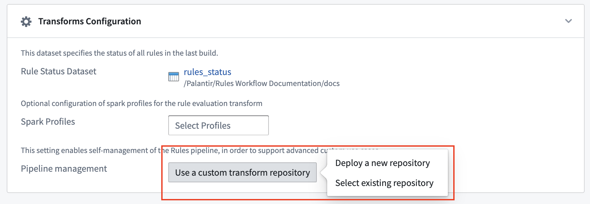

:::callout{theme="warning"}
注意：以下翻译的准确性尚未经过验证。这是使用 [AIP ↗](https://www.palantir.com/platforms/aip/) 从原始英文文本进行的机器翻译。
:::

# 自定义您的 Foundry Rules 流水线

:::callout{theme="warning"}
自定义 Foundry Rules 流水线是一个高级功能，适用于有经验的 Foundry 流水线作者。这种自定义可能会增加工作流管理员的实施和维护负担。
:::

Foundry Rules 不要求用户开箱即用地编写任何流水线逻辑。然而，一些应用案例需要自定义 Foundry Rules 流水线，以实现其他方式无法实现的结果。

## 应用案例

自定义您的 Foundry Rules 流水线可以提供许多潜在的好处，包括：

* 对不同规则子集的运行方式和时间进行细粒度控制。
* 在运行规则逻辑之前预处理 Foundry Rules 输入的能力。
* 能够在[增量变换](https://www.palantir.com/docs/foundry/transforms-python/incremental-overview/)中运行 Foundry Rules。这要求规则逻辑与增量数据兼容。

:::callout{theme="neutral"}
Foundry Rules 输出的后处理（例如添加列）可以通过专用的下游变换实现。我们不建议仅为了后处理 Foundry Rules 输出而自定义 Foundry Rules 流水线。
:::

## 指南

:::callout{theme="neutral"}
自定义流水线目前不支持流式工作流。
:::

您可以通过启用自管理变换、选择自定义变换库、保存 Foundry Rules 工作流，然后生成并将 Foundry Rules 流水线代码保存到所选库来部署您自己的自定义 Foundry Rules 流水线。要做到这一点，请按照以下说明进行操作：

1. 点击齿轮图标打开高级设置菜单。

   

2. 启用**启用自管理变换**选项。

   

3. 点击**使用自定义变换库**在**变换配置**部分。您可以选择**部署新的库**（推荐）或选择**选择现有库**以查找并选择您选择的库。

   

4. 保存您的 Foundry Rules 工作流。

5. 点击**生成**并然后点击**复制**，生成并复制您的 Foundry Rules 流水线代码。

   

6. 如果您之前选择了一个现有的库，请创建一个名为`FoundryRulesTransform`的文件，该文件位于`rules.transforms`目录内并粘贴复制的代码。如果在步骤3中选择了新部署的库，请找到“FoundryRulesTransform”并粘贴代码。
