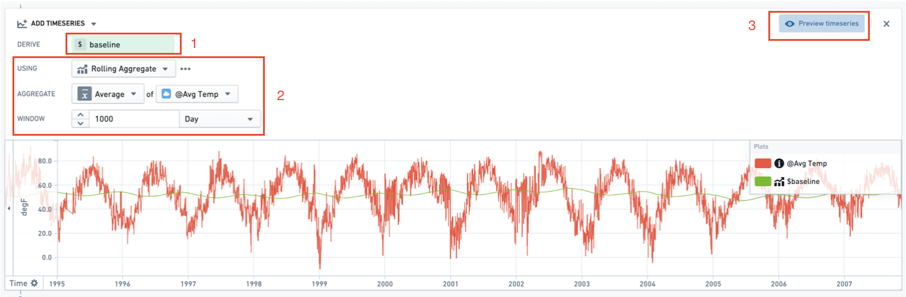
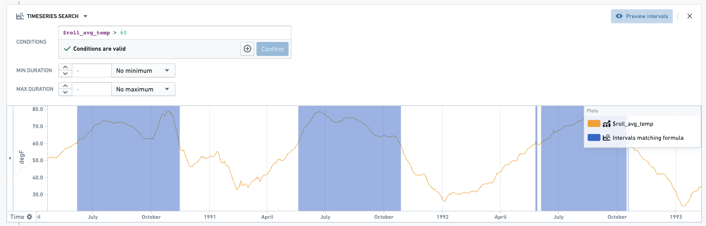

:::callout{theme="warning"}
注意：以下翻译的准确性尚未经过验证。这是使用 [AIP ↗](https://www.palantir.com/platforms/aip/) 从原始英文文本进行的机器翻译。
:::

# 时间序列规则

## 概述

除了对数据集和Objects进行操作之外，Foundry Rules还使用户能够管理使用时间序列数据的规则。通过Foundry Rules，用户可以编写规则以识别数据中感兴趣的时间段。这些时间间隔作为行由Foundry规则输出，并可以在下游用于警报或其他应用案例。Foundry Rules目前支持变换现有的时间序列；例如，使用聚合、公式和导数，以及基于多个标准识别间隔。

Foundry Rules基于Foundry中的[时间序列](https://www.palantir.com/docs/foundry/time-series/time-series-overview/)构建，并支持[时间序列属性](https://www.palantir.com/docs/foundry/time-series/time-series-concepts-glossary/#time-series-property-tsp)和度量。

要在Foundry Rules中使用时间序列，请按照[部署说明](%E9%83%A8%E7%BD%B2%E6%97%B6%E9%97%B4%E5%BA%8F%E5%88%97%20Foundry%20%E8%A7%84%E5%88%99.md)进行操作。

## 时间序列面板

规则可以包含所有标准的Foundry Rules [逻辑](../Core%20concepts/%E8%A7%84%E5%88%99%E9%80%BB%E8%BE%91.md)，以及两种类型的时间序列面板：**添加时间序列**和**时间序列搜索**。

### 添加时间序列面板

添加时间序列面板以一个序列作为输入，并生成一个经过修改的序列，随后可以由后续面板使用。一个变换后的序列通过名称(1)和操作(2)来定义，并包含该操作所需的配置。例如，下图所示的面板添加了一个新的序列`$baseline`，该序列是使用1000天的滚动聚合创建的。可以使用“预览时间序列”按钮(3)预览结果时间序列。

### 时间序列搜索面板

时间序列搜索面板根据指定条件为输入集中每个对象生成间隔。条件可以引用链接到原始根对象的序列以及由先前**添加时间序列**面板创建的任何序列。对象上存在的度量以`@`为前缀，而作为规则一部分添加的任何序列则以`$`为前缀。符合条件的间隔也可以使用“预览间隔”按钮进行预览。

对于输入中的每个根对象，输出数据集中将存在一组匹配的间隔，作为包含间隔数据的列序列：起始时间、结束时间和持续时间。

