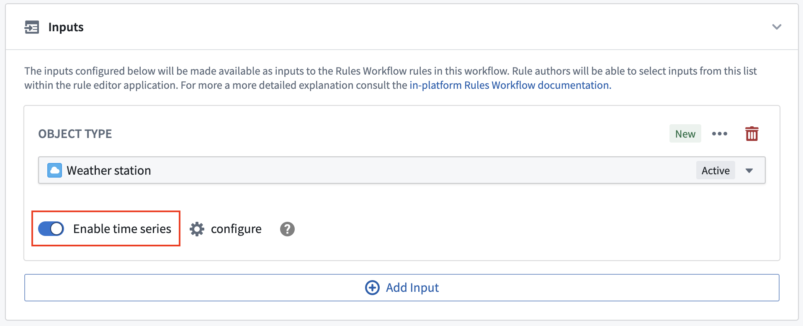
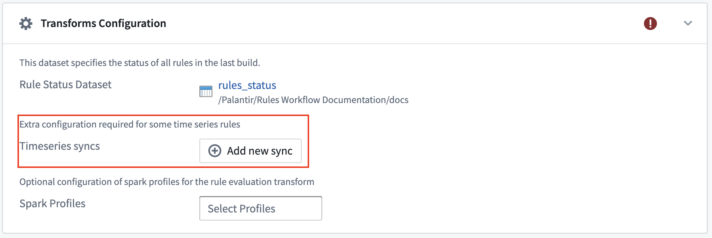

:::callout{theme="warning"}
注意：以下翻译的准确性尚未经过验证。这是使用 [AIP ↗](https://www.palantir.com/platforms/aip/) 从原始英文文本进行的机器翻译。
:::

# 部署时间序列 Foundry 规则

:::callout{theme="neutral"}
这些说明假设您的平台中已设置时间序列。了解更多关于[在 Foundry 中使用时间序列](https://www.palantir.com/docs/foundry/time-series/time-series-overview/#use-time-series-in-foundry)的信息。
:::

要在 Foundry 规则中启用时间序列功能，请首先按照步骤[部署 Foundry 规则](../Deploy/%E9%83%A8%E7%BD%B2%20Foundry%20Rules.md)。一旦您部署了 Foundry 规则，下面描述的步骤是启用时间序列支持所必需的：

1. 要创建时间序列规则，其中一个工作流输入必须是时间序列根Object类型。对于所有您希望编写时间序列规则的输入Object类型，切换**启用时间序列**开关。

   

2. 如果您的时间序列数据是使用[时间序列属性](https://www.palantir.com/docs/foundry/time-series/time-series-setup/)设置的，则无需额外配置步骤，您可以开始编写基于时间序列的规则。然而，如果您的时间序列数据是使用测量值配置的，您必须完成以下步骤：

* 切换**启用时间序列**开关时，将打开一个对话框，提示您选择从**系列Object类型**到**根Object类型**的链接。
* 然后，在变换配置部分，您必须添加支持这些测量值的*所有*[时间序列同步](https://www.palantir.com/docs/foundry/time-series/time-series-setup/#time-series-sync)。

