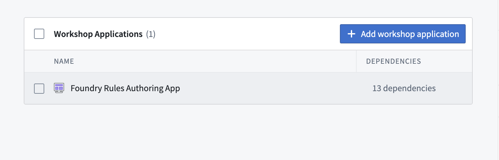
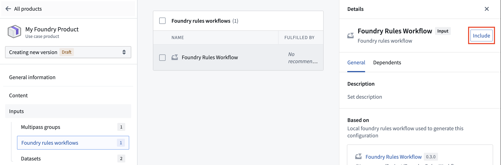
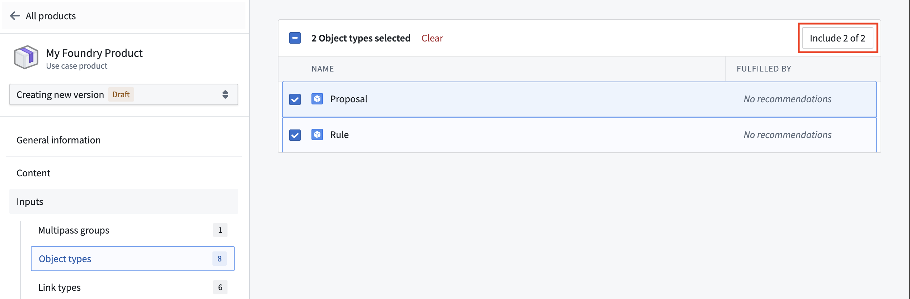
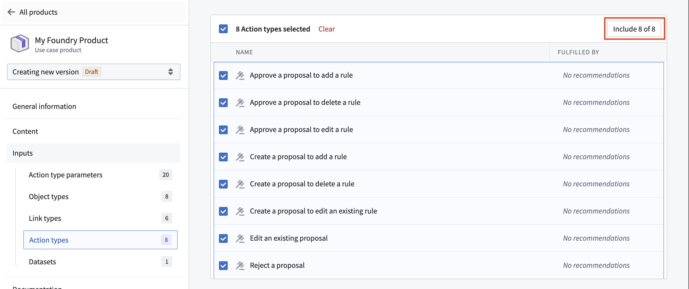

:::callout{theme="warning"}
注意：以下翻译的准确性尚未经过验证。这是使用 [AIP ↗](https://www.palantir.com/platforms/aip/) 从原始英文文本进行的机器翻译。
:::

# 将 Foundry Rules 添加到 Marketplace 产品 \[Beta]

使用 [Foundry DevOps](https://www.palantir.com/docs/foundry/devops/overview/) 将您的 Foundry Rules 工作流包含在 [Marketplace 产品](https://www.palantir.com/docs/foundry/devops/core-concepts/#product)中，并允许其他用户安装和重用它们。[了解如何创建您的第一个产品](https://www.palantir.com/docs/foundry/foundry-devops/create-products/)。

## 支持的功能

所有 Foundry Rules 功能均被支持。

## 将 Foundry Rules 工作流添加到产品中

要将 Foundry Rules 工作流添加到产品中，首先[创建一个产品](https://www.palantir.com/docs/foundry/foundry-devops/create-products/)，然后选择 **Workshop Application** 内容类型，接着选择您的 [Foundry Rules 编写应用](Deploy/%E7%BC%96%E5%86%99%E5%B9%B6%E8%BF%90%E8%A1%8C%E8%A7%84%E5%88%99.md)，如下所示。

添加您的 Workshop 应用程序后，转到产品输入中的 **Foundry rules 工作流** 部分并包含您的工作流。

一旦您的工作流被包含，附加的 Object 类型和操作类型将作为输入包含到您的产品中。您可能希望将 `Rule` 和 `Proposal` Object 类型以及所有生成的操作类型包含到您的产品中。

:::callout{theme="neutral"}
将产品的安装模式设置为 `Production` 时，请确保在 Ontology Manager 应用程序的 `Datasources` 选项卡中为 `Rule` 和 `Proposal` Object 类型启用 `Only allow edits via actions`。否则，用户在尝试创建提案时将遇到 `Actions:PermissionDenied` 出错。
:::
