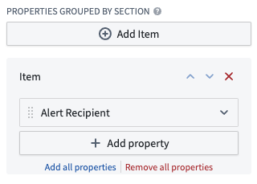
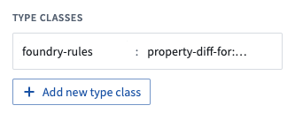

:::callout{theme="warning"}
注意：以下翻译的准确性尚未经过验证。这是使用 [AIP ↗](https://www.palantir.com/platforms/aip/) 从原始英文文本进行的机器翻译。
:::

# 故障排除参考

本页描述了Foundry Rules的一些常见问题以及调试步骤。

## 错误信息

### ReadonlyObjectError

确保您创建的每个Object都关联了一个数据输出数据集。查看[创建和运行规则](Deploy/%E7%BC%96%E5%86%99%E5%B9%B6%E8%BF%90%E8%A1%8C%E8%A7%84%E5%88%99.md)中的搭建数据输出数据集步骤以获取更多信息。

### 400: Actions:InvalidParametersForApply

在操作请求中未提供一些必需的参数。请确认操作配置正确。

## 自定义属性的提案差异未正确显示

要使提案微件正确显示差异，请按照以下步骤操作：

1. 在Workshop应用中，将`new_<PROPERTY>`属性添加到提案审阅者微件配置的**按部分分组的属性**中。此处无需选择“当前”值。

2. 如有需要，编辑属性名称以去除“new”前缀。

   

3. 将`foundry-rules.property-diff-for:ID_OF_NEW_PROPERTY`类型类添加到**提案Object**的**当前**属性中。请注意，类型类由*类型*和*名称*组成，写作`kind.name`。在`foundry-rules.property-diff-for:new_<PROPERTY>`中，类型是`foundry-rules`，名称是`property-diff-for:new_<PROPERTY>`。

   

## 较旧的错误

在2022年7月之前，Foundry Rules（以前称为Taurus）需要额外配置并使用略有不同的概念。以下错误与该过程相关。如果您在2022年7月后部署了Foundry Rules并遇到以下问题，请尝试导航到[工作流配置编辑器](Core%20concepts/Foundry%20Rules%20%E5%B7%A5%E4%BD%9C%E6%B5%81%E9%85%8D%E7%BD%AE.md)以查看工作流中是否有任何错误。

### Taurus:MissingOntologyInformation

此错误表示请求的Ontology信息（在错误信息中标识）不存在或变换没有权限访问它。检查以下步骤以修复错误：

1. 验证信息中的RID或ID是否存在于[Ontology管理器](../%E6%9C%AC%E4%BD%93%E7%AE%A1%E7%90%86%E5%99%A8/%E6%A6%82%E8%BF%B0.md)中。
2. 验证Foundry Rules Workshop应用中使用的所有Object类型*和*关系是否通过**设置**选项卡中的**Ontology导入**助手导入到项目中。
3. 验证Foundry Rules Workshop应用中使用的所有Object类型*和*关系的RID是否列在变换代码顶部的`@AdditionalInputs`部分中。了解有关[使用`@AdditionalInputs`](Legacy%20Foundry%20Rules%20Setup%20%28Taurus%29/%E9%85%8D%E7%BD%AE%E5%8F%98%E6%8D%A2%E7%AE%A1%E9%81%93.md#using-additionalinputs)的更多信息。
4. 确保支持Foundry Rules Workshop应用中使用的Object类型和多对多关系的所有数据集通过[项目视图](https://www.palantir.com/docs/foundry/projects/use-project-navigation-panel/#references)的**项目参考**部分导入到项目中。这包括任何由受限视图支持的Objects或关系。

### TransformsGradlePlugin:StaticTaurusDependencyDisallowed

此错误表示不再允许声明`tau-execution-core`的静态版本号依赖项。要修复此错误，请将声明的版本更改为版本范围`[0,1[`而不是静态版本号：

1. 首先，导航到包含Foundry Rules变换的[**代码库**](https://www.palantir.com/docs/foundry/code-repositories/overview/)。
2. 打开**显示隐藏的文件和文件夹**。
3. 在项目级别的`build.gradle`文件中，将行`compile "com.palantir.tau-execution:tau-execution-core:0.x.x"`更改为`compile "com.palantir.tau-execution:tau-execution-core:[0,1["`。
   * 如果还有另一行`compile "com.palantir.tau-grammar:tau-grammar-api-objects:0.x.x"`，那么*删除此行*。
4. 提交结果，检查应通过。

### 规则编辑器预览与Foundry Rules变换的输出不匹配

1. 验证Foundry Rules变换的输入数据集是否与规则编辑器预览中用于支持您的Objects的数据集对应。
2. 验证Foundry Rules变换中的标志`.shouldMatchContourExecutionBehavior(true)`是否设置为`true`（如下例所示）。此标志确保Foundry Rules变换执行的逻辑与规则编辑器预览中一致。

```java
    // 配置 Foundry 规则的规则运行器
    Args ruleRunnerArgs = new TaurusRuleRunner.Args.Builder()
            .rules(new Rules.Builder()
                    .logicColumnName("RuleLogic") // 设置逻辑列名称
                    .ruleIdColumnName("RuleId") // 设置规则 ID 列名称
                    .dataset(rulesDataset) // 指定规则数据集
                    .build())
            .putSources(SourceReference.objectTypeId("employee"), source) // 将源对象类型 ID 设置为 "employee"
            // 设置为 true 以确保规则执行输出与规则编辑器小部件的预览匹配
            .shouldMatchContourExecutionBehavior(true)
            .context(transformContext) // 指定上下文
            .build();
```

### Taurus:UnknownMeasureName

当传感器Object缺失或变换没有正确权限时，可能会出现此出错。检查以下内容以解决出错：

* 检查根Object与传感器Object之间的链接RID是否已通过代码库的**设置**选项卡中的Ontology导入助手导入到项目中。
* 检查根与传感器Object之间的链接RID是否列在变换代码顶部的`@AdditionalInputs`部分。
* 检查传感器Object的支持数据集是否列在变换代码顶部的`@AdditionalInputs`部分。
* 检查传感器Object的支持数据集是否已通过[项目视图](https://www.palantir.com/docs/foundry/projects/use-project-navigation-panel/#references)的项目引用部分导入到项目中。

验证您是否遵循了[部署指南](Legacy%20Foundry%20Rules%20Setup%20%28Taurus%29/%E9%85%8D%E7%BD%AE%E5%8F%98%E6%8D%A2%E7%AE%A1%E9%81%93.md)中的所有步骤。
