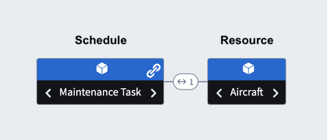
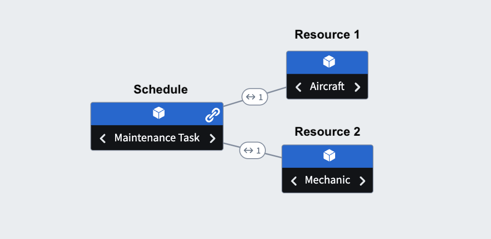

:::callout{theme="warning"}
注意：以下翻译的准确性尚未经过验证。这是使用 [AIP ↗](https://www.palantir.com/platforms/aip/) 从原始英文文本进行的机器翻译。
:::

# Ontology 原语和数据模型配置

用于动态调度的 Ontology 原语包括一个计划对象和一个或多个资源对象。首先在 [Ontology 管理器](../%E6%9C%AC%E4%BD%93%E7%AE%A1%E7%90%86%E5%99%A8/%E6%A6%82%E8%BF%B0.md) 中创建您的对象。至少，Workshop 微件需要两种对象类型：计划对象和资源对象。

| 对象类型 | 描述 |
| --- | --- |
| 计划对象 | 计划对象代表感兴趣的任务或活动，并应包括事件发生时的起始和结束时间和/或预期持续时间。 |
| 资源对象 | 资源对象代表任何实体（例如人员、位置、项目等），计划对象将被指派或安排的对象。 |

## 示例：飞机维护计划

下面的示例演示了为飞机安排维护任务的过程。

### 简单配置

下面展示了 Dynamic Scheduling Workshop 微件的两对象类型配置，这是最低要求。

* **计划对象类型:** 在下面的示例中，维护任务是一个时间限制活动。
* **资源对象类型:** 飞机是执行任务的对象/地点。

### 高级配置

动态调度数据支持多种超出两对象类型模型的附加配置，允许应用程序构建者创建复杂的高级工作流。

在上述两对象类型模型的基础上，除了安排*何时*在指定飞机上进行维护任务外，用户还可以通过将任务指派给特定的机械师来确定*谁*将执行维护任务。在这个新的 Ontology 中，如下图所示，机械师对象作为**第二资源对象类型**，数量可以是无限的。

* **计划对象类型:** 维护任务是一个时间限制活动。
* **资源对象类型 1:** 飞机是执行任务的对象/地点。
* **资源对象类型 2:** 执行指派维护任务的机械师。

## Ontology 要求

您的 Ontology 必须定义为调度原语。为了帮助快速分类您的 Ontology 对象，请使用 [Ontology 管理器向导](#ontology-manager-wizard)。在可以使用设置工具之前，您的计划对象必须满足下面概述的属性和链接要求。

### 所需的计划对象属性

| 对象属性 | 类型 |
| --- | --- |
| 起始时间 | timestamp |
| 结束时间 | timestamp |
| 持续时间 | long (毫秒) |
| 指向资源的外键 | 字符串 |

### 所需的 Ontology 链接

计划对象类型应与每个资源对象类型建立多对一关系。例如，在上面的例子中，可以将多个任务指派给一架飞机。

## Ontology 管理器向导

为了帮助您快速轻松地将 Ontology 对象分类为调度原语，Ontology 管理器向导应用了一系列必需的类型类到您的计划对象的属性上（如果在非必填配置部分选择，向导会创建一个计划保存操作）。

在使用向导之前，请确保按照模型配置描述创建了所需的对象和链接。

要使用 Ontology 管理器向导对您的 Ontology 对象进行分类，请按照以下步骤操作：

1. 在 Ontology 管理器中导航到您的计划对象类型。
2. 从左侧面板中选择 **功能** 标签。
3. 找到 **动态调度** 并选择 **开始**。

从这里，向导将引导您设置所选计划对象的起始时间和结束时间属性、相关资源对象类型的链接和高级配置选项。当向导完成工作时，您需要修改计划对象类型的主键属性上的类型类：

1. 向导为您创建一个保存处理操作。导航到它并复制操作 RID，看起来像这样：

   `ri.actions.main.action-type.9853f3fd-ad15-4015-8865-081d537e19e6`

2. 导航到您的计划对象类型的主键属性并选择 **交互** 标签。

3. 将 `schedulable-save-handler` 类型类设置为复制的操作 RID 并保存 Ontology。
