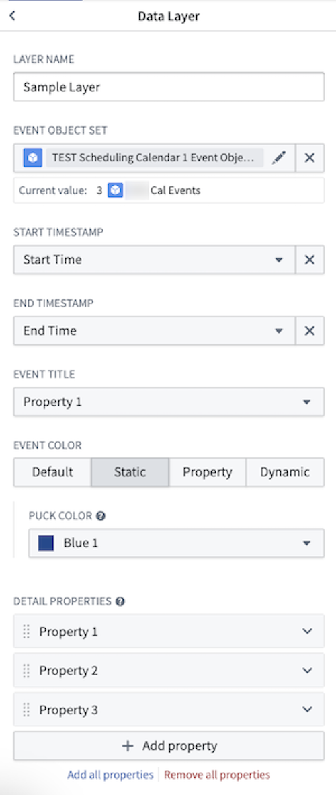
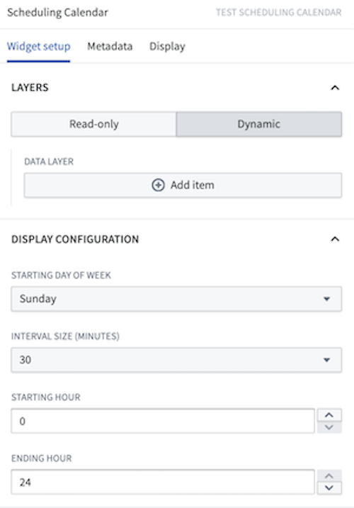

:::callout{theme="warning"}
注意：以下翻译的准确性尚未经过验证。这是使用 [AIP ↗](https://www.palantir.com/platforms/aip/) 从原始英文文本进行的机器翻译。
:::

# 微件配置

## 微件模式

调度日历微件有两种模式：只读模式和动态模式。默认情况下，微件以只读模式开始，该模式设计用于在不进行任何更改的情况下查看和分析数据。切换到动态模式可以直接在微件中添加、编辑或删除调度对象。

动态模式需要在调度对象类型上进行特定的Ontology设置。您需要在表示起始 (`schedules:schedulable-start-time`) 和结束时间 (`schedules:schedulable-end-time`) 的属性上添加类型类。您可以通过以下步骤完成：

1. 在Ontology Manager中导航到您的调度对象类型。
2. 在**属性**选项卡中，选择需要类型类的属性。
3. 从右侧的属性详细信息面板中选择**交互**选项卡。
4. 向下滚动并选择**添加新类型类**，然后在提供的文本框中输入类型类种类和值。

## 输入数据（pucks）

* **调度名称：** 帮助在配置过程中区分不同层的层名称。此值不会显示在微件中。

* **调度对象集：** 这是调度日历微件的输入变量，决定将显示哪些数据。为此对象集选择的对象类型必须具有表示起始时间和结束时间的属性。

* **起始时间（只读模式）：** 选择一个日期或时间戳属性作为事件的起始时间。在动态模式下，如果已应用正确的Ontology设置，微件将推断此值。

* **结束时间（只读模式）：** 选择一个日期或时间戳属性作为事件的结束时间。在动态模式下，如果已应用正确的Ontology设置，微件将推断此值。

* **标题：** 选择一个属性作为微件中对象pucks的显示标签值。

* **颜色：** 选择在图表中显示事件时使用的颜色。
  * **静态：** 为所有pucks选择单一颜色。
  * **按段：** 选择一个属性，微件将根据所选属性的值自动为pucks进行颜色编码。
  * **动态：** 配置条件格式规则以应用于图表中的pucks。

* **弹出属性：** 此部分决定当用户的光标悬停在日历上的puck上时，将在弹出卡片上显示哪些属性。

* **保存处理操作（动态模式）：** 选择一个操作用于拖放交互。此操作应为修改操作，编辑调度对象的起始和结束时间属性。

### 显示配置

* **起始星期几：** 此选择决定在您的图表处于周视图或月视图时，哪一天作为一周的起始。

* **间隔大小（仅动态模式）：** 默认情况下，用户可以在调度日历微件上指派对象到任何时间，精确到分钟。捕捉行为允许搭建者设置对象可以被指派的定义间隔。当puck被拖放到图表中的新位置时，puck将捕捉到最近间隔的起始。

* **起始小时：** 此选择决定图表在日视图或周视图中何时开始。

* **结束小时：** 此选择决定图表在日视图或周视图中何时结束。

