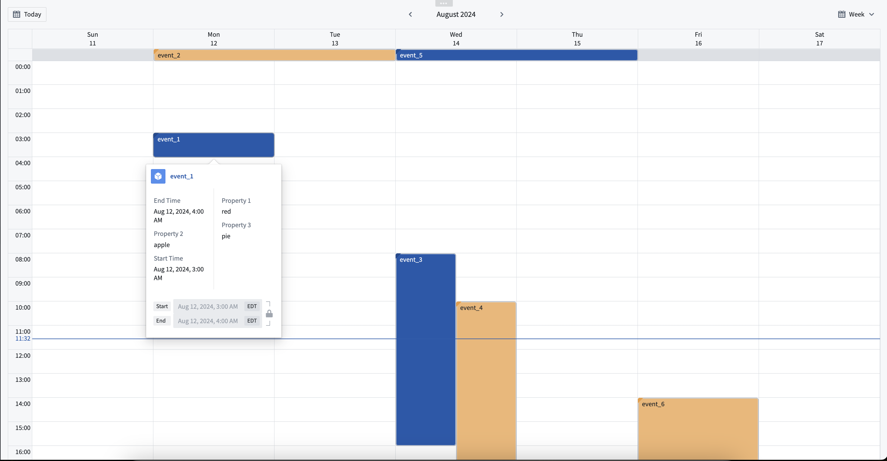

:::callout{theme="warning"}
注意：以下翻译的准确性尚未经过验证。这是使用 [AIP ↗](https://www.palantir.com/platforms/aip/) 从原始英文文本进行的机器翻译。
:::

# 日程安排日历微件

日程安排日历是一个Workshop微件，可以被用于在显示基于日期或时间戳属性的对象。用户可以选择按天、周或月查看数据，并可以选择启用拖放功能以便在需要更改日程对象时使用。

受益于日程安排日历微件的应用案例包括：

* 预约或会议安排。
* 任务和里程碑截止日期的跟踪。
* 查看员工班次指派。

