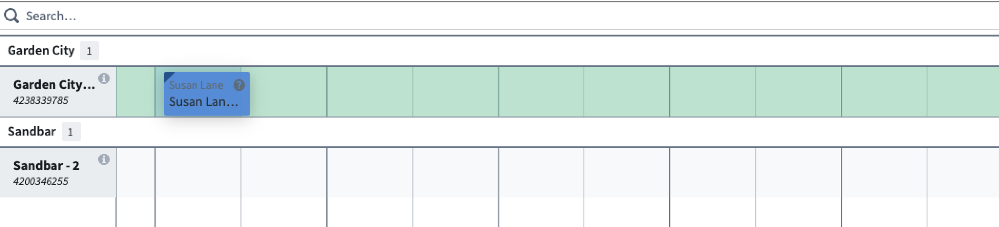
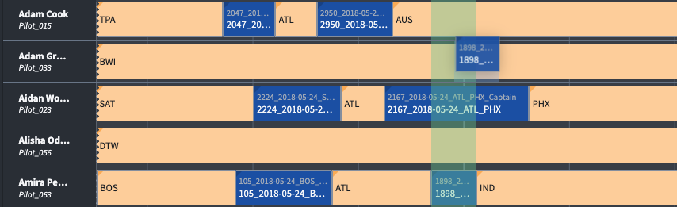

:::callout{theme="warning"}
注意：以下翻译的准确性尚未经过验证。这是使用 [AIP ↗](https://www.palantir.com/platforms/aip/) 从原始英文文本进行的机器翻译。
:::

# 建议函数

在调度和资源分配工作流中，一个关键挑战是了解特定事件可以发生的位置和时间，或者它们可以移动到的位置。大多数调度都有局限性，并非所有调度选项都同样合适；通过将这些限制和标准构建到逻辑中，工具可以帮助用户快速评估选择。建议函数功能通过根据组织定义的逻辑，直观地指示潜在调度对象圆盘放置的适用性来引导用户行为。

每个建议函数都有一个TypeScript函数支持。规则逻辑的输出可用于突出显示可以指派的区域，或者相反，不能进行指派的区域。应用程序构建者可以通过在Workshop微件配置中的设置来强制执行这些建议。当开启时，此功能将强制圆盘放置到最近的高亮区域。

:::callout{theme="neutral"}
在调度甘特图中的建议函数结果是静态的。该函数在初始应用程序加载期间运行，之后进行的任何操作**不**被考虑在内。这对该功能是否适合您的工作流有影响。
:::

以下是建议函数可以有效使用的两个示例。

在下图中，建议函数被编写为建议被指派个体的首选位置（在本例中为“Susan”）。绿色区域表示花园城是Susan的首选位置，而灰色表示的沙洲则不是首选。



在下面的示例中，应用程序用于指派飞行员。时间的垂直切片（绿色）向调度员指示不应调整航班的起始/结束时间，而只应调整飞行员。



## 函数接口

以下类型表示从行或圆盘触发时编写搜索函数所需的信息，其中包括有关搜索组的详细信息。

```typescript
/*
   Suggestion函数接受一个puck主键列表以及Gantt的开始/结束时间，
   返回一个从puck主键到行主键映射到时间槽数组的映射。
*/

type ISuggestion = (
    scheduleObjectPrimaryKeys: string[],
    domainStart: Timestamp,
    domainEnd: Timestamp,
) => FunctionsMap<string, FunctionsMap<string, Array<ISuggestionSlot>>>

/* Suggestion类型定义 */

export interface IDomain {
    start: Long; // 开始时间
    end: Long;   // 结束时间
}

/* rating用于确定小部件UI中的高亮颜色。基于-1到1的比例。
   越接近1，高亮颜色越深的绿色。越接近-1，高亮颜色为红色。
*/

export interface ISuggestionSlot {
    domain: IDomain; // 时间域，包括开始和结束时间
    rating: Float;   // 评分，用于UI高亮颜色
}

export type IValidSlots = Array<ISuggestionSlot>;
export type ISlotMappings = FunctionsMap<string, IValidSlots>;
export type ISuggestionResult = FunctionsMap<string, ISlotMappings>;


/*
  在那些日程对象有固定开始/结束时间且仅可能更改分配资源的工作流程中（纵向切片高亮），
  可以使用ALL_ROWS_ID作为快捷方式。
*/

export const ALL_ROWS_ID = "__ALL_ROWS";

```
